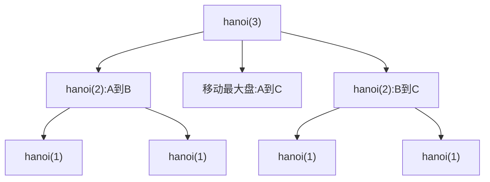
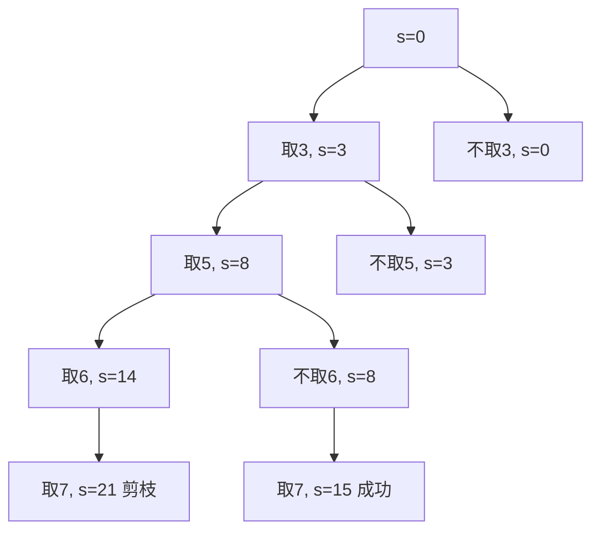
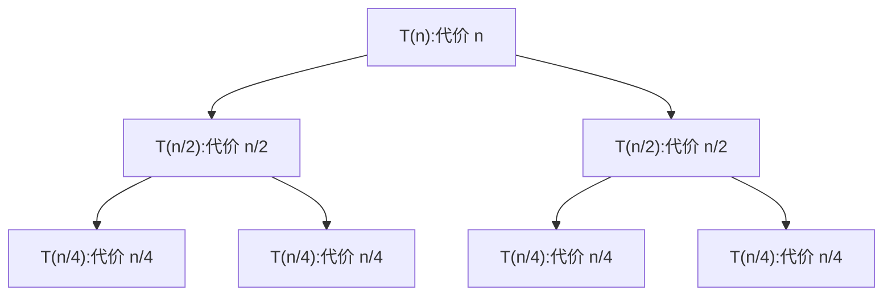
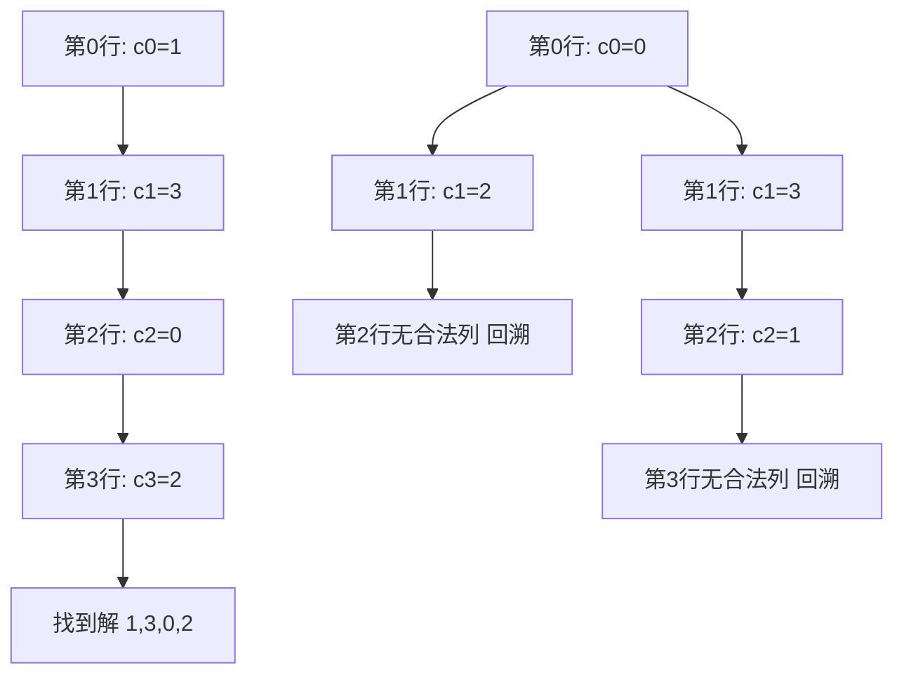

# SPL Run: build_concept_book

- **Adapter:** claude_cli
- **Model:** claude-sonnet-5-5
- **Tokens:** 3740 in / 1523 out
- **Latency:** 67009ms
- **Timestamp:** 2026-11-23 18:39:35

## Output

```output


---

## 递归

**定义。** 递归(recursion)是归约(reduction)的一种特殊情形:把一个问题归约为一个或多个**规模更小的同类问题**,再由一位想象中的“递归仙子”(Recursion Fairy)去解决这些更小的实例。我们只需做两件事:

1. **基础情形**:对最小的实例直接给出答案;
2. **递归步骤**:假设仙子能正确解决所有更小的实例,说明如何用这些结果拼出原问题的答案。

关键在于**信任仙子**:不要去展开每一层调用,只需验证“若更小的实例正确,则当前实例正确”。这正是数学归纳法的结构,因此递归算法的正确性可用归纳法证明。

**例题:汉诺塔。** 将 $n$ 个盘子从柱 $A$ 移到柱 $C$,借助柱 $B$,每次只能移动一个盘子,且大盘不能压在小盘上。

- 基础情形:$n=0$ 时无需任何操作。
- 递归步骤:请仙子把上面的 $n-1$ 个盘子从 $A$ 移到 $B$;自己把最大的盘子从 $A$ 移到 $C$;再请仙子把 $n-1$ 个盘子从 $B$ 移到 $C$。

```python
def hanoi(n, src, dst, tmp):
    if n == 0:
        return
    hanoi(n - 1, src, tmp, dst)   # 仙子:移走上面的 n-1 个
    print(f"{src} -> {dst}")      # 自己:移最大的盘子
    hanoi(n - 1, tmp, dst, src)   # 仙子:移回 n-1 个
```

**复杂度分析。** 设 $T(n)$ 为移动次数,则

$$T(0)=0,\qquad T(n)=2T(n-1)+1.$$

逐层展开可得 $T(n)=2T(n-1)+1=4T(n-2)+3=\cdots=2^{k}T(n-k)+(2^{k}-1)$。取 $k=n$,得

$$T(n)=2^{n}-1.$$

**归纳验证:** $n=0$ 时 $2^0-1=0$ 成立;若 $T(n-1)=2^{n-1}-1$,则 $T(n)=2(2^{n-1}-1)+1=2^n-1$。


*汉诺塔的递归调用树:每个规模为 $n$ 的问题分解为两个规模为 $n-1$ 的子问题加一次直接移动。*

**问题求解应用。** 设计递归算法时,可按以下步骤思考:

1. **明确子问题**:它必须与原问题同类,且规模严格更小;
2. **写出基础情形**:确保每条调用链都能到达它,否则会无限递归;
3. **只设计“合并”步骤**:假设仙子已给出正确的子问题答案,思考如何组合它们。

**练习:** 用同样的思路写出计算 $n!$ 的递归定义($0!=1$,$n!=n\cdot(n-1)!$),并证明它恰好进行 $n$ 次乘法。再思考:若 $T(n)=2T(n/2)+n$,解为何种量级?(提示:递归树每层代价为 $n$,共 $\log_2 n$ 层,故 $T(n)=\Theta(n\log n)$。)

递归的威力在于:复杂问题只需“一步合并 + 信任仙子”,而正确性与代价都可由归纳法和递推式严格分析。

---

## 回溯法

**定义。** 回溯法(backtracking)是一种递归搜索策略:每次只为解增加一个分量,在每个决策点依次尝试所有可选项,并对每个选项递归地向下探索。若当前的部分解已经违反约束(或不可能扩展为完整解),就**剪枝**,撤销最近一步选择(即"回溯"),换下一个选项继续。

设部分解为 $x=(x_1,\dots,x_k)$,候选集为 $C(x)$,则通用框架为:

```python
def backtrack(x):
    if is_complete(x):
        record(x); return
    for c in candidates(x):
        if feasible(x, c):      # 剪枝检查
            x.append(c)         # 选择
            backtrack(x)        # 探索
            x.pop()             # 撤销(回溯)
```

"选择 → 探索 → 撤销"三步是回溯法的核心。它本质上是对**解空间树**的深度优先遍历,与暴力枚举的区别在于:一旦某个节点不可行,其整棵子树都被跳过。

**例题:子集和。** 从集合 $\{3,5,6,7\}$ 中选出若干数,使其和为 $15$。

按顺序决定每个数"取"或"不取",记当前和为 $s$:

- 取 3($s=3$)→ 取 5($s=8$)→ 取 6($s=14$)→ 取 7 得 $21>15$,剪枝;不取 7 得 $14\ne15$,失败。回溯到 6。
- 不取 6($s=8$)→ 取 7 得 $15$ ✓。找到解 $\{3,5,7\}$。

因为所有数为正,只要 $s>15$ 就可以立即剪枝,这避免了展开大量子树。


*子集和的解空间树(局部):超过目标值的分支被剪枝,成功分支给出解 $\{3,5,7\}$。*

**问题求解应用:$n$ 皇后。** 在 $n\times n$ 棋盘上放置 $n$ 个皇后,使其互不攻击。逐行放置,第 $r$ 行选择列 $c$,可行条件是:与已放皇后不同列、不同对角线,即对所有 $i<r$,
$$c\ne c_i,\qquad |c-c_i|\ne r-i.$$

```python
def solve(n):
    cols, res = [], 0
    def bt(r):
        nonlocal res
        if r == n: res += 1; return
        for c in range(n):
            if all(c != cols[i] and abs(c-cols[i]) != r-i for i in range(r)):
                cols.append(c); bt(r+1); cols.pop()
    bt(0)
    return res
```

对 $n=8$,朴素枚举需检查 $8^8\approx1.7\times10^7$ 种放法,而回溯法因提前剪枝,只访问约两千多个节点即可找出全部 92 个解。

**复杂度与使用要点。** 最坏情况下回溯仍是指数级,例如子集和为 $O(2^n)$,排列问题为 $O(n!)$;其优势依赖于剪枝的强度。设计时应注意:(1)状态必须能被**完全撤销**;(2)约束检查应尽早进行;(3)合理排序候选项,可更快发现解或更早剪枝。

---

## 递归树

**定义。** 递归树(recursion tree)是把一个递归算法的全部调用过程画成的树:每个节点代表一个子问题,节点上标注该子问题在**本层自身**花费的非递归工作量;每条边代表一次递归调用,从父问题指向它调用的子问题。根节点是原问题,叶节点是不再递归的基本情形。把所有节点的代价相加,就得到算法的总运行时间。

对于形如
$$T(n)=aT\!\left(\frac{n}{b}\right)+f(n)$$
的递归式,递归树具有清晰的规律:第 $i$ 层有 $a^i$ 个节点,每个子问题规模为 $n/b^i$,树高为 $\log_b n$,叶子数为 $a^{\log_b n}=n^{\log_b a}$。


*归并排序 $T(n)=2T(n/2)+n$ 的递归树前三层:每层总代价都是 $n$。*

**例题。** 求 $T(n)=2T(n/2)+n$ 的解。

1. 第 $i$ 层有 $2^i$ 个节点,每个节点代价 $n/2^i$,所以该层总代价为 $2^i\cdot\dfrac{n}{2^i}=n$。
2. 树高为 $\log_2 n$,共有 $\log_2 n+1$ 层。
3. 各层求和:$T(n)=n(\log_2 n+1)=\Theta(n\log n)$。

**问题求解应用。** 解 $T(n)=3T(n/4)+n^2$ 时,按"逐层求和"的步骤:

- 第 $i$ 层有 $3^i$ 个节点,每个节点代价 $(n/4^i)^2$,层总代价为
$$3^i\cdot\frac{n^2}{16^i}=\left(\frac{3}{16}\right)^i n^2 .$$
- 层代价构成公比 $\frac{3}{16}<1$ 的递减等比数列,因此总和被首项主导:
$$T(n)\le n^2\sum_{i=0}^{\infty}\left(\frac{3}{16}\right)^i=\frac{16}{13}n^2 .$$
- 又根节点本身代价为 $n^2$,故 $T(n)=\Theta(n^2)$。

**读树的三种情形。** 观察层代价随深度的变化,即可判断结果:

- 层代价**递减**(如上例):根主导,$T(n)=\Theta(f(n))$;
- 层代价**不变**(如归并排序):总和 $=$ 每层代价 $\times$ 层数;
- 层代价**递增**(如 $T(n)=4T(n/2)+n$,层代价为 $2^i n$):叶子主导,$T(n)=\Theta(n^{\log_b a})=\Theta(n^2)$。

**注意。** 递归树给出的是有力的直观推导;若要作为严格证明,应当用数学归纳法(代入法)验证猜出的界。此外,递归树也能揭示重复计算:朴素斐波那契 $F(n)=F(n-1)+F(n-2)$ 的树中,同一子问题反复出现,节点数呈指数增长,这正是引入记忆化(动态规划)的动机。

---

## N 皇后问题

**定义。** 在 $n\times n$ 棋盘上放置 $n$ 个皇后,使任意两个皇后不在同一行、同一列或同一对角线上。皇后位于 $(r,c)$ 与 $(r',c')$ 时发生冲突,当且仅当
$$
c=c' \quad\text{或}\quad r-c=r'-c' \quad\text{或}\quad r+c=r'+c'.
$$
每行恰好放一个皇后,因此一个解可以表示为列号序列 $(c_0,c_1,\dots,c_{n-1})$,其中 $c_r$ 是第 $r$ 行皇后所在的列。这样行冲突已被排除,只需检查列和两个对角线。

**回溯法。** 逐行放置:在第 $r$ 行依次尝试每一列,若与前面的皇后无冲突就放下并递归到第 $r+1$ 行;若该行没有合法列,就撤销上一行的选择(回溯),换下一列。这是剪枝的深度优先搜索,比枚举全部 $n^n$ 种放法(或 $n!$ 种排列)高效得多。

```python
def solve(n):
    cols, d1, d2, res = set(), set(), set(), []
    def go(r, path):
        if r == n:
            res.append(path[:]); return
        for c in range(n):
            if c in cols or r-c in d1 or r+c in d2:
                continue
            cols.add(c); d1.add(r-c); d2.add(r+c); path.append(c)
            go(r+1, path)
            path.pop(); cols.remove(c); d1.remove(r-c); d2.remove(r+c)
    go(0, [])
    return res
```

集合使每次冲突检测为 $O(1)$。

**例题:$n=4$。** 第 0 行放 $c_0=0$。第 1 行:列 0、1 分别与其同列、同对角线冲突,取 $c_1=2$。第 2 行:列 0 同列,列 1 与 $(1,2)$ 同对角线($r+c=2+1=3=1+2$),列 2 同列,列 3 与 $(1,2)$ 同对角线($r-c=-1=1-2$),无合法列,回溯。改 $c_1=3$,第 2 行取 $c_2=1$,第 3 行列 0、1、2、3 均冲突,再回溯,最终 $c_0=0$ 整个分支失败。尝试 $c_0=1$:得 $c_1=3,\ c_2=0,\ c_3=2$,成功。所以 $(1,3,0,2)$ 是一个解,其镜像 $(2,0,3,1)$ 是另一个,$n=4$ 共 2 个解。


*图:$n=4$ 时的搜索树片段。$c_0=1$ 分支直达解,$c_0=0$ 分支在更深处被剪枝并回溯。*

**问题求解应用。** 已知解的个数:$n=1,\dots,8$ 依次为 $1,0,0,2,10,4,40,92$。因此 $n=2,3$ 无解,回溯会穷尽搜索树后返回空列表。若只需“是否存在解”,在 `r == n` 时直接返回 `True` 并逐层向上传递即可,不必枚举全部。

**复杂度。** 第 $r$ 行至多有 $n-r$ 个可选列(列互不相同),所以搜索树节点数至多为 $O(n!)$,实际远小于此,因为对角线冲突提前剪枝。回溯的核心思想是:**一旦部分解已违反约束,就放弃它的全部后续扩展**。同样的框架也适用于数独、图着色和子集和等约束满足问题。

**练习。** 手工追踪 $n=5$,统计以 $c_0=0$ 开头的解的个数(答案:2)。

---

## 收益(Payoff)

### n 皇后问题实现了什么

n 皇后问题要求在 $n\times n$ 棋盘上放置 $n$ 个皇后,使任意两个皇后都不同行、不同列、不在同一对角线上。令 $x_i$ 表示第 $i$ 行皇后所在的列,问题就变成寻找一个排列 $(x_1,\dots,x_n)$,使得对所有 $i<j$ 都有

$$x_i\neq x_j,\qquad |x_i-x_j|\neq |i-j|.$$

它是本书自然的终点,因为前面各章的工具都在这里一起用上了。排列给出候选解的空间,递归给出逐行放置的结构,约束检查负责剪枝,回溯负责撤销错误的选择。

暴力枚举要检查 $n!$ 个排列。回溯在第 $k$ 行发现冲突时,会立刻放弃以此为前缀的全部 $(n-k)!$ 个排列。当 $n=8$ 时,暴力枚举需检查 $40320$ 个排列,而回溯只展开其中很小的一部分,最终得到 $92$ 个解。其中本质不同的解(不计旋转与翻转)只有 $12$ 个。

```python
def solve(n, cols=()):
    r = len(cols)
    if r == n:
        return 1
    return sum(solve(n, cols + (c,)) for c in range(n)
               if all(c != x and abs(c - x) != r - i
                      for i, x in enumerate(cols)))
```

调用 `solve(8)` 返回 $92$。这段代码里,"选择、检查、递归、撤销"这套回溯框架完整可见。

### 与应用领域的联系

题目没有列出具体的应用领域。下面讨论三类依赖同一思想的典型场景。

- **约束满足与调度。** 排课、排班、芯片布线都要在一组互相排斥的约束下为每个变量赋值。把"皇后互不攻击"换成"两门课不能同时占用一间教室",就得到同样的结构。数独求解器和 SAT 求解器的核心也是这套搜索加剪枝。
- **组合搜索与优化。** 旅行商问题和背包问题的分支定界,本质上是在回溯上加了"当前分支不可能优于已知最优解"的剪枝条件。
- **并行与高性能计算。** 第一行的 $n$ 种选择互不依赖,可以分给不同处理器独立搜索。因此 n 皇后常被用来测试并行框架的负载均衡。

### 继续探索

请从上面三个方向中选一个深入。最直接的办法是改写 `solve`:把它改成数独求解器,只需更换约束检查;也可以试着用位运算加速冲突检测,看 $n=14$ 时的运行时间能缩短多少。
```
