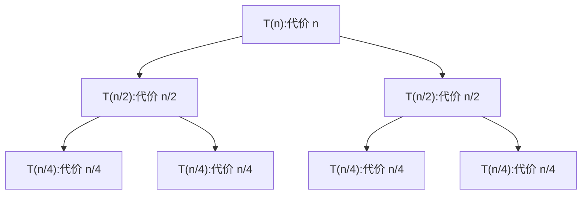
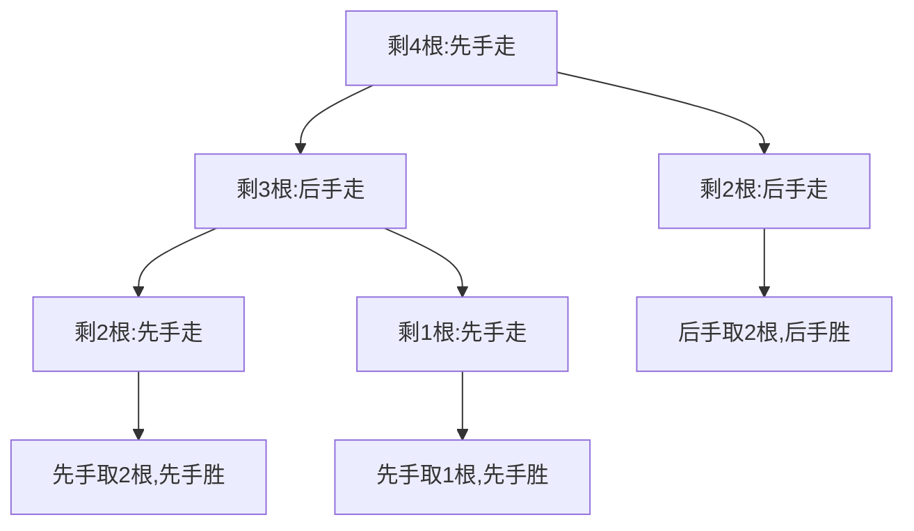
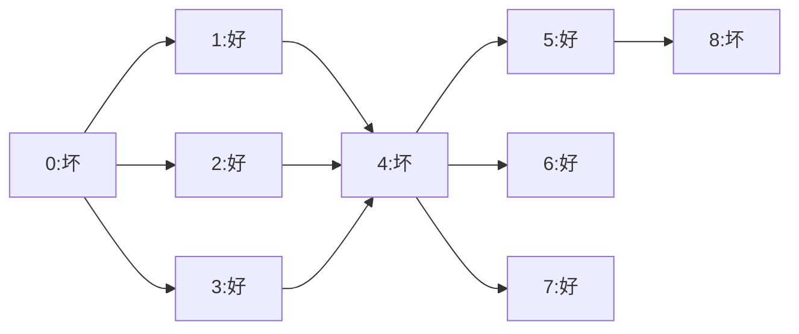
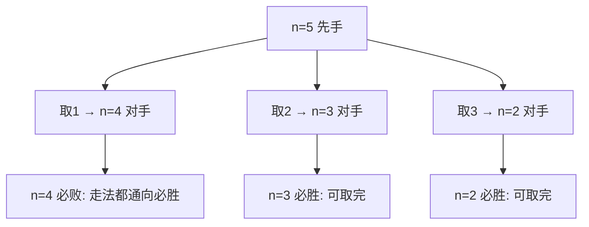

# SPL Run: build_concept_book

- **Adapter:** claude_cli
- **Model:** claude-sonnet-5-5
- **Tokens:** 3753 in / 1410 out
- **Latency:** 78205ms
- **Timestamp:** 2026-11-23 18:40:42

## Output

```output


---

## 递归树

**定义。** 递归树(recursion tree)是把一个递归算法的全部调用过程画成的树:每个节点代表一个子问题,节点上标注该子问题在**本层自身**花费的非递归工作量;每条边代表一次递归调用,从父问题指向它调用的子问题。根节点是原问题,叶节点是不再递归的基本情形。把所有节点的代价相加,就得到算法的总运行时间。

对于形如
$$T(n)=aT\!\left(\frac{n}{b}\right)+f(n)$$
的递归式,递归树具有清晰的规律:第 $i$ 层有 $a^i$ 个节点,每个子问题规模为 $n/b^i$,树高为 $\log_b n$,叶子数为 $a^{\log_b n}=n^{\log_b a}$。


*归并排序 $T(n)=2T(n/2)+n$ 的递归树前三层:每层总代价都是 $n$。*

**例题。** 求 $T(n)=2T(n/2)+n$ 的解。

1. 第 $i$ 层有 $2^i$ 个节点,每个节点代价 $n/2^i$,所以该层总代价为 $2^i\cdot\dfrac{n}{2^i}=n$。
2. 树高为 $\log_2 n$,共有 $\log_2 n+1$ 层。
3. 各层求和:$T(n)=n(\log_2 n+1)=\Theta(n\log n)$。

**问题求解应用。** 解 $T(n)=3T(n/4)+n^2$ 时,按"逐层求和"的步骤:

- 第 $i$ 层有 $3^i$ 个节点,每个节点代价 $(n/4^i)^2$,层总代价为
$$3^i\cdot\frac{n^2}{16^i}=\left(\frac{3}{16}\right)^i n^2 .$$
- 层代价构成公比 $\frac{3}{16}<1$ 的递减等比数列,因此总和被首项主导:
$$T(n)\le n^2\sum_{i=0}^{\infty}\left(\frac{3}{16}\right)^i=\frac{16}{13}n^2 .$$
- 又根节点本身代价为 $n^2$,故 $T(n)=\Theta(n^2)$。

**读树的三种情形。** 观察层代价随深度的变化,即可判断结果:

- 层代价**递减**(如上例):根主导,$T(n)=\Theta(f(n))$;
- 层代价**不变**(如归并排序):总和 $=$ 每层代价 $\times$ 层数;
- 层代价**递增**(如 $T(n)=4T(n/2)+n$,层代价为 $2^i n$):叶子主导,$T(n)=\Theta(n^{\log_b a})=\Theta(n^2)$。

**注意。** 递归树给出的是有力的直观推导;若要作为严格证明,应当用数学归纳法(代入法)验证猜出的界。此外,递归树也能揭示重复计算:朴素斐波那契 $F(n)=F(n-1)+F(n-2)$ 的树中,同一子问题反复出现,节点数呈指数增长,这正是引入记忆化(动态规划)的动机。

---

## 博弈树

**定义。** 博弈树(game tree)是一棵以"局面"为节点、以"合法着法"为边的有根树。根节点是初始局面;若从局面 $s$ 经一步合法着法可到达局面 $s'$,则 $s$ 到 $s'$ 有一条边。没有后继的节点称为**叶节点**(终局),每个叶节点带有一个收益值,例如 $+1$(先手胜)、$0$(平局)、$-1$(先手负)。博弈树适用于**有限、双人、零和、无隐藏信息、无随机性**的博弈,如井字棋、象棋、围棋。

若平均每个局面有 $b$ 种合法着法(分支因子),整局最多持续 $d$ 步(深度),则叶节点数大约为 $b^d$。井字棋约有 $9! = 362880$ 条完整对局路径;国际象棋 $b\approx 35,\ d\approx 80$,树的规模约 $10^{123}$,无法穷举。

**例题:一个小博弈。** 桌上有 4 根火柴,两人轮流取 1 根或 2 根,取走最后一根者获胜。设先手为 MAX,后手为 MIN。以剩余火柴数标记局面:

- 剩 4(MAX 走)→ 剩 3 或剩 2(MIN 走)
- 剩 3(MIN 走)→ 剩 2 或剩 1
- 剩 2(MAX 或 MIN 走)→ 取 2 根即胜


*取火柴博弈(剩 4 根)的博弈树:每个内部节点是一个局面,叶节点标明胜者。*

**问题求解:自底向上标注。** 从叶节点向上逐层赋值,规则为极小极大(minimax)原则:

$$
V(s)=\begin{cases}
u(s), & s\text{ 为终局},\\
\max_{s'} V(s'), & s\text{ 轮到 MAX},\\
\min_{s'} V(s'), & s\text{ 轮到 MIN}.
\end{cases}
$$

令先手胜为 $+1$,后手胜为 $-1$。图中:"剩 3 根"节点的两个子节点都是 $+1$,故 $V=\min(+1,+1)=+1$;"剩 2 根(后手走)"节点 $V=-1$。根节点 $V=\max(+1,-1)=+1$,说明先手有必胜策略:取 1 根,留下 3 根。无论后手怎么取,先手都能取完。

**一般结论。** 对任何有限、完全信息的双人零和博弈,自底向上的标注必定终止,并给出确定的博弈值(Zermelo 定理的内容):要么先手有必胜策略,要么后手有,要么双方都能保证至少平局。博弈树因此把"如何下棋"转化为"如何在树上搜索"。实际中,树过大时需要用 $\alpha$-$\beta$ 剪枝(可将搜索量减至约 $b^{d/2}$)、深度限制加评估函数,或蒙特卡洛树搜索来近似。

**练习。** 把火柴数改为 6,并允许取 1、2 或 3 根,画出博弈树的前两层,计算根节点的值,并说明先手第一步应取几根。(提示:留给对手 4 根的局面对其不利。)

---

## 好坏状态

**定义。** 在两人轮流行动、无随机性、有限步必然结束的组合博弈中(规定无法行动者判负),每个局面可递归分类如下:

- **坏状态**(又称必败态,$P$-position):轮到行动的一方,无论怎么走,对手都能获胜。即**每一步**都通向好状态。终局(无合法着法)是坏状态。
- **好状态**(又称必胜态,$N$-position):轮到行动的一方存在某一步,使对手面对**坏状态**。

记 $M(s)$ 为从 $s$ 出发的合法后继集合,则

$$
\text{好}(s)\iff \exists\, t\in M(s),\ \text{坏}(t),\qquad
\text{坏}(s)\iff \forall\, t\in M(s),\ \text{好}(t).
$$

当 $M(s)=\varnothing$ 时,"$\forall$"空真,故终局为坏状态,递归由此启动。由于博弈有限,从终局向前逐层标记,每个状态恰好得到一个标签。

**例题。** 一堆 $n$ 颗石子,每次取 $1$、$2$ 或 $3$ 颗,取走最后一颗者胜。令 $n$ 为剩余石子数:

- $n=0$:无法行动,坏。
- $n=1,2,3$:可一步取到 $0$,好。
- $n=4$:只能到 $3,2,1$,全是好状态,所以坏。
- $n=5,6,7$:可取到 $4$,好。
- $n=8$:只能到 $7,6,5$,坏。

规律是:$n\equiv 0\pmod 4$ 为坏状态,其余为好状态。归纳证明:若 $4\mid n$,则取 $k\in\{1,2,3\}$ 后 $n-k$ 不被 $4$ 整除,故都是好状态;若 $4\nmid n$,取 $k=n\bmod 4$ 可到达被 $4$ 整除的状态。


*图中箭头表示"可由该状态到达的更大状态"的标记关系:每个好状态都能走回一个坏状态(箭头反向),坏状态之间相隔 4。*

**问题求解应用。** 将取石子规则改为每次取 $1$ 到 $m$ 颗,同样推出坏状态为 $n\equiv 0\pmod{m+1}$。若 $m=5$、$n=20$,先手应取 $20\bmod 6=2$ 颗,留下 $18$,此后无论对手取 $k$ 颗,先手回应 $6-k$ 颗,始终把 $6$ 的倍数留给对手。

一般的游戏没有这样简洁的公式,但算法不变:

1. 列出所有状态与后继;
2. 从终局开始,按上述两条规则自底向上(或带记忆的递归)标记;
3. 若起始状态为好,选择通向坏状态的那一步;若为坏,则对手若不犯错必胜。

该方法的时间复杂度为 $O(|V|+|E|)$,其中 $V$ 为状态集、$E$ 为着法集。它是 Sprague–Grundy 理论的基础,后者把"好/坏"二值标签推广为整数值,用于分析多个游戏的组合。

---

## 博弈树搜索

### 定义

**博弈树**是描述双人轮流行动博弈的树:结点表示局面,边表示一步合法走法,叶结点表示游戏结束。设两名玩家交替行动,且无平局、有限步结束(如取石子游戏)。**博弈树搜索**是对这棵树做深度优先的回溯搜索,判定任一局面对"当前轮到走棋的一方"是好还是坏,并找出必胜走法。

局面的好坏用递归定义:

- **必胜局面(N 局面)**:存在一步走法,使对手进入必败局面。
- **必败局面(P 局面)**:所有走法都使对手进入必胜局面;终局时无法走棋的一方为必败。

写成公式,设 $W(s)$ 表示局面 $s$ 对先手必胜:

$$W(s)=\bigvee_{s'\in \text{moves}(s)} \neg W(s')$$

无合法走法时 $W(s)=\text{False}$(此为递归基)。

### 例题

取石子:一堆 $n$ 颗石子,每次可取 1、2 或 3 颗,取走最后一颗者获胜。判断 $n=4$ 与 $n=5$。

- $n=0$:无法走棋,$W(0)=\text{False}$。
- $n=1,2,3$:可一次取完,使对手面对 0,故 $W=\text{True}$。
- $n=4$:走法通向 3、2、1,它们都是必胜局面,即对手总能赢,所以 $W(4)=\text{False}$。
- $n=5$:取 1 颗通向 4(必败),所以 $W(5)=\text{True}$,必胜走法为"取 1 颗"。

规律是:$n \bmod 4 = 0$ 时先手必败。

```python
def win(n, memo={}):
    if n in memo: return memo[n]
    # 存在一步使对手必败,则当前必胜
    memo[n] = any(not win(n - k) for k in (1, 2, 3) if k <= n)
    return memo[n]

def best_move(n):
    for k in (1, 2, 3):
        if k <= n and not win(n - k):
            return k   # 找到必胜走法
    return None        # 必败局面,无必胜走法
```

### 问题求解应用

**问题**:两人从 $n=10$ 开始取石子(规则同上),先手应怎么走?

**解**:调用 `best_move(10)`。依次检查:取 1 得 9,$9 \bmod 4=1$,对手必胜;取 2 得 8,$8 \bmod 4=0$,对手必败。因此先手取 2 颗,此后无论对手取 $k$ 颗,先手都回应 $4-k$ 颗,始终把 4 的倍数留给对手。

**复杂度**:若不加记忆,每个局面分出 $b$ 个子局面,深度为 $d$,则搜索结点数为 $O(b^d)$。这里相同的 $n$ 会被重复计算,用 `memo` 缓存后,局面只有 $n+1$ 个,时间降为 $O(n)$。对于象棋、围棋这类状态空间巨大的游戏,仍需采用 α-β 剪枝或启发式评估来限制搜索。

**要点**:

1. 先写出局面与走法的表示,再写递归基(无路可走)。
2. 利用"只要存在一步使对手必败即为必胜"来提前返回,这是回溯中的剪枝。
3. 在状态会重复出现时,加记忆化。


*图:$n=5$ 的博弈树。取 1 颗使对手面对必败局面 $n=4$,所以这是必胜走法。*

---

## 收获(Payoff)

### 博弈树搜索达成了什么

博弈树搜索把"在对手也会思考的情况下做决策"变成一个可以精确计算的问题。我们之前学过的递归、状态空间、剪枝和评估函数,在这里汇合成一个统一的算法。

**定义。** 博弈树的节点是局面,边是合法着法。对两人零和博弈,极小极大值(minimax value)定义为

$$
V(s)=\begin{cases}
U(s), & s \text{ 为终局},\\[2pt]
\max_{a\in A(s)} V(\text{result}(s,a)), & \text{轮到己方},\\[2pt]
\min_{a\in A(s)} V(\text{result}(s,a)), & \text{轮到对手}.
\end{cases}
$$

它是此前各章的自然终点:递归给出结构,状态空间给出节点,剪枝控制规模,评估函数在深度受限时代替真值。

### 例题:一步看清 α-β 剪枝

设根节点为己方(取最大),有两个子节点 A、B(取最小)。A 的叶值为 3 和 5,故 $V(A)=3$。检查 B 时,第一个叶值为 2,则 $V(B)\le 2<3$。无论 B 的其余叶值是多少,己方都不会选 B,所以可以直接剪掉。

若分支因子为 $b$、深度为 $d$,纯极小极大需访问约 $O(b^d)$ 个节点。在最佳着法排序下,α-β 剪枝只需约 $O(b^{d/2})$ 个节点,相同时间内搜索深度可以翻倍。例如国际象棋 $b\approx 35$,深度 10 的朴素搜索约为 $35^{10}\approx 2.8\times 10^{15}$,剪枝后约为 $35^{5}\approx 5\times 10^{7}$。

### 与各应用领域的联系

本节没有列出具体的应用领域,下面给出三个最典型的方向,说明同一个算法骨架如何迁移:

1. **棋类与游戏 AI。** 国际象棋、跳棋、四子棋直接使用上述算法,再配合迭代加深与置换表。围棋的分支因子太大,所以改用蒙特卡洛树搜索,但它仍是在博弈树上用采样代替完整展开。
2. **对抗式规划与安全。** 攻防双方交替行动,攻击者最大化损失,防御者最小化损失,恰好是极小极大结构。
3. **多步决策与智能体。** 若把"对手"换成环境的不确定性,取最大加取期望(expectimax)就能处理随机事件。语言模型的多步推理也可以看作在"思路树"上搜索,用评分器做剪枝。

### 问题求解的启示

遇到新问题时,依次问三个问题:状态是什么?着法如何转移?深度受限时用什么评估函数代替真值?回答完这三个问题,算法几乎自动成形。

### 邀请

请选一个方向深入。最容易上手的是井字棋或四子棋:先写出朴素极小极大,统计访问节点数,再加入 α-β 剪枝和着法排序,验证节点数是否接近 $b^{d/2}$。做完之后,你就拥有了一个可以迁移到其他领域的搜索框架。
```
