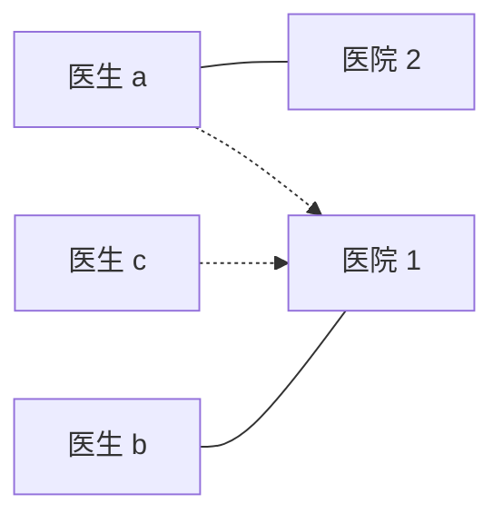
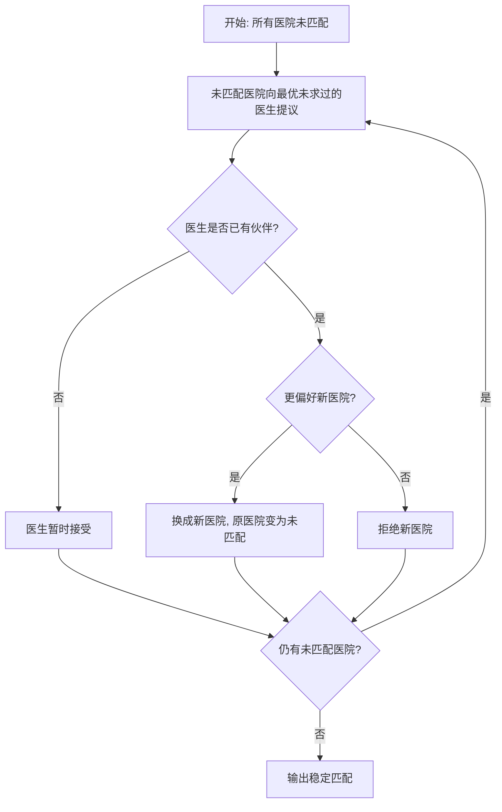
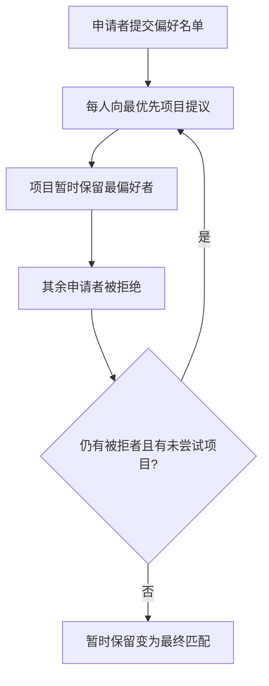

# SPL Run: build_concept_book

- **Adapter:** claude_cli
- **Model:** claude-sonnet-5-5
- **Tokens:** 5903 in / 2320 out
- **Latency:** 109145ms
- **Timestamp:** 2026-11-23 18:44:34

## Output

```output


---

## 匹配(Matching)

**定义。** 设图 $G=(V,E)$。**匹配** $M\subseteq E$ 是一组两两不共享顶点的边,即每个顶点至多与 $M$ 中的一条边相关联。在二部图 $G=(X\cup Y,E)$ 中(例如 $X$ 为医生、$Y$ 为医院),匹配就是把 $X$ 中的元素与 $Y$ 中的元素一对一配对,且每个参与者至多配一个。

几个常用术语:

- 若顶点 $v$ 被 $M$ 中某条边覆盖,称 $v$ 被**饱和**。
- $|M|$ 最大的匹配称为**最大匹配**。
- 若 $X$ 中每个顶点都被饱和,称 $M$ **完美匹配于 $X$**。若 $|X|=|Y|$ 且 $M$ 饱和所有顶点,则称 $M$ 为**完美匹配**。

**例题。** 三名医生 $a,b,c$ 与三家医院 $1,2,3$。可接受的配对为:$a$–1,$a$–2,$b$–1,$c$–1。

取 $M_1=\{a1,\,b1\}$。两条边都含医院 1,违反"至多一个"的要求,所以它不是匹配。

取 $M_2=\{a2,\,b1\}$。这是匹配,$|M_2|=2$。

能否再配上 $c$?$c$ 只能去医院 1,而医院 1 已被 $b$ 占用。设想沿"交错路径"调整:从未饱和的 $c$ 出发,经边 $c1$(不在 $M_2$ 中),再经边 $1b$(在 $M_2$ 中),到达 $b$。此时 $b$ 只能去医院 1,无法继续延伸,所以这条路径不能增广。因此最大匹配大小为 2,而不是 3。

**问题求解:Hall 定理。** 如何不靠试错就判断能否完美匹配于 $X$?对 $S\subseteq X$,记 $N(S)$ 为 $S$ 的所有邻居构成的集合。

> **Hall 定理。** 二部图中存在饱和 $X$ 的匹配,当且仅当对每个 $S\subseteq X$,都有 $|N(S)|\ge |S|$。

必要性显然:$S$ 中的 $|S|$ 个元素要配到互不相同的邻居,邻居数至少为 $|S|$。充分性可对 $|X|$ 用归纳法证明,这里略去。

回到例题。取 $S=\{b,c\}$,则 $N(S)=\{1\}$,$|N(S)|=1<2=|S|$。Hall 条件被破坏,所以不可能饱和全部医生。这与上面的结论一致,并且还指出了瓶颈所在:$b$ 与 $c$ 抢同一家医院。

**求最大匹配的算法。** 若匹配 $M$ 存在一条**增广路径**(起点与终点都未饱和,且路径上的边在 $M$ 外与 $M$ 内交替出现),把路径上的边在 $M$ 内外互换,就得到大小为 $|M|+1$ 的匹配。Berge 定理说明其逆也成立:$M$ 是最大匹配当且仅当不存在增广路径。反复寻找并翻转增广路径,即得到匈牙利算法,其时间复杂度为 $O(|V|\cdot|E|)$。

**小结。** 匹配刻画"一对一配对"。判断存在性用 Hall 条件,构造最优解则靠增广路径。


*图中实线为匹配 $M_2$,虚线为可接受但未选中的配对。医生 $c$ 只能去医院 1,而该医院已被 $b$ 占用,所以 $c$ 无法被饱和。*

---

## 偏好列表

**定义。** 在匹配问题中，每个参与者对所有可能的伙伴给出一个**严格全序**排名，称为该参与者的**偏好列表**（preference list）。设两个集合 $M$（如医院）和 $W$（如实习生），参与者 $m\in M$ 的偏好列表记作

$$P(m)=\;w_{i_1}\succ_m w_{i_2}\succ_m\cdots\succ_m w_{i_n},$$

其中 $w\succ_m w'$ 表示 $m$ 认为 $w$ 优于 $w'$。严格全序要求：任意两个不同伙伴都可比较（完全性），且不存在并列。为便于计算，常定义**排名函数** $\operatorname{rank}_m(w)$，它表示 $w$ 在 $P(m)$ 中的位置（1 表示最喜欢）。于是 $w\succ_m w'$ 当且仅当 $\operatorname{rank}_m(w)<\operatorname{rank}_m(w')$。

偏好列表是匹配算法（如 Gale–Shapley 稳定匹配算法）的**唯一输入**：算法只比较名次，不关心偏好的“强度”。

**例题。** 三位学生 $a,b,c$ 与三个项目 $X,Y,Z$：

| 参与者 | 偏好列表 |
|---|---|
| $a$ | $X\succ Y\succ Z$ |
| $b$ | $X\succ Z\succ Y$ |
| $c$ | $Y\succ X\succ Z$ |
| $X$ | $b\succ a\succ c$ |
| $Y$ | $a\succ b\succ c$ |
| $Z$ | $a\succ c\succ b$ |

读表：$\operatorname{rank}_a(Y)=2$，$\operatorname{rank}_X(c)=3$。学生 $a$ 认为 $X$ 优于 $Z$，这是一个比较关系，而不是打分。

**问题求解：判断稳定性。** 匹配 $\mu_1=\{(a,X),(b,Z),(c,Y)\}$ 是否稳定？

稳定性要求不存在**阻塞对**：即一对 $(s,p)$ 尚未配对，却互相认为对方优于当前伙伴。

1. 检查 $(b,X)$：$b$ 当前是 $Z$，而 $X\succ_b Z$，所以 $b$ 愿意换；$X$ 当前是 $a$，而 $b\succ_X a$，所以 $X$ 也愿意换。双方都愿意，因此 $(b,X)$ 是阻塞对。
2. 结论：$\mu_1$ **不稳定**。

修正：令 $\mu_2=\{(b,X),(a,Y),(c,Z)\}$。检查 $(a,X)$：$a$ 偏好 $X$，但 $X$ 更喜欢 $b$，不构成阻塞。检查 $(c,Y)$：$c$ 偏好 $Y$，但 $Y$ 更喜欢 $a$，不构成阻塞。检查 $(c,X)$：$X$ 更喜欢 $b$，不构成阻塞。其余各对依次检查，也都无法使双方同时获益，所以 $\mu_2$ 稳定。

**实践要点。**

- 偏好列表只需要**序**，所以可以用数组或字典实现，排名函数查询的时间复杂度为 $O(1)$（预先建立 $\operatorname{rank}$ 表）。若不预处理，每次比较要扫描列表，代价为 $O(n)$。
- 对 $n$ 人对 $n$ 人的问题，输入规模为 $O(n^2)$，因为每人都要给出长度为 $n$ 的列表。Gale–Shapley 算法最多进行 $n^2$ 次提议，因此总时间为 $O(n^2)$，与输入规模同阶。
- 实际场景中常允许**不完整列表**（只排出可接受的伙伴）和**并列**；此时稳定性的定义与算法都要相应调整，最终匹配的规模也可能随之变化。

**小结。** 偏好列表把“喜好”抽象为一个可比较的严格全序，使稳定性成为可以精确检验的性质：只需逐对查找阻塞对。

---

## 稳定匹配问题

**定义。** 设有两个大小相同的集合 $M=\{m_1,\dots,m_n\}$(例如求职者)和 $W=\{w_1,\dots,w_n\}$(例如公司)。每个参与者对另一侧所有成员给出一个严格的偏好排序。**匹配** $\mu$ 是 $M$ 与 $W$ 之间的一一对应。若存在一对 $(m,w)$ 满足

$$
w \succ_m \mu(m) \quad\text{且}\quad m \succ_w \mu(w),
$$

即二者彼此都更偏爱对方而非当前伴侣,则称 $(m,w)$ 为**阻塞对**(不稳定对)。没有任何阻塞对的匹配称为**稳定匹配**。

**Gale–Shapley 延迟接受算法。** 当存在未匹配的 $m$ 时:$m$ 向其名单上尚未求过的最优选 $w$ 发出提议;若 $w$ 未匹配,或更偏爱 $m$ 胜过当前伴侣,则 $w$ 暂时接受 $m$(并抛弃原伴侣);否则拒绝。

**定理。** 对任意偏好,算法至多经 $n^2$ 轮提议终止,并输出稳定匹配。

*证明要点。* 每个 $m$ 至多向每个 $w$ 提议一次,故提议总数 $\le n^2$。一旦 $w$ 被提议,她此后始终保持匹配,且伴侣只会变得更好。因此终止时人人都已匹配。假设最终存在阻塞对 $(m,w)$,且 $w\succ_m\mu(m)$。$m$ 按偏好从高到低提议,所以他必定先向 $w$ 提议过并被拒绝(或被抛弃),这说明 $w$ 当时的伴侣优于 $m$。又因 $w$ 的伴侣只会越来越好,最终 $\mu(w)\succ_w m$,与 $(m,w)$ 是阻塞对矛盾。$\blacksquare$

**例题。** 设 $n=2$,偏好如下:

| | 第一选择 | 第二选择 |
|---|---|---|
| $m_1$ | $w_1$ | $w_2$ |
| $m_2$ | $w_1$ | $w_2$ |
| $w_1$ | $m_2$ | $m_1$ |
| $w_2$ | $m_1$ | $m_2$ |

1. $m_1$ 与 $m_2$ 都向 $w_1$ 提议。$w_1$ 偏爱 $m_2$,暂时接受 $m_2$,拒绝 $m_1$。
2. $m_1$ 转向 $w_2$,$w_2$ 未匹配,接受。
3. 所有人均已匹配,得到 $\mu=\{(m_1,w_2),(m_2,w_1)\}$。

检验:$m_1$ 更想要 $w_1$,但 $w_1$ 更喜欢现任 $m_2$;$m_2$ 已得到最优选。无阻塞对,匹配稳定。

**问题求解应用。** 医学院毕业生与医院的住院医师分配(NRMP)、学生与学校的录取都是此模型的变体。解题时的步骤是:(1)明确提议方与被提议方;(2)写出双方完整的偏好表;(3)按算法逐轮模拟,记录每个接受方“当前暂定伴侣”;(4)用阻塞对定义逐一验证。

注意两点性质:其一,**提议方最优**——由 $m$ 一侧提议所得的匹配,使每个 $m$ 得到其在所有稳定匹配中可能获得的最佳伴侣,而每个 $w$ 得到最差的稳定伴侣。在上例中,若改由 $w$ 提议,会得到另一个稳定匹配 $\{(m_1,w_2),(m_2,w_1)\}$ 以外的结果吗?请自己模拟,并比较两者。其二,算法的时间复杂度为 $O(n^2)$,对大规模匹配市场仍然高效。

**练习。** 令 $n=3$,自行设定偏好表,用上述算法求出稳定匹配,并分别检验所有 $\binom{3}{1}\cdot 2=6$ 个可能的非匹配对是否构成阻塞对。

---

## 盖尔-沙普利算法(Gale–Shapley Algorithm)

### 定义

在医院—医生匹配问题中,有 $n$ 家医院和 $n$ 名医生,每一方对另一方的所有成员都有严格的偏好排序。**匹配** $\mu$ 是医院与医生之间的一一配对。若存在一对 $(h,d)$,它们没有被配对在一起,但彼此都更偏好对方胜过各自当前的伙伴,则称 $(h,d)$ 为**阻塞对**。没有阻塞对的匹配称为**稳定匹配**。

**盖尔-沙普利算法(医院提议版)** 按轮进行:

1. 每家未匹配的医院向其偏好表中尚未求过的最优医生提出邀请。
2. 每名医生在所有收到的邀请(包括当前暂时接受的那一个)中,暂时接受最喜欢的,拒绝其余。
3. 被拒绝的医院回到未匹配状态,下一轮继续向下一位医生提议。
4. 当所有医院都已匹配时停止。

### 例题

设 3 家医院 $H_1,H_2,H_3$ 和 3 名医生 $D_1,D_2,D_3$,偏好(左为最优):

| 医院 | 偏好 | 医生 | 偏好 |
|---|---|---|---|
| $H_1$ | $D_1 > D_2 > D_3$ | $D_1$ | $H_2 > H_1 > H_3$ |
| $H_2$ | $D1 > D_3 > D_2$ | $D_2$ | $H_1 > H_3 > H_2$ |
| $H_3$ | $D_1 > D_2 > D_3$ | $D_3$ | $H_1 > H_2 > H_3$ |

- **第 1 轮**:三家医院都向 $D_1$ 提议。$D_1$ 偏好 $H_2$,故暂时接受 $H_2$,拒绝 $H_1,H_3$。
- **第 2 轮**:$H_1$ 向 $D_2$ 提议,$H_3$ 向 $D_2$ 提议。$D_2$ 偏好 $H_1$,接受 $H_1$,拒绝 $H_3$。
- **第 3 轮**:$H_3$ 向 $D_3$ 提议,$D_3$ 无其他邀请,暂时接受。

结果:$\mu=\{(H_1,D_2),(H_2,D_1),(H_3,D_3)\}$。检验:$H_1$ 更想要 $D_1$,但 $D_1$ 偏好现任 $H_2$;$H_3$ 更想要 $D_1,D_2$,但两人都偏好各自现任。无阻塞对,匹配稳定。

### 问题求解应用

**定理 1(终止性)** 算法至多进行 $n^2$ 次提议后终止。

*证明*:每家医院对每名医生至多提议一次,故总提议数 $\le n^2$,而每轮至少产生一次新提议,所以算法必然终止。又因为只要有医院未匹配,它就仍有未求过的医生(否则 $n$ 家医院都曾向某医生提议,该医生已被匹配,与"医院未匹配且已向所有医生提议"矛盾),所以终止时所有人均已匹配。

**定理 2(稳定性)** 输出的匹配是稳定的。

*证明*:假设 $(h,d)$ 是阻塞对,$h$ 更偏好 $d$ 胜过其最终伙伴。那么 $h$ 必然先向 $d$ 提议过并被拒绝(或后来被替换)。医生接受的伙伴只会越来越好,因此 $d$ 的最终伙伴不比 $h$ 差,即 $d$ 并不偏好 $h$,与阻塞对定义矛盾。$\square$

**最优性** 可以进一步证明:每家医院得到的医生,是**所有稳定匹配中**它能得到的最好的一位(医院最优),而每名医生得到的则是最差的稳定伙伴。因此"谁来提议"决定了谁受益。

**应用思路**:面对任何"双边匹配"问题(住院医师分配、学校录取、器官交换),先写出双方偏好表,令受益方作为提议方,按上述轮次模拟;复杂度为 $O(n^2)$,可直接用于验证方案是否稳定。


*图:医院提议版盖尔-沙普利算法的流程,循环直至所有医院都被匹配。*

---

## 全国住院医师匹配项目(NRMP)

**定义。** 全国住院医师匹配项目(National Resident Matching Program,NRMP)是美国医学毕业生与医院住院医师岗位之间的集中匹配机构。申请者和项目各自提交按偏好排序的名单,算法据此一次性算出分配结果。其核心是 Gale–Shapley 延迟接受算法的一个变体,目标是得到**稳定匹配**。

设申请者集合为 $A$,项目集合为 $P$,项目 $p$ 的名额为 $q_p$。若存在一对 $(a,p)$ 满足以下两个条件,就称它为**阻塞对**:

1. $a$ 更偏好 $p$,胜过自己当前的匹配;
2. $p$ 有空位,或更偏好 $a$,胜过它当前录取的某位申请者。

没有阻塞对的匹配就是稳定的。稳定性很重要:如果存在阻塞对,双方都有动机绕开系统私下达成协议,匹配就会失效。

**算法(申请者提议版)。**

1. 每位未匹配的申请者向其名单中尚未尝试的最优先项目提出申请。
2. 每个项目暂时保留其最偏好的至多 $q_p$ 位申请者,拒绝其余申请者。
3. 被拒绝者转向下一个选择,重复前两步,直到无人可提议为止。

该算法至多进行 $\sum_{a}|L_a|$ 轮提议($L_a$ 为申请者 $a$ 的名单),因此必定终止,并且总能给出稳定匹配。

**例题。** 申请者 $a_1,a_2,a_3$,项目 $X$(1 个名额)、$Y$(2 个名额)。偏好如下:

- $a_1$:$X \succ Y$;$a_2$:$X \succ Y$;$a_3$:$Y \succ X$
- $X$:$a_2 \succ a_1 \succ a_3$;$Y$:$a_1 \succ a_3 \succ a_2$

第 1 轮:$a_1,a_2$ 申请 $X$,$a_3$ 申请 $Y$。$X$ 偏好 $a_2$,于是保留 $a_2$,拒绝 $a_1$。$Y$ 保留 $a_3$。
第 2 轮:$a_1$ 申请 $Y$。$Y$ 还有空位,因此接受。
结果:$\{a_2\to X,\ a_1\to Y,\ a_3\to Y\}$。

检验:$a_1$ 更想去 $X$,但 $X$ 更偏好 $a_2$,所以 $(a_1,X)$ 不是阻塞对。$a_3$ 已得到第一志愿。因此匹配稳定。

**问题求解应用。** 这套机制有几个重要性质,可以用来分析实际问题:

- **申请者最优性。** 申请者提议版得到的稳定匹配,对每位申请者而言都是所有稳定匹配中最好的。因此申请者如实填写偏好是最优策略(对申请者而言,如实报告是占优策略)。
- **项目端可能操纵。** 项目虚报偏好有时能获益,但这只在特定结构下可行,所以真实偏好仍是合理的默认选择。
- **夫妻联合申请。** 这是 NRMP 对原始算法最大的修改。夫妻需要联合排序成对的岗位组合,偏好不再是单个申请者的线性序。此时稳定匹配**不一定存在**,问题也变为 NP 完全问题。NRMP 因此采用启发式处理,并不保证得到稳定结果。

**练习。** 在上面的例题中,若 $X$ 改为 $a_1 \succ a_2 \succ a_3$,重新运行算法,写出结果并说明哪些申请者的结果发生了变化。(答案:$a_1\to X$,$a_2\to Y$,$a_3\to Y$;$a_1$ 与 $a_2$ 的结果改变。)


*图示:申请者提议的延迟接受流程。项目只做“暂时保留”,直到无人再被拒绝时才确定最终匹配。*

---

## 收益(Payoff)

### 一、国家住院医师匹配计划(NRMP)实现了什么

NRMP 每年把数万名医学毕业生分配到各医院的住院医师岗位。它的核心是一个**稳定匹配**算法。每位申请人提交一份偏好排序表,每个项目也提交一份排序表。算法输出一个匹配 $\mu$。在这个匹配下,不存在"阻塞对"。阻塞对指一位申请人 $a$ 和一个项目 $p$,双方都认为对方比当前分配更好:

$$a \succ_p \mu(p)\ \text{的某位成员}\quad\text{且}\quad p \succ_a \mu(a).$$

Gale–Shapley 的延迟接受算法保证这样的匹配一定存在。算法最多进行 $n^2$ 轮提议,所以是多项式时间。

它之所以是本书自然的终点,是因为它把前面各章汇集到了一起:偏好的序关系、集合与函数(匹配本身)、归纳法与终止性证明(每次提议后,申请人只会"向下"移动,所以算法必然停止),以及复杂度分析。它还加入了一个设计层面的问题:怎样让一个机制抵抗策略性操纵。

### 二、例题:三人小规模匹配

申请人 $A_1, A_2$,项目 $P_1, P_2$(各一个名额)。

- 申请人偏好:$A_1: P_1 \succ P_2$;$A_2: P_1 \succ P_2$。
- 项目偏好:$P_1: A_2 \succ A_1$;$P_2: A_1 \succ A_2$。

**第 1 轮**:$A_1, A_2$ 都向 $P_1$ 提议。$P_1$ 偏好 $A_2$,暂时接受 $A_2$,拒绝 $A_1$。
**第 2 轮**:$A_1$ 向 $P_2$ 提议,$P_2$ 接受。
**结果**:$\mu=\{(A_2,P_1),(A_1,P_2)\}$。

检验阻塞对:$A_1$ 更想去 $P_1$,但 $P_1$ 更喜欢 $A_2$,所以 $(A_1,P_1)$ 不阻塞。$A_2$ 已得到第一志愿。匹配稳定。

这个算法由申请人一方提议,所得匹配对申请人是最优的。这也是 NRMP 采用申请人提议版本的原因:申请人如实填写偏好,是其最优策略。

### 三、与各应用领域的联系

本节没有列出具体的应用领域。同一套框架在以下场景都适用,你可以把它们当作练习的方向:

- **学校录取与选课**:学生与学校互相排序,约束与住院医师匹配相同。
- **器官移植交换**:把"双边偏好"换成相容性约束,用环交换的思路扩展匹配。
- **网约车与任务分配**:偏好来自价格或距离,需要在线、实时地计算。

### 四、问题求解练习

1. 对上面的例子,改成项目提议,求匹配。它与申请人提议的结果相同吗?
2. 证明:申请人提议算法最多在 $n^2-n+1$ 轮内结束。
3. 构造一个例子,说明项目虚报偏好可以获益。

### 五、邀请

选一个你最熟悉的场景,比如你所在学校的选课或社团分配。写下参与者的偏好,手动运行延迟接受算法,再用代码实现它,并检查输出里是否有阻塞对。从这里出发,你会发现稳定性、效率与公平之间的取舍。这正是机制设计的入口。
```
