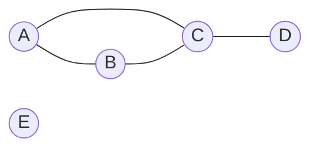
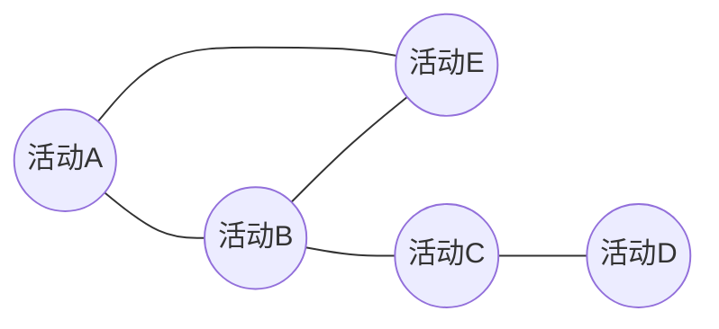

# SPL Run: build_concept_book

- **Adapter:** claude_cli
- **Model:** claude-sonnet-5-5
- **Tokens:** 2672 in / 985 out
- **Latency:** 52867ms
- **Timestamp:** 2026-11-23 18:46:24

## Output

```output


---

## 图

**定义。** 一个**图**(graph)是一个二元组 $G=(V,E)$,其中 $V$ 是有限的**顶点**集合,$E$ 是由顶点构成的**边**的集合。在无向图中,每条边是一个无序对 $\{u,v\}\subseteq V$;在有向图中,边是有序对 $(u,v)$。顶点 $v$ 的**度** $\deg(v)$ 是与它相连的边的条数。**路径**是顶点序列 $v_0,v_1,\dots,v_k$,其中相邻顶点之间都有边;若任意两个顶点之间都存在路径,则称图是**连通**的。

图的第一个基本结论是**握手引理**:

$$\sum_{v\in V}\deg(v)=2|E|.$$

*证明:* 每条边 $\{u,v\}$ 恰好为 $\deg(u)$ 和 $\deg(v)$ 各贡献 $1$,所以每条边在度数之和中被计算两次。$\blacksquare$

由此可知,度为奇数的顶点个数必为偶数,因为总和 $2|E|$ 是偶数。

**例题。** 设 $V=\{A,B,C,D,E\}$,$E=\{\{A,B\},\{A,C\},\{B,C\},\{C,D\}\}$。

- 各顶点的度:$\deg(A)=2,\ \deg(B)=2,\ \deg(C)=3,\ \deg(D)=1,\ \deg(E)=0$。
- 度数之和为 $2+2+3+1+0=8=2\times 4$,与握手引理一致。
- 从 $A$ 到 $D$ 的一条路径是 $A\to C\to D$,长度为 $2$。
- 顶点 $E$ 是孤立点,没有任何边与它相连,所以 $G$ **不连通**。


*图示:例题中的无向图。顶点 $E$ 孤立,因此整个图不连通。*

**问题求解应用。** 图是把"对象与关系"抽象出来的通用工具。

*问题:* 一个班有 $7$ 名同学,能否让每人恰好与另外 $3$ 名同学互为朋友?

*解答:* 把同学看作顶点,朋友关系看作边。若可行,则每个顶点的度都为 $3$,度数之和为 $7\times 3=21$。但握手引理要求度数之和等于 $2|E|$,必须是偶数,而 $21$ 是奇数,矛盾。因此这种安排**不可能**。

*再看一个应用:* 判断连通性。从某个顶点出发,用广度优先搜索逐层访问相邻顶点。若最后访问到的顶点数等于 $|V|$,则图连通。在例题中,从 $A$ 出发只能访问到 $\{A,B,C,D\}$,共 $4<5$ 个顶点,所以 $G$ 不连通。最短路径、网络可靠性、任务依赖调度等问题,也都是在这一结构上展开的。

**小结。** 图由 $(V,E)$ 完整刻画。握手引理 $\sum\deg(v)=2|E|$ 是判断某种结构是否可能存在的第一道检验。遇到"谁与谁相连"的问题时,先把对象设为顶点、关系设为边,再用度、路径和连通性来分析。

---

## 交集图(Intersection Graph)

**定义。** 设 $\mathcal{F}=\{S_1,S_2,\dots,S_n\}$ 是一族对象(通常是某个集合的子集,如区间、圆盘、线段)。$\mathcal{F}$ 的**交集图** $G=(V,E)$ 定义为:

- 顶点集 $V=\{v_1,\dots,v_n\}$,每个对象 $S_i$ 对应一个顶点 $v_i$;
- 边集 $E=\{\,v_iv_j \mid i\ne j,\ S_i\cap S_j\neq\varnothing\,\}$。

也就是说,两个顶点相邻,当且仅当对应的对象有公共部分。几乎每个图都可以表示为某族集合的交集图,因此有意义的问题是:当对象被限制为某一类几何形状时,得到的图有什么特殊性质。最经典的一类是**区间图**:每个 $S_i$ 都是实数轴上的闭区间。

**例题。** 有五场活动,各自占用的时间段为:
$A=[1,4]$,$B=[3,6]$,$C=[5,8]$,$D=[7,10]$,$E=[2,3]$。

逐对检查是否有重叠:

- $A\cap B=[3,4]\neq\varnothing$,所以 $AB$ 是边;
- $A\cap E=\{3\}\neq\varnothing$(闭区间,端点相接也算相交),所以 $AE$ 是边;
- $B\cap E=\{3\}$,所以 $BE$ 是边;
- $B\cap C=[5,6]$,所以 $BC$ 是边;
- $C\cap D=[7,8]$,所以 $CD$ 是边;
- 其余各对不相交。

于是 $E(G)=\{AB,AE,BE,BC,CD\}$。


*五个时间区间的交集图:三角形 $ABE$ 说明这三场活动在 $t=3$ 时刻同时进行。*

**问题求解应用。** 交集图把"冲突"问题转化为图论问题。

*问题:至少需要几个会议室,才能让上述活动互不冲突地安排?*

给每场活动分配一个会议室,相当于对 $G$ 做**顶点着色**,相邻顶点(时间冲突)必须使用不同的颜色(房间)。

1. 下界:三角形 $ABE$ 是一个团,其中三个顶点两两相邻,故至少需要 $\omega(G)=3$ 个房间。
2. 上界:取 $A\to 1$,$B\to 2$,$E\to 3$,$C\to 1$(与 $B$ 冲突,与 $A$ 不冲突),$D\to 2$(与 $C$ 冲突,与 $B$ 不冲突)。这是合法着色,用了 3 个房间。

因此最少需要 3 个会议室,即 $\chi(G)=3=\omega(G)$。

这不是巧合。区间图是**完美图**,总有 $\chi(G)=\omega(G)$。团的大小恰好等于某个时刻同时进行的活动数,所以最少房间数就是"最大同时进行的活动数",只需扫描一遍时间轴就能算出,不必真的去求解一般图着色这个 NP 难问题。同样的思路也适用于:

- 圆盘交集图,可用来分析无线信号干扰与频道分配;
- 线段交集图,可用来分析布线冲突;
- 基因组中的重叠片段,可用来做序列拼接。

**要点:** 先判断对象属于哪一类几何形状,再利用该类交集图的结构性质(如完美性),把一般情形下很难的问题变成易解的问题。

---

## 终章回报(Payoff)

### 交集图实现了什么

在前面的章节中,我们分别处理了"集合""元素"和"成员关系"。交集图(intersection graph)把这些想法收拢到一个对象中。给定一族集合 $S_1, S_2, \dots, S_n$,它的交集图 $G$ 定义如下:

- 顶点集:$V=\{1,2,\dots,n\}$,每个集合对应一个顶点;
- 边集:当且仅当 $S_i\cap S_j\neq\varnothing$ 时,$\{i,j\}\in E$。

也就是说,交集图把"谁与谁共享某些东西"这个关系变成一张可以计算的图。这正是它成为自然终点的原因。集合论回答"里面有什么",图论回答"如何相连",而交集图把两者合在一起。图的每一个性质,例如连通分量、团、着色数和最短路径,都能翻译回关于共享资源的结论。

### 工作示例

设有三门课的选课名单:$A=\{\text{小明},\text{小红}\}$,$B=\{\text{小红},\text{小刚}\}$,$C=\{\text{小丽}\}$。

- $A\cap B=\{\text{小红}\}\neq\varnothing$,所以 $A$ 与 $B$ 之间有边;
- $A\cap C=B\cap C=\varnothing$,所以 $C$ 是孤立顶点。

于是 $G$ 有两个连通分量。若这三门课要在同一时段安排考试,冲突的课程不能同时进行。那么求最少考试时段数,就是求 $G$ 的**色数** $\chi(G)$。这里 $\chi(G)=2$:$A$ 与 $B$ 必须错开,$C$ 可以与任何一门同时进行。

### 与各应用领域的联系

本节没有给出具体的应用清单,所以我们沿着交集图的三种基本用法来说明。每一种用法都给出一个可以直接求解的问题:

1. **冲突与调度**:把任务、课程或频段看作集合,元素是它们占用的资源。边表示冲突,着色给出无冲突的调度。
2. **区间与几何**:当每个集合是数轴上的一个区间时,得到**区间图**。这类图的 $\chi(G)$ 等于最大团的大小 $\omega(G)$,所以贪心算法就能给出最优解。
3. **网络与社群**:把用户看作集合,他们共同参与的事物是元素。连通分量对应社群,团对应紧密小组。

在这三种用法里,解题的步骤相同:先建模(定义集合),再构图(检验交集),最后用图的性质得出答案。

### 邀请

现在轮到你自己动手。选一个你熟悉的场景,例如班级社团的活动时间表、校园无线网络的信道分配,或者社交平台上的兴趣小组。列出集合,画出交集图,计算 $\chi(G)$ 和 $\omega(G)$,再检验这两个数是否相等。请把这个应用深入做完。你会发现,一个看似零散的问题,可以被还原成同一个简单而有力的结构。
```
