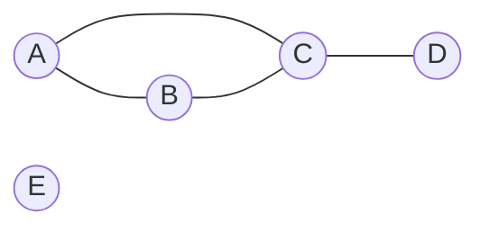
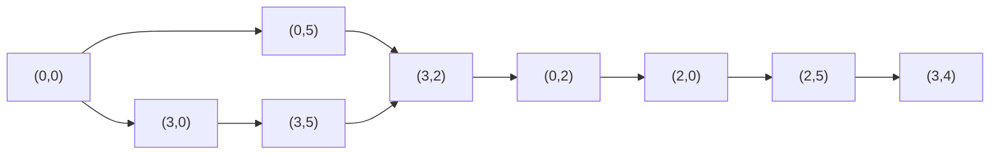

# SPL Run: build_concept_book

- **Adapter:** claude_cli
- **Model:** claude-sonnet-5-5
- **Tokens:** 1646 in / 706 out
- **Latency:** 40425ms
- **Timestamp:** 2026-11-23 18:47:18

## Output

```output


---

## 图

**定义。** 一个**图**(graph)是一个二元组 $G=(V,E)$,其中 $V$ 是有限的**顶点**集合,$E$ 是由顶点构成的**边**的集合。在无向图中,每条边是一个无序对 $\{u,v\}\subseteq V$;在有向图中,边是有序对 $(u,v)$。顶点 $v$ 的**度** $\deg(v)$ 是与它相连的边的条数。**路径**是顶点序列 $v_0,v_1,\dots,v_k$,其中相邻顶点之间都有边;若任意两个顶点之间都存在路径,则称图是**连通**的。

图的第一个基本结论是**握手引理**:

$$\sum_{v\in V}\deg(v)=2|E|.$$

*证明:* 每条边 $\{u,v\}$ 恰好为 $\deg(u)$ 和 $\deg(v)$ 各贡献 $1$,所以每条边在度数之和中被计算两次。$\blacksquare$

由此可知,度为奇数的顶点个数必为偶数,因为总和 $2|E|$ 是偶数。

**例题。** 设 $V=\{A,B,C,D,E\}$,$E=\{\{A,B\},\{A,C\},\{B,C\},\{C,D\}\}$。

- 各顶点的度:$\deg(A)=2,\ \deg(B)=2,\ \deg(C)=3,\ \deg(D)=1,\ \deg(E)=0$。
- 度数之和为 $2+2+3+1+0=8=2\times 4$,与握手引理一致。
- 从 $A$ 到 $D$ 的一条路径是 $A\to C\to D$,长度为 $2$。
- 顶点 $E$ 是孤立点,没有任何边与它相连,所以 $G$ **不连通**。


*图示:例题中的无向图。顶点 $E$ 孤立,因此整个图不连通。*

**问题求解应用。** 图是把"对象与关系"抽象出来的通用工具。

*问题:* 一个班有 $7$ 名同学,能否让每人恰好与另外 $3$ 名同学互为朋友?

*解答:* 把同学看作顶点,朋友关系看作边。若可行,则每个顶点的度都为 $3$,度数之和为 $7\times 3=21$。但握手引理要求度数之和等于 $2|E|$,必须是偶数,而 $21$ 是奇数,矛盾。因此这种安排**不可能**。

*再看一个应用:* 判断连通性。从某个顶点出发,用广度优先搜索逐层访问相邻顶点。若最后访问到的顶点数等于 $|V|$,则图连通。在例题中,从 $A$ 出发只能访问到 $\{A,B,C,D\}$,共 $4<5$ 个顶点,所以 $G$ 不连通。最短路径、网络可靠性、任务依赖调度等问题,也都是在这一结构上展开的。

**小结。** 图由 $(V,E)$ 完整刻画。握手引理 $\sum\deg(v)=2|E|$ 是判断某种结构是否可能存在的第一道检验。遇到"谁与谁相连"的问题时,先把对象设为顶点、关系设为边,再用度、路径和连通性来分析。

---

## 配置图(Configuration Graph)

**定义。** 配置图是一个图 $G=(V,E)$:顶点集 $V$ 是谜题或机构所有*合法配置*(状态)的集合,边 $\{u,v\}\in E$ 当且仅当配置 $u$ 可通过*一次合法移动*变为 $v$。若移动可逆(如华容道、魔方),图是无向的;若不可逆(如单向开关),则是有向图。把"如何走"的问题转化为图论问题:

- 求解谜题 $\iff$ 在 $G$ 中寻找从初始顶点 $s$ 到目标顶点 $t$ 的路径;
- 最少步数 $\iff$ $s$ 到 $t$ 的最短路径长度 $d(s,t)$;
- 无解 $\iff$ $s$ 与 $t$ 不在同一连通分量中。

**例题:倒水问题。** 有容量为 3 升与 5 升的两个水壶,均为空。目标:量出恰好 4 升。

配置记为 $(a,b)$,其中 $0\le a\le 3$,$0\le b\le 5$。合法移动包括:装满某壶、倒空某壶、把一壶倒入另一壶直到倒空或对方装满。从 $(0,0)$ 出发:

$$(0,0)\to(0,5)\to(3,2)\to(0,2)\to(2,0)\to(2,5)\to(3,4)$$

终点 $(3,4)$ 含 4 升,共 6 步。用广度优先搜索(BFS)逐层展开可证明 6 是最少步数,因为 BFS 按距离 $0,1,2,\dots$ 的顺序访问顶点。


*倒水问题配置图的一部分:上方主链为 6 步最短解,另一条分支经 $(3,0)$、$(3,5)$ 汇入 $(3,2)$。*

**应用:判断可解性与估计规模。** 

1. *规模*:配置数 $|V|$ 决定搜索代价。BFS 的时间复杂度为 $O(|V|+|E|)$。倒水问题至多 $4\times 6=24$ 个顶点,轻而易举;但 $3\times3$ 魔方有
$$|V|=\frac{8!\cdot 3^8\cdot 12!\cdot 2^{12}}{12}\approx 4.3\times10^{19},$$
无法显式存储,必须利用结构(如双向搜索、对称性)。

2. *可解性*:用连通分量判断。例如 15 数码问题的配置图恰好有两个连通分量,各含 $16!/2$ 个顶点。奇偶性(排列的逆序数加上空格行号)是在两个分量上取值不同的不变量,因此只需计算一次奇偶性,即可断定任意初始局面能否到达目标,无需搜索。

3. *最难局面*:图的*直径* $\max_{u,v} d(u,v)$ 给出最坏情形所需步数。魔方(半转度量)的直径为 20,即"上帝之数"。

**解题步骤小结:** (1) 明确配置的表示;(2) 写出合法移动规则,生成邻居;(3) 用 BFS 求最短路,或用不变量分析连通性;(4) 若 $|V|$ 太大,改用启发式搜索(如 A*)或利用对称性压缩。

**练习。** 对 $(3,5)$ 倒水问题,说明能否量出 $1$ 升,并求最少步数。(提示:因为 $\gcd(3,5)=1$,所有整数升数都可达。)

---

## 回报(Payoff)

**配置图(configuration graph)**把一个计算系统的所有可能“状态”视为顶点,把一步合法的转移视为有向边。形式化地,设系统为 $M$,输入为 $x$,则

$$G_{M,x}=(V,E),\qquad V=\{\text{所有格局 } c\},\quad E=\{(c,c')\mid c\vdash_M c'\}.$$

其中格局 $c$ 记录了某一时刻的全部信息,例如控制状态、内存内容和读写头位置。从初始格局 $c_0$ 出发的每条路径就是一次执行;“$M$ 接受 $x$”等价于图中存在从 $c_0$ 到某个接受格局的路径。这样,一个关于“计算”的动态问题就化成了一个关于“图”的静态问题。

### 为什么它是自然的终点

前面各章的工具都在这里汇合:状态与转移(自动机)、可达性(图论)、递推与计数(组合分析)、资源界(复杂度)。配置图把它们放进同一个对象里。

先看一个例子。设 $M$ 是空间上界为 $s(n)$ 的确定型图灵机,字母表大小为 $|\Gamma|$,控制状态数为 $|Q|$,则格局总数满足

$$|V|\le |Q|\cdot s(n)\cdot|\Gamma|^{s(n)}=2^{O(s(n))}.$$

于是 $M$ 的运行要么在 $2^{O(s(n))}$ 步内停机,要么陷入环路。这就给出了 $\mathrm{SPACE}(s(n))\subseteq \mathrm{TIME}\bigl(2^{O(s(n))}\bigr)$。

再看一个问题:能否用 $O(s(n)^2)$ 的空间判定可达性?可以。对“从 $u$ 出发 $2^k$ 步内能否到达 $v$”做二分递归,得到

$$\text{REACH}(u,v,k)=\exists w\;[\text{REACH}(u,w,k-1)\wedge \text{REACH}(w,v,k-1)].$$

递归深度为 $O(s(n))$,每层只存 $O(s(n))$ 个比特,所以总空间为 $O(s(n)^2)$。这就是 Savitch 定理 $\mathrm{NSPACE}(s)\subseteq\mathrm{SPACE}(s^2)$。

### 与各应用领域的联系

当前没有列出具体的应用领域,下面按配置图最典型的三类用途说明它如何落地:

- **复杂度理论**:上面的两个推导就是例证。配置图的规模给出资源界,可达性给出判定方法,$\mathrm{NL}$ 完全问题和 $\mathrm{PSPACE}$ 完全问题都由此定义。
- **程序验证与模型检验**:把软件或协议的状态空间建成配置图,再把“永不进入错误状态”转为“错误格局不可达”,就可以用搜索或符号方法自动检验。
- **工作流与智能体编排**:一个多步骤的 LLM 工作流,其变量取值与当前步骤构成格局,分支、循环和并行调用构成转移。在这张图上可以检查终止性、死循环和不可达分支。

### 邀请

请任选一个方向深入。比如,用你熟悉的语言为一个小型状态机(如红绿灯控制器或简单的重试循环)枚举所有格局,构造邻接表,再用广度优先搜索回答:“某个危险格局是否可达?最短的触发序列有多长?”做完这道练习,你就亲手走完了从定义到问题求解的全过程。
```
