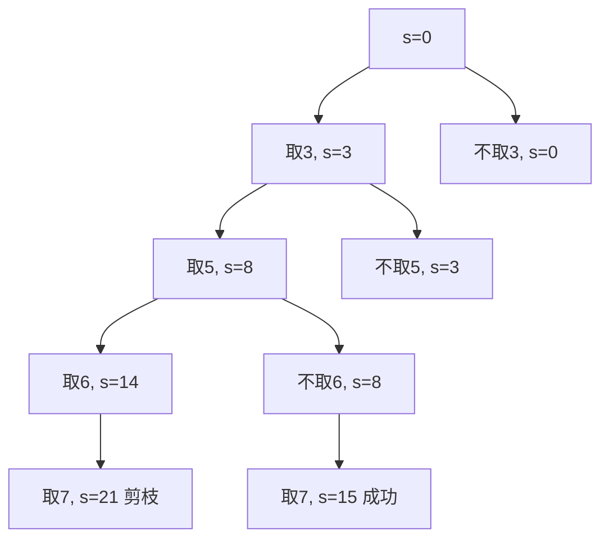
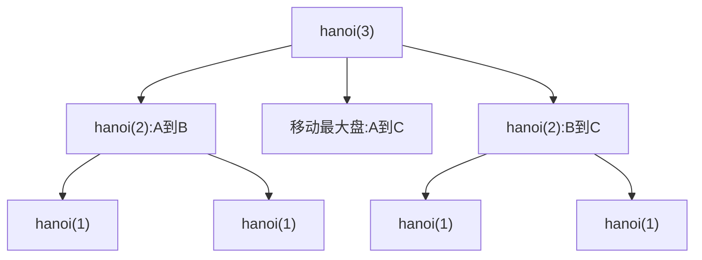
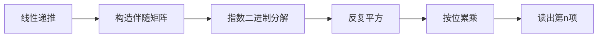
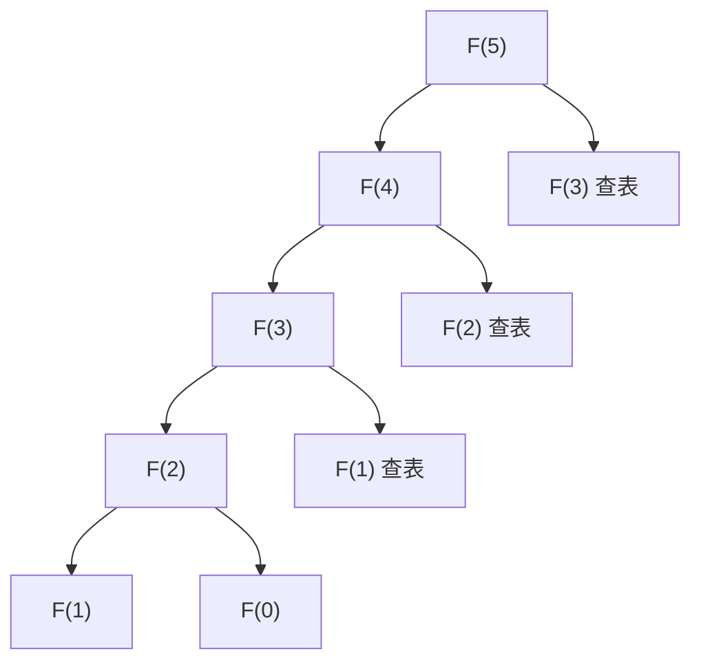
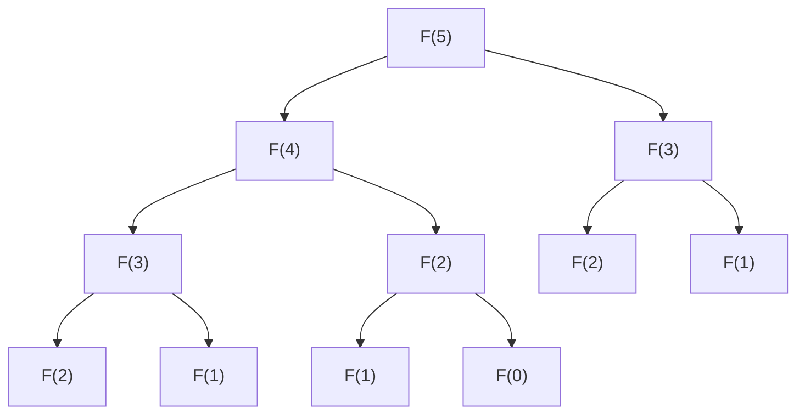

# SPL Run: build_concept_book

- **Adapter:** claude_cli
- **Model:** claude-sonnet-5-5
- **Tokens:** 0 in / 0 out
- **Latency:** 10351ms
- **Timestamp:** 2026-11-24 23:16:48

## Output

```output


---

## 递推关系

### 定义

**递推关系**(recurrence relation)用序列中较小下标的项来表示第 $n$ 项,并配以**初始条件**(基例)。一个递推关系要完整地确定序列,必须同时给出两部分:

1. 递推式:$a_n = f(a_{n-1}, a_{n-2}, \dots, a_{n-k})$,对所有 $n \ge k$ 成立;
2. 基例:$a_0, a_1, \dots, a_{k-1}$ 的具体取值。

缺少基例,递推式只描述一族序列;有了基例,序列唯一确定。例如斐波那契数列:
$$F_n = F_{n-1} + F_{n-2},\quad F_0 = 0,\ F_1 = 1.$$

### 例题:解一阶线性递推

求解 $a_n = 2a_{n-1} + 1$,$a_0 = 0$。

**步骤 1:展开前几项。** $a_1 = 1,\ a_2 = 3,\ a_3 = 7,\ a_4 = 15$。

**步骤 2:猜测通式。** 各项比 $2$ 的幂小 $1$,猜 $a_n = 2^n - 1$。

**步骤 3:用数学归纳法验证。**
- 基例:$a_0 = 2^0 - 1 = 0$ ✓。
- 归纳步:设 $a_{n-1} = 2^{n-1} - 1$,则
$$a_n = 2(2^{n-1} - 1) + 1 = 2^n - 1.$$

这就是"汉诺塔"问题中移动 $n$ 个圆盘所需的最少步数。

### 问题求解应用

**(1)二阶常系数齐次递推。** 对 $a_n = c_1 a_{n-1} + c_2 a_{n-2}$,设 $a_n = r^n$,代入得**特征方程**
$$r^2 = c_1 r + c_2.$$
若有两个不同的根 $r_1, r_2$,则通解为 $a_n = A r_1^n + B r_2^n$,系数 $A, B$ 由基例确定。

对斐波那契数列,$r^2 = r + 1$,解得 $r = \frac{1 \pm \sqrt5}{2}$,代入 $F_0 = 0,\ F_1 = 1$ 得比内公式:
$$F_n = \frac{1}{\sqrt5}\left[\left(\frac{1+\sqrt5}{2}\right)^n - \left(\frac{1-\sqrt5}{2}\right)^n\right].$$
所以 $F_n$ 以黄金比例 $\varphi \approx 1.618$ 指数增长。

**(2)分治算法的复杂度。** 归并排序的运行时间满足
$$T(n) = 2T(n/2) + n,\quad T(1) = 1.$$
每层递归的总工作量为 $n$,共有 $\log_2 n$ 层,因此 $T(n) = \Theta(n \log n)$。一般形式 $T(n) = aT(n/b) + f(n)$ 可用**主定理**(Master Theorem)比较 $f(n)$ 与 $n^{\log_b a}$ 的增长速度来求解。

**(3)编程实现。** 直接按定义递归计算 $F_n$ 会重复求解子问题,时间为指数级;加上记忆化,或从基例向上迭代,即可降到 $O(n)$:

```python
def fib(n):
    a, b = 0, 1
    for _ in range(n):
        a, b = b, a + b
    return a
```

### 小结

解递推关系的通用流程是:**写出递推式与基例 → 展开或猜测 → 用归纳或特征方程求闭式 → 检验基例**。遇到分治类问题,先建立 $T(n)$ 的递推式,再分析其渐近增长。

---

## 回溯法

**定义。** 回溯法(backtracking)是一种递归搜索策略:每次只为解增加一个分量,在每个决策点依次尝试所有可选项,并对每个选项递归地向下探索。若当前的部分解已经违反约束(或不可能扩展为完整解),就**剪枝**,撤销最近一步选择(即"回溯"),换下一个选项继续。

设部分解为 $x=(x_1,\dots,x_k)$,候选集为 $C(x)$,则通用框架为:

```python
def backtrack(x):
    if is_complete(x):
        record(x); return
    for c in candidates(x):
        if feasible(x, c):      # 剪枝检查
            x.append(c)         # 选择
            backtrack(x)        # 探索
            x.pop()             # 撤销(回溯)
```

"选择 → 探索 → 撤销"三步是回溯法的核心。它本质上是对**解空间树**的深度优先遍历,与暴力枚举的区别在于:一旦某个节点不可行,其整棵子树都被跳过。

**例题:子集和。** 从集合 $\{3,5,6,7\}$ 中选出若干数,使其和为 $15$。

按顺序决定每个数"取"或"不取",记当前和为 $s$:

- 取 3($s=3$)→ 取 5($s=8$)→ 取 6($s=14$)→ 取 7 得 $21>15$,剪枝;不取 7 得 $14\ne15$,失败。回溯到 6。
- 不取 6($s=8$)→ 取 7 得 $15$ ✓。找到解 $\{3,5,7\}$。

因为所有数为正,只要 $s>15$ 就可以立即剪枝,这避免了展开大量子树。


*子集和的解空间树(局部):超过目标值的分支被剪枝,成功分支给出解 $\{3,5,7\}$。*

**问题求解应用:$n$ 皇后。** 在 $n\times n$ 棋盘上放置 $n$ 个皇后,使其互不攻击。逐行放置,第 $r$ 行选择列 $c$,可行条件是:与已放皇后不同列、不同对角线,即对所有 $i<r$,
$$c\ne c_i,\qquad |c-c_i|\ne r-i.$$

```python
def solve(n):
    cols, res = [], 0
    def bt(r):
        nonlocal res
        if r == n: res += 1; return
        for c in range(n):
            if all(c != cols[i] and abs(c-cols[i]) != r-i for i in range(r)):
                cols.append(c); bt(r+1); cols.pop()
    bt(0)
    return res
```

对 $n=8$,朴素枚举需检查 $8^8\approx1.7\times10^7$ 种放法,而回溯法因提前剪枝,只访问约两千多个节点即可找出全部 92 个解。

**复杂度与使用要点。** 最坏情况下回溯仍是指数级,例如子集和为 $O(2^n)$,排列问题为 $O(n!)$;其优势依赖于剪枝的强度。设计时应注意:(1)状态必须能被**完全撤销**;(2)约束检查应尽早进行;(3)合理排序候选项,可更快发现解或更早剪枝。

---

## 递归

**定义。** 递归(recursion)是归约(reduction)的一种特殊情形:把一个问题归约为一个或多个**规模更小的同类问题**,再由一位想象中的“递归仙子”(Recursion Fairy)去解决这些更小的实例。我们只需做两件事:

1. **基础情形**:对最小的实例直接给出答案;
2. **递归步骤**:假设仙子能正确解决所有更小的实例,说明如何用这些结果拼出原问题的答案。

关键在于**信任仙子**:不要去展开每一层调用,只需验证“若更小的实例正确,则当前实例正确”。这正是数学归纳法的结构,因此递归算法的正确性可用归纳法证明。

**例题:汉诺塔。** 将 $n$ 个盘子从柱 $A$ 移到柱 $C$,借助柱 $B$,每次只能移动一个盘子,且大盘不能压在小盘上。

- 基础情形:$n=0$ 时无需任何操作。
- 递归步骤:请仙子把上面的 $n-1$ 个盘子从 $A$ 移到 $B$;自己把最大的盘子从 $A$ 移到 $C$;再请仙子把 $n-1$ 个盘子从 $B$ 移到 $C$。

```python
def hanoi(n, src, dst, tmp):
    if n == 0:
        return
    hanoi(n - 1, src, tmp, dst)   # 仙子:移走上面的 n-1 个
    print(f"{src} -> {dst}")      # 自己:移最大的盘子
    hanoi(n - 1, tmp, dst, src)   # 仙子:移回 n-1 个
```

**复杂度分析。** 设 $T(n)$ 为移动次数,则

$$T(0)=0,\qquad T(n)=2T(n-1)+1.$$

逐层展开可得 $T(n)=2T(n-1)+1=4T(n-2)+3=\cdots=2^{k}T(n-k)+(2^{k}-1)$。取 $k=n$,得

$$T(n)=2^{n}-1.$$

**归纳验证:** $n=0$ 时 $2^0-1=0$ 成立;若 $T(n-1)=2^{n-1}-1$,则 $T(n)=2(2^{n-1}-1)+1=2^n-1$。


*汉诺塔的递归调用树:每个规模为 $n$ 的问题分解为两个规模为 $n-1$ 的子问题加一次直接移动。*

**问题求解应用。** 设计递归算法时,可按以下步骤思考:

1. **明确子问题**:它必须与原问题同类,且规模严格更小;
2. **写出基础情形**:确保每条调用链都能到达它,否则会无限递归;
3. **只设计“合并”步骤**:假设仙子已给出正确的子问题答案,思考如何组合它们。

**练习:** 用同样的思路写出计算 $n!$ 的递归定义($0!=1$,$n!=n\cdot(n-1)!$),并证明它恰好进行 $n$ 次乘法。再思考:若 $T(n)=2T(n/2)+n$,解为何种量级?(提示:递归树每层代价为 $n$,共 $\log_2 n$ 层,故 $T(n)=\Theta(n\log n)$。)

递归的威力在于:复杂问题只需“一步合并 + 信任仙子”,而正确性与代价都可由归纳法和递推式严格分析。

---

## 动态规划

**定义。** 动态规划(Dynamic Programming, DP)是一种解题方法:先写出正确的**递推关系**,再按照精心安排的顺序,**自底向上**地填写各个子问题的解,使每个子问题只计算一次。它适用于具备两个性质的问题:

- **最优子结构**:原问题的最优解由子问题的最优解组合而成;
- **重叠子问题**:不同的分支会反复遇到相同的子问题。

回溯(或朴素递归)会重复求解这些子问题,代价常常是指数级的。DP 用一张表保存已有结果,把代价降为"子问题个数 × 每个子问题的转移代价"。

**设计四步。** (1) 定义状态;(2) 写出递推式;(3) 确定边界条件;(4) 确定填表顺序,使每个状态依赖的项都已先算出。

**例题:爬楼梯的计数。** 每次可走 1 或 2 级台阶,问走到第 $n$ 级共有多少种走法?

设 $f(n)$ 为到达第 $n$ 级的方法数。最后一步要么来自第 $n-1$ 级,要么来自第 $n-2$ 级,所以
$$f(n)=f(n-1)+f(n-2),\qquad f(0)=f(1)=1.$$
朴素递归会反复计算 $f(n-2),f(n-3),\dots$,调用次数约为 $\Theta(\varphi^n)$,其中 $\varphi=\tfrac{1+\sqrt5}{2}$。自底向上填表则按 $i=2,3,\dots,n$ 的顺序计算:

```python
def climb(n):
    f = [1, 1] + [0] * (n - 1)
    for i in range(2, n + 1):
        f[i] = f[i-1] + f[i-2]
    return f[n]
```

时间为 $O(n)$。因为 $f(i)$ 只依赖前两项,空间还可压缩到 $O(1)$。例如 $f(5)=8$。

**问题求解:0-1 背包。** 有 $n$ 件物品,第 $i$ 件重 $w_i$、价值 $v_i$,背包容量为 $W$,每件至多取一次,求最大总价值。

*状态*:$dp[i][c]$ 表示只考虑前 $i$ 件物品、容量为 $c$ 时的最大价值。

*递推*:第 $i$ 件要么不取,要么取(需 $c\ge w_i$):
$$dp[i][c]=\max\bigl(dp[i-1][c],\; dp[i-1][c-w_i]+v_i\bigr),$$
边界为 $dp[0][c]=0$。

*填表顺序*:$i$ 从 $1$ 到 $n$,每行内 $c$ 从 $0$ 到 $W$。第 $i$ 行只依赖第 $i-1$ 行,所以顺序是合法的。

数值演示:三件物品 $(w,v)=(1,1),(3,4),(4,5)$,$W=4$。

| $i\backslash c$ | 0 | 1 | 2 | 3 | 4 |
|---|---|---|---|---|---|
| 0 | 0 | 0 | 0 | 0 | 0 |
| 1 | 0 | 1 | 1 | 1 | 1 |
| 2 | 0 | 1 | 1 | 4 | 5 |
| 3 | 0 | 1 | 1 | 4 | 5 |

答案为 $dp[3][4]=5$,取第 1、2 件物品(重量 4,价值 5)。复杂度为 $O(nW)$,而枚举所有子集需要 $O(2^n)$。

**正确性。** 对 $i$ 做归纳:若 $dp[i-1][\cdot]$ 都正确,则前 $i$ 件的任何最优方案要么不含第 $i$ 件(对应第一项),要么含第 $i$ 件,其余部分必为容量 $c-w_i$ 下前 $i-1$ 件的最优方案(否则可替换得到更优解,矛盾)。因此递推式取到最优值。

**小结。** 用 DP 时先问:最后一步有哪些选择?每种选择后剩下的子问题是什么?再据此定义状态,按依赖顺序填表。

---

## 矩阵快速幂递推

**定义。** 若序列满足 $k$ 阶线性递推
$$a_n = c_1 a_{n-1} + c_2 a_{n-2} + \cdots + c_k a_{n-k},$$
则可把连续 $k$ 项打包成状态向量 $\mathbf v_n=(a_n, a_{n-1},\dots,a_{n-k+1})^{\mathsf T}$，于是
$$\mathbf v_{n} = M\,\mathbf v_{n-1},$$
其中 $M$ 是 $k\times k$ 的**伴随矩阵**：第一行为 $(c_1,c_2,\dots,c_k)$，其余部分在次对角线上为 1，其他元素为 0。反复应用得
$$\mathbf v_n = M^{\,n-k+1}\mathbf v_{k-1}.$$
逐项递推需要 $O(n)$ 次迭代；而 $M^m$ 可由**快速幂**计算：利用 $M^{2j}=(M^j)^2$ 与 $M^{2j+1}=M\cdot M^{2j}$，只需 $O(\log m)$ 次矩阵乘法，总代价为 $O(k^3\log n)$。

**例题。** 斐波那契数 $F_n=F_{n-1}+F_{n-2}$，$F_0=0,\ F_1=1$。此时
$$\begin{pmatrix}F_{n+1}\\F_n\end{pmatrix}=\begin{pmatrix}1&1\\1&0\end{pmatrix}\begin{pmatrix}F_n\\F_{n-1}\end{pmatrix},\qquad \begin{pmatrix}1&1\\1&0\end{pmatrix}^{n}=\begin{pmatrix}F_{n+1}&F_n\\F_n&F_{n-1}\end{pmatrix}.$$
求 $F_{10}$：记 $A=\begin{pmatrix}1&1\\1&0\end{pmatrix}$，则
$$A^2=\begin{pmatrix}2&1\\1&1\end{pmatrix},\quad A^4=\begin{pmatrix}5&3\\3&2\end{pmatrix},\quad A^8=\begin{pmatrix}34&21\\21&13\end{pmatrix}.$$
因为 $10=8+2$，所以
$$A^{10}=A^8A^2=\begin{pmatrix}89&55\\55&34\end{pmatrix},$$
右上角即 $F_{10}=55$。只做了 3 次平方和 1 次乘法，而不是 9 次逐项相加。

**问题求解应用。** 设 $a_n=3a_{n-1}-a_{n-3}$，$a_0=1,a_1=2,a_2=5$，要求 $a_{10^{18}} \bmod (10^9+7)$。

1. 确定阶数 $k=3$，写出
$$M=\begin{pmatrix}3&0&-1\\1&0&0\\0&1&0\end{pmatrix},\quad \mathbf v_2=(5,2,1)^{\mathsf T}.$$
2. 计算 $M^{10^{18}-2}$：指数约 $2^{60}$，只需约 60 次平方，每次 $3^3=27$ 次乘法，共约 $60\times 27\times 2$ 次模乘。
3. 每次乘法后立即取模，避免整数溢出。
4. $\mathbf v_n$ 的第一个分量即为答案。

```python
def mat_mul(A, B, mod):
    n = len(A)
    return [[sum(A[i][t]*B[t][j] for t in range(n)) % mod
             for j in range(n)] for i in range(n)]

def mat_pow(M, e, mod):
    n = len(M)
    R = [[int(i == j) for j in range(n)] for i in range(n)]  # 单位矩阵
    while e:
        if e & 1:
            R = mat_mul(R, M, mod)
        M = mat_mul(M, M, mod)
        e >>= 1
    return R
```

**要点与局限。** 该方法适用于**常系数**线性递推；若系数随 $n$ 变化，则 $M$ 不固定，技巧失效。当 $k$ 很大时，$k^3$ 因子占主导，此时可改用多项式取模（Kitamasa 方法）。若还含常数项 $b$，可把状态扩充为 $(a_n,\dots,a_{n-k+1},1)^{\mathsf T}$，仍可用同样方法处理。


*从递推式到答案的流程：把递推转为矩阵幂，再用二进制快速幂在对数时间内求值。*

---

## 记忆化(Memoization)

**定义。** 记忆化是对递归算法的一种优化:第一次算出某个子问题的结果后,把它存入表(如字典)中;以后再遇到相同的子问题,直接查表,而不再重新计算。它适用于满足两个条件的问题:(1) 存在**重叠子问题**,即同一子问题被反复求解;(2) 子问题的结果只取决于其参数(无副作用)。

**为什么需要它。** 以斐波那契数列 $F(n)=F(n-1)+F(n-2)$,$F(0)=0,\ F(1)=1$ 为例。朴素递归的调用次数 $T(n)$ 满足

$$T(n)=T(n-1)+T(n-2)+1,$$

因此 $T(n)=\Theta(\varphi^{n})$,其中 $\varphi=\frac{1+\sqrt5}{2}\approx1.618$,增长是指数级的。原因是大量重复计算:计算 $F(5)$ 时,$F(3)$ 被算了 2 次,$F(2)$ 被算了 3 次。

**worked example(例题)。** 加入缓存后的实现:

```python
def fib(n, memo={}):
    if n in memo:            # 命中缓存,直接返回
        return memo[n]
    if n < 2:
        return n
    memo[n] = fib(n-1, memo) + fib(n-2, memo)
    return memo[n]
```

计算 $F(5)$ 时,递归先一路向下到 $F(1)$ 与 $F(0)$,然后自底向上依次填表:$F(2)=1,\ F(3)=2,\ F(4)=3,\ F(5)=5$。每个 $F(k)$ 只真正计算一次,之后的调用都是 $O(1)$ 的查表。于是不同的子问题只有 $n+1$ 个,每个的额外工作量为常数,总时间降为 $O(n)$,空间为 $O(n)$(缓存加递归栈)。

一般结论:记忆化后的时间复杂度 $=$ (不同子问题的个数)$\times$(每个子问题自身的计算代价,不含递归调用)。


*图:带记忆化的 $F(5)$ 调用树。标注“查表”的节点直接返回缓存值,不再向下展开,整棵树的规模由指数级缩减为线性。*

**解题应用。** 问题:一个机器人在 $m\times n$ 网格中从左上角出发,每次只能向右或向下走一步,求到达右下角的路径数。

1. **写递归关系**:$P(i,j)=P(i-1,j)+P(i,j-1)$,边界 $P(0,j)=P(i,0)=1$。
2. **识别重叠**:$P(i-1,j)$ 与 $P(i,j-1)$ 都会用到 $P(i-1,j-1)$,所以子问题重叠。
3. **加缓存**,以 $(i,j)$ 作为键:

```python
from functools import lru_cache

@lru_cache(maxsize=None)
def paths(i, j):
    if i == 0 or j == 0:
        return 1
    return paths(i-1, j) + paths(i, j-1)
```

4. **分析复杂度**:不同状态共 $mn$ 个,每个只需一次加法,故时间为 $O(mn)$。不用缓存的话,调用次数约为 $\binom{m+n}{m}$ 量级,是指数增长的。

**注意事项。** 缓存的键必须完整刻画子问题的所有参数;函数必须是纯函数;递归过深可能导致栈溢出,这时可改用自底向上的**动态规划**填表,它与记忆化的子问题结构相同,只是计算顺序不同。

---

## 斐波那契数列

**定义。** 斐波那契数列由递推关系

$$F(n) = F(n-1) + F(n-2), \quad n \ge 2,$$

以及初始值 $F(0)=0,\ F(1)=1$ 确定。数列的前几项为 $0, 1, 1, 2, 3, 5, 8, 13, 21, 34,\dots$。每一项都是前两项之和。它是讲解递归、记忆化和动态规划时最常用的入门例子,因为它的定义本身就是递归的。

**例题。** 计算 $F(5)$。

按定义逐层展开:

$$F(5)=F(4)+F(3)=\big(F(3)+F(2)\big)+\big(F(2)+F(1)\big)\ \dots$$

最后得到 $F(5)=5$。展开时可以发现,$F(3)$ 被算了 2 次,$F(2)$ 被算了 3 次。子问题大量重复,这就是后面所有优化的出发点。


*计算 F(5) 的递归调用树(已省略部分底层分支):F(3)、F(2) 等子问题在不同分支中被重复计算。*

**问题求解应用。** 以下三种实现解决同一个问题,但效率差别很大。

1. **朴素递归。** 
```python
def fib(n):
    return n if n < 2 else fib(n-1) + fib(n-2)
```
设调用次数为 $T(n)$,则 $T(n)=T(n-1)+T(n-2)+1$,其增长速度与 $F(n)$ 同阶,即 $T(n)=\Theta(\varphi^{n})$,其中 $\varphi=\frac{1+\sqrt5}{2}\approx1.618$。计算 $F(50)$ 需要约 $10^{10}$ 次调用,实际上已经无法接受。

2. **记忆化(自顶向下)。** 把已算出的结果存入字典,每个 $F(k)$ 只计算一次:
```python
from functools import lru_cache
@lru_cache(None)
def fib(n):
    return n if n < 2 else fib(n-1) + fib(n-2)
```
时间 $O(n)$,空间 $O(n)$。

3. **动态规划(自底向上)。** 从小到大迭代,只保留最近两项:
```python
def fib(n):
    a, b = 0, 1
    for _ in range(n):
        a, b = b, a + b
    return a
```
时间 $O(n)$,空间 $O(1)$。

**解题思路。** 当一个递归定义出现重叠子问题(同一个子问题被反复求解)时,先画出调用树,找出重复的节点,再选择记忆化或自底向上的方式消除重复。

**练习。** 爬楼梯问题:每次可以爬 1 级或 2 级,到达第 $n$ 级共有多少种方法?设方法数为 $W(n)$。最后一步只能来自第 $n-1$ 级或第 $n-2$ 级,所以 $W(n)=W(n-1)+W(n-2)$,且 $W(1)=1,\ W(2)=2$。因此 $W(n)=F(n+1)$。

---

## 收获(Payoff)

### 斐波那契数列为何是自然的终点

斐波那契数列由递推关系定义:

$$F_0=0,\quad F_1=1,\quad F_n=F_{n-1}+F_{n-2}\ (n\ge 2).$$

前几项是 $0,1,1,2,3,5,8,13,21,34,\dots$。它把前面学过的几条线索汇到了一起。

- **递推与归纳**:每一项由前两项决定,这是"用已知构造未知"的最简单形式。
- **特征方程与线性代数**:设 $F_n=r^n$,代入递推得 $r^2=r+1$,解为 $\varphi=\frac{1+\sqrt5}{2}$ 和 $\psi=\frac{1-\sqrt5}{2}$,于是得到比内公式(Binet):
$$F_n=\frac{\varphi^n-\psi^n}{\sqrt5}.$$
- **极限与增长**:因为 $|\psi|<1$,所以 $F_n\approx \varphi^n/\sqrt5$,而且 $\lim_{n\to\infty}\frac{F_{n+1}}{F_n}=\varphi\approx1.618$。
- **算法分析**:朴素递归计算 $F_n$ 的时间为 $T(n)=T(n-1)+T(n-2)+1=\Theta(\varphi^n)$,是指数级的。动态规划把时间降到 $O(n)$。矩阵快速幂
$$\begin{pmatrix}1&1\\1&0\end{pmatrix}^n=\begin{pmatrix}F_{n+1}&F_n\\F_n&F_{n-1}\end{pmatrix}$$
把时间进一步降到 $O(\log n)$。

同一个对象可以用递推、闭式、矩阵和算法四种方式描述,这就是它适合作为终点的原因。

### 与各应用领域的联系

本节没有列出具体的应用领域,下面选三个最常见的方向,说明这个概念如何用到其中。

1. **算法与数据结构**:斐波那契堆、斐波那契查找和 AVL 树的最坏高度分析都用到它。高度为 $h$ 的 AVL 树至少有 $N_h=N_{h-1}+N_{h-2}+1$ 个结点,所以 $N_h+1=F_{h+3}$,树高为 $O(\log n)$。
2. **自然与几何**:植物叶序中的螺旋数常是相邻的斐波那契数。原因是黄金角 $360^\circ/\varphi^2\approx137.5^\circ$ 使种子排布最均匀。
3. **金融与计数**:用 1 阶和 2 阶台阶登上 $n$ 阶楼梯,方法数是 $F_{n+1}$。这类"最后一步分类"的计数方法同样适用于许多组合问题。

### 例题:爬楼梯

求爬 10 阶楼梯的方法数,每次走 1 阶或 2 阶。

设 $a_n$ 为方法数。最后一步要么走 1 阶,要么走 2 阶,所以 $a_n=a_{n-1}+a_{n-2}$,初值 $a_1=1,\ a_2=2$。依次得到 $3,5,8,13,21,34,55,89$,所以 $a_{10}=89=F_{11}$。

### 邀请

接下来请你选一个方向深入。若偏好算法,可以实现 $O(\log n)$ 的矩阵快速幂,并用 $N_h+1=F_{h+3}$ 证明 AVL 树的高度上界。若偏好自然现象,可以编程生成黄金角向日葵图案,再改变角度,观察螺旋为何会失去均匀性。
```
