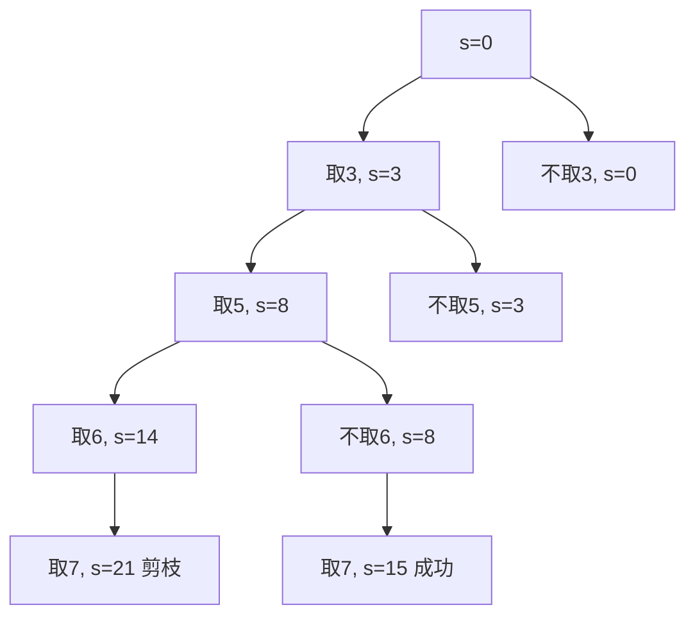

# SPL Run: build_concept_book

- **Adapter:** claude_cli
- **Model:** claude-sonnet-5-5
- **Tokens:** 0 in / 0 out
- **Latency:** 6569ms
- **Timestamp:** 2026-11-24 23:16:59

## Output

```output


---

## 回溯法

**定义。** 回溯法(backtracking)是一种递归搜索策略:每次只为解增加一个分量,在每个决策点依次尝试所有可选项,并对每个选项递归地向下探索。若当前的部分解已经违反约束(或不可能扩展为完整解),就**剪枝**,撤销最近一步选择(即"回溯"),换下一个选项继续。

设部分解为 $x=(x_1,\dots,x_k)$,候选集为 $C(x)$,则通用框架为:

```python
def backtrack(x):
    if is_complete(x):
        record(x); return
    for c in candidates(x):
        if feasible(x, c):      # 剪枝检查
            x.append(c)         # 选择
            backtrack(x)        # 探索
            x.pop()             # 撤销(回溯)
```

"选择 → 探索 → 撤销"三步是回溯法的核心。它本质上是对**解空间树**的深度优先遍历,与暴力枚举的区别在于:一旦某个节点不可行,其整棵子树都被跳过。

**例题:子集和。** 从集合 $\{3,5,6,7\}$ 中选出若干数,使其和为 $15$。

按顺序决定每个数"取"或"不取",记当前和为 $s$:

- 取 3($s=3$)→ 取 5($s=8$)→ 取 6($s=14$)→ 取 7 得 $21>15$,剪枝;不取 7 得 $14\ne15$,失败。回溯到 6。
- 不取 6($s=8$)→ 取 7 得 $15$ ✓。找到解 $\{3,5,7\}$。

因为所有数为正,只要 $s>15$ 就可以立即剪枝,这避免了展开大量子树。


*子集和的解空间树(局部):超过目标值的分支被剪枝,成功分支给出解 $\{3,5,7\}$。*

**问题求解应用:$n$ 皇后。** 在 $n\times n$ 棋盘上放置 $n$ 个皇后,使其互不攻击。逐行放置,第 $r$ 行选择列 $c$,可行条件是:与已放皇后不同列、不同对角线,即对所有 $i<r$,
$$c\ne c_i,\qquad |c-c_i|\ne r-i.$$

```python
def solve(n):
    cols, res = [], 0
    def bt(r):
        nonlocal res
        if r == n: res += 1; return
        for c in range(n):
            if all(c != cols[i] and abs(c-cols[i]) != r-i for i in range(r)):
                cols.append(c); bt(r+1); cols.pop()
    bt(0)
    return res
```

对 $n=8$,朴素枚举需检查 $8^8\approx1.7\times10^7$ 种放法,而回溯法因提前剪枝,只访问约两千多个节点即可找出全部 92 个解。

**复杂度与使用要点。** 最坏情况下回溯仍是指数级,例如子集和为 $O(2^n)$,排列问题为 $O(n!)$;其优势依赖于剪枝的强度。设计时应注意:(1)状态必须能被**完全撤销**;(2)约束检查应尽早进行;(3)合理排序候选项,可更快发现解或更早剪枝。

---

## 递推关系

### 定义

**递推关系**(recurrence relation)用序列中较小下标的项来表示第 $n$ 项,并配以**初始条件**(基例)。一个递推关系要完整地确定序列,必须同时给出两部分:

1. 递推式:$a_n = f(a_{n-1}, a_{n-2}, \dots, a_{n-k})$,对所有 $n \ge k$ 成立;
2. 基例:$a_0, a_1, \dots, a_{k-1}$ 的具体取值。

缺少基例,递推式只描述一族序列;有了基例,序列唯一确定。例如斐波那契数列:
$$F_n = F_{n-1} + F_{n-2},\quad F_0 = 0,\ F_1 = 1.$$

### 例题:解一阶线性递推

求解 $a_n = 2a_{n-1} + 1$,$a_0 = 0$。

**步骤 1:展开前几项。** $a_1 = 1,\ a_2 = 3,\ a_3 = 7,\ a_4 = 15$。

**步骤 2:猜测通式。** 各项比 $2$ 的幂小 $1$,猜 $a_n = 2^n - 1$。

**步骤 3:用数学归纳法验证。**
- 基例:$a_0 = 2^0 - 1 = 0$ ✓。
- 归纳步:设 $a_{n-1} = 2^{n-1} - 1$,则
$$a_n = 2(2^{n-1} - 1) + 1 = 2^n - 1.$$

这就是"汉诺塔"问题中移动 $n$ 个圆盘所需的最少步数。

### 问题求解应用

**(1)二阶常系数齐次递推。** 对 $a_n = c_1 a_{n-1} + c_2 a_{n-2}$,设 $a_n = r^n$,代入得**特征方程**
$$r^2 = c_1 r + c_2.$$
若有两个不同的根 $r_1, r_2$,则通解为 $a_n = A r_1^n + B r_2^n$,系数 $A, B$ 由基例确定。

对斐波那契数列,$r^2 = r + 1$,解得 $r = \frac{1 \pm \sqrt5}{2}$,代入 $F_0 = 0,\ F_1 = 1$ 得比内公式:
$$F_n = \frac{1}{\sqrt5}\left[\left(\frac{1+\sqrt5}{2}\right)^n - \left(\frac{1-\sqrt5}{2}\right)^n\right].$$
所以 $F_n$ 以黄金比例 $\varphi \approx 1.618$ 指数增长。

**(2)分治算法的复杂度。** 归并排序的运行时间满足
$$T(n) = 2T(n/2) + n,\quad T(1) = 1.$$
每层递归的总工作量为 $n$,共有 $\log_2 n$ 层,因此 $T(n) = \Theta(n \log n)$。一般形式 $T(n) = aT(n/b) + f(n)$ 可用**主定理**(Master Theorem)比较 $f(n)$ 与 $n^{\log_b a}$ 的增长速度来求解。

**(3)编程实现。** 直接按定义递归计算 $F_n$ 会重复求解子问题,时间为指数级;加上记忆化,或从基例向上迭代,即可降到 $O(n)$:

```python
def fib(n):
    a, b = 0, 1
    for _ in range(n):
        a, b = b, a + b
    return a
```

### 小结

解递推关系的通用流程是:**写出递推式与基例 → 展开或猜测 → 用归纳或特征方程求闭式 → 检验基例**。遇到分治类问题,先建立 $T(n)$ 的递推式,再分析其渐近增长。

---

## 动态规划

**定义。** 动态规划(Dynamic Programming, DP)是一种解题方法:先写出正确的**递推关系**,再按照精心安排的顺序,**自底向上**地填写各个子问题的解,使每个子问题只计算一次。它适用于具备两个性质的问题:

- **最优子结构**:原问题的最优解由子问题的最优解组合而成;
- **重叠子问题**:不同的分支会反复遇到相同的子问题。

回溯(或朴素递归)会重复求解这些子问题,代价常常是指数级的。DP 用一张表保存已有结果,把代价降为"子问题个数 × 每个子问题的转移代价"。

**设计四步。** (1) 定义状态;(2) 写出递推式;(3) 确定边界条件;(4) 确定填表顺序,使每个状态依赖的项都已先算出。

**例题:爬楼梯的计数。** 每次可走 1 或 2 级台阶,问走到第 $n$ 级共有多少种走法?

设 $f(n)$ 为到达第 $n$ 级的方法数。最后一步要么来自第 $n-1$ 级,要么来自第 $n-2$ 级,所以
$$f(n)=f(n-1)+f(n-2),\qquad f(0)=f(1)=1.$$
朴素递归会反复计算 $f(n-2),f(n-3),\dots$,调用次数约为 $\Theta(\varphi^n)$,其中 $\varphi=\tfrac{1+\sqrt5}{2}$。自底向上填表则按 $i=2,3,\dots,n$ 的顺序计算:

```python
def climb(n):
    f = [1, 1] + [0] * (n - 1)
    for i in range(2, n + 1):
        f[i] = f[i-1] + f[i-2]
    return f[n]
```

时间为 $O(n)$。因为 $f(i)$ 只依赖前两项,空间还可压缩到 $O(1)$。例如 $f(5)=8$。

**问题求解:0-1 背包。** 有 $n$ 件物品,第 $i$ 件重 $w_i$、价值 $v_i$,背包容量为 $W$,每件至多取一次,求最大总价值。

*状态*:$dp[i][c]$ 表示只考虑前 $i$ 件物品、容量为 $c$ 时的最大价值。

*递推*:第 $i$ 件要么不取,要么取(需 $c\ge w_i$):
$$dp[i][c]=\max\bigl(dp[i-1][c],\; dp[i-1][c-w_i]+v_i\bigr),$$
边界为 $dp[0][c]=0$。

*填表顺序*:$i$ 从 $1$ 到 $n$,每行内 $c$ 从 $0$ 到 $W$。第 $i$ 行只依赖第 $i-1$ 行,所以顺序是合法的。

数值演示:三件物品 $(w,v)=(1,1),(3,4),(4,5)$,$W=4$。

| $i\backslash c$ | 0 | 1 | 2 | 3 | 4 |
|---|---|---|---|---|---|
| 0 | 0 | 0 | 0 | 0 | 0 |
| 1 | 0 | 1 | 1 | 1 | 1 |
| 2 | 0 | 1 | 1 | 4 | 5 |
| 3 | 0 | 1 | 1 | 4 | 5 |

答案为 $dp[3][4]=5$,取第 1、2 件物品(重量 4,价值 5)。复杂度为 $O(nW)$,而枚举所有子集需要 $O(2^n)$。

**正确性。** 对 $i$ 做归纳:若 $dp[i-1][\cdot]$ 都正确,则前 $i$ 件的任何最优方案要么不含第 $i$ 件(对应第一项),要么含第 $i$ 件,其余部分必为容量 $c-w_i$ 下前 $i-1$ 件的最优方案(否则可替换得到更优解,矛盾)。因此递推式取到最优值。

**小结。** 用 DP 时先问:最后一步有哪些选择?每种选择后剩下的子问题是什么?再据此定义状态,按依赖顺序填表。

---

## 文本分词(Text Segmentation)

**定义。** 给定字符串 $s = s_0 s_1 \cdots s_{n-1}$ 和词典 $D$(有限的合法单词集合),**文本分词问题**(又称 Word Break)询问:能否把 $s$ 切成若干连续片段 $w_1 w_2 \cdots w_k$,使得每个 $w_i \in D$。

关键观察:若在位置 $i$ 切下第一个单词 $s[0{:}i]\in D$,则剩下的后缀 $s[i{:}]$ 必须自身可分词。这是一个**与原问题同形的子问题**,因此可用递推求解。

令 $f(i)$ 表示后缀 $s[i{:}n]$ 是否可被分词(为真或为假)。则

$$
f(n)=\text{真},\qquad f(i)=\bigvee_{\substack{i<j\le n\\ s[i:j]\in D}} f(j),\quad 0\le i<n.
$$

边界 $f(n)$ 对应空后缀,空串可由零个单词构成。所求答案为 $f(0)$。

**正确性。** 对 $s[i{:}]$ 的任一合法分词,其第一个单词必为某个 $s[i{:}j]\in D$,其余部分是 $s[j{:}]$ 的合法分词,故该分词被递推式中 $j$ 对应的项所覆盖。反之,递推式中任一为真的项都能拼出合法分词。因此递推式既不漏解也不误判。

**例题。** 取 $D=\{\texttt{cat},\texttt{cats},\texttt{and},\texttt{sand},\texttt{dog}\}$,$s=\texttt{catsanddog}$($n=10$)。自右向左计算:

- $f(10)=\text{真}$。
- $f(7)$:$s[7{:}10]=\texttt{dog}\in D$,且 $f(10)$ 为真,故 $f(7)=\text{真}$。
- $f(4)$:$s[4{:}7]=\texttt{and}\in D$,$f(7)$ 为真,故 $f(4)=\text{真}$。
- $f(3)$:$s[3{:}7]=\texttt{sand}\in D$,$f(7)$ 为真,故 $f(3)=\text{真}$。
- $f(0)$:$\texttt{cat}\in D$ 且 $f(3)$ 为真,故 $f(0)=\text{真}$。(用 $\texttt{cats}$ 则对应 $f(4)$,同样为真。)

因此 $\texttt{catsanddog}$ 可分词,例如 $\texttt{cat|sand|dog}$ 与 $\texttt{cats|and|dog}$。若令 $s=\texttt{catsandog}$,则 $f(0)$ 为假,因为没有任何切分能同时覆盖末尾的 $\texttt{og}$。

**问题求解:实现与复杂度。**

```python
def word_break(s, D):
    n = len(s)
    f = [False] * (n + 1)
    f[n] = True
    L = max(map(len, D))           # 最长单词长度
    for i in range(n - 1, -1, -1):
        for j in range(i + 1, min(n, i + L) + 1):
            if s[i:j] in D and f[j]:
                f[i] = True
                break
    return f[0]
```

若不做记忆化,递归会反复计算同一后缀,最坏情况下呈指数级(例如 $s=\texttt{aaaa}\cdots\texttt{b}$,$D=\{\texttt{a},\texttt{aa}\}$)。后缀只有 $n+1$ 种,每个 $f(i)$ 只需计算一次,每次枚举至多 $L$ 个候选终点,每次子串比较花费 $O(L)$,所以总时间为 $O(nL^2)$,空间为 $O(n)$。

**延伸。** 若要还原具体切分,只需记录使 $f(i)$ 为真的 $j$ 并回溯;若要统计切分方案数,把"或"改成求和:$g(i)=\sum_{s[i:j]\in D} g(j)$,$g(n)=1$。同样的后缀递推思想也出现在分词、拼写纠错与语音识别的解码中。

---

## 收获(Payoff)

### 文本分割为何是自然的终点

回顾整本书:我们从字符、词元与序列出发,经过相似度度量、嵌入表示、滑动窗口与动态规划,最终抵达**文本分割**(text segmentation)。其定义可以简洁地表述为:给定长度为 $n$ 的文本单元序列 $x_1,\dots,x_n$,寻找边界集合 $B=\{b_1<b_2<\dots<b_k\}$,使每个片段内部尽可能连贯、相邻片段之间尽可能不同。

常见的目标函数写作

$$
\min_{B}\ \sum_{j=0}^{k}\operatorname{cost}(b_j+1,\,b_{j+1})+\lambda k,
$$

其中 $\operatorname{cost}(i,j)$ 衡量片段 $x_i,\dots,x_j$ 的内部不一致程度,$\lambda k$ 惩罚过多的切分。这个问题可用动态规划在 $O(n^2)$ 时间内精确求解:令 $F(j)=\min_{i\le j}\,[F(i-1)+\operatorname{cost}(i,j)+\lambda]$,逐步回溯即得最优边界。

它之所以是终点,是因为前面每个概念都在此汇合:嵌入给出单元的语义表示,相似度给出 $\operatorname{cost}$,窗口给出局部比较,动态规划给出全局最优。

### worked example(简例)

设六个句子的相邻余弦相似度依次为 $0.82,\ 0.78,\ 0.21,\ 0.80,\ 0.76$。相似度骤降处(第 3 与第 4 句之间,值 $0.21$)是话题转换点。取阈值 $\tau=0.4$,凡相似度低于 $\tau$ 之处即切分,得到 $B=\{3\}$,即两个片段:句 1–3 与句 4–6。若阈值改为 $0.9$,则每处都被切开,片段过碎——这说明 $\tau$(或 $\lambda$)控制着粒度,需要依据下游任务来调节。

### 与各应用领域的联系

本节未列出具体应用清单,下面以最常见的三类场景说明分割如何落地:

- **检索增强生成(RAG)**:检索质量取决于片段是否语义完整。按话题边界切分,比按固定 512 词元切分更少出现"一个片段混杂两个话题"的情况,检索命中更精准。
- **文档摘要与阅读辅助**:先分割、再对每段单独摘要,可以把长文档的问题化为若干短文本问题,并自然产生分层目录。
- **语音与会议转写**:转写文本没有标点与章节标记,分割可恢复话题结构,便于生成会议纪要与时间轴索引。

### 练习式思考

取一篇你熟悉的 2000 字文章,依次尝试固定长度切分与基于相似度的切分。用"每段是否只谈一个话题"作为人工标准比较两者,并记录 $\tau$ 或 $\lambda$ 变化时片段数 $k$ 的变化曲线。

### 邀请

现在请选择一个应用深入探索。若你想要最快见效的实践,建议从 RAG 开始:搭建一个小型问答系统,比较不同分割策略下的回答准确率。你会亲眼看到,本书积累的每一个概念,都在这一道"切口"上发挥作用。
```
