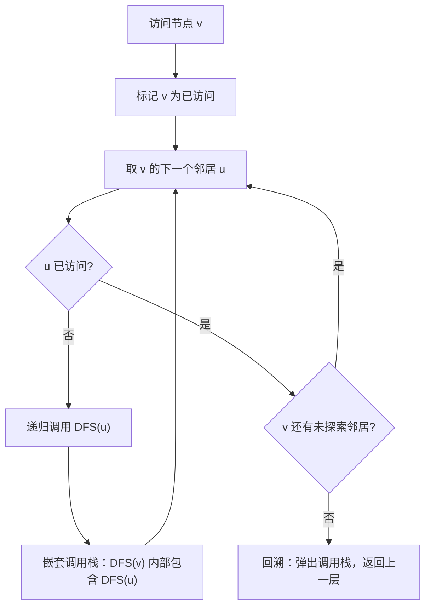
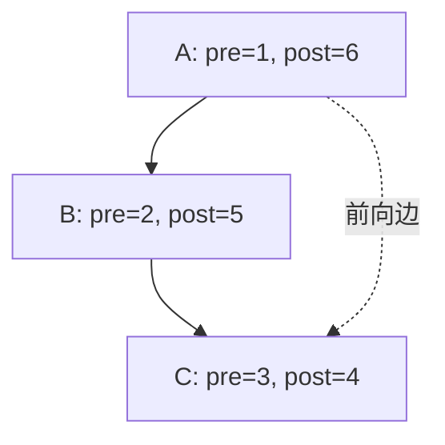
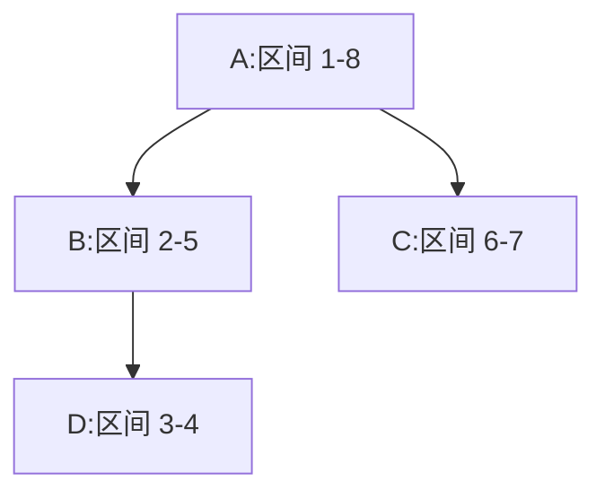
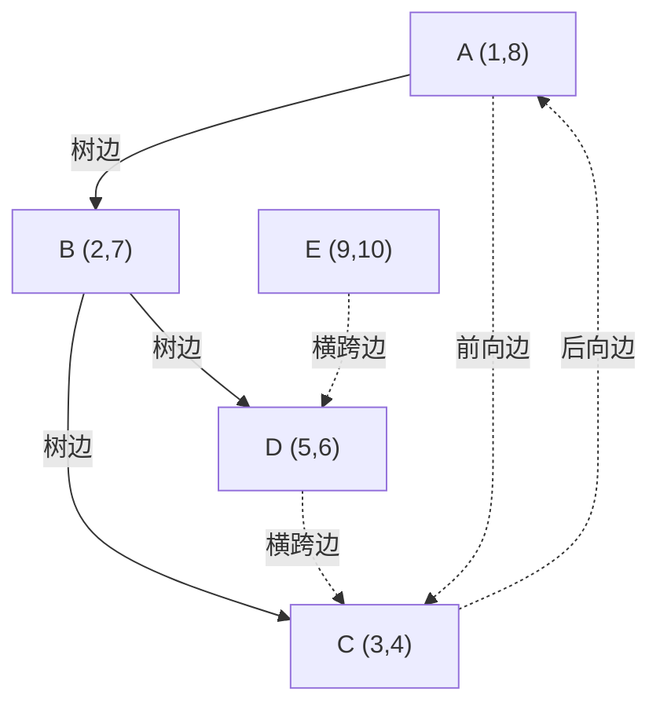
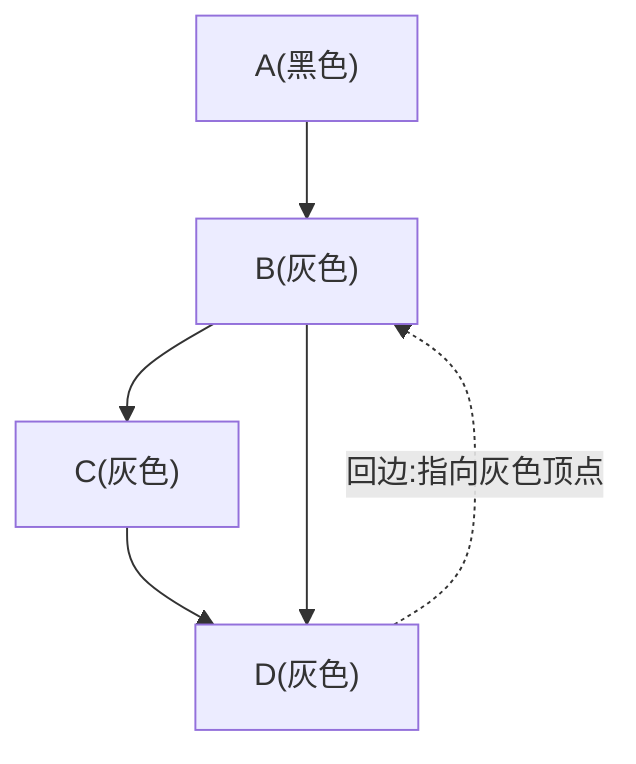

# SPL Run: build_concept_book

- **Adapter:** claude_cli
- **Model:** claude-sonnet-5-5
- **Tokens:** 0 in / 0 out
- **Latency:** 8449ms
- **Timestamp:** 2026-11-24 23:17:27

## Output

```output


---

## Depth First Search

深度优先搜索（Depth First Search，DFS）是一种图遍历算法：从起始节点出发，沿着某一条分支尽可能深入地探索，直到无法继续前进（所有邻居都已访问）为止，再回溯到上一个节点，尝试其他未探索的分支。这种"先深入、后回溯"的策略天然地用递归实现——每次递归调用对应向前探索一步，递归返回则对应回溯一步。算法维护一个 `visited` 集合以避免重复访问同一节点（否则在有环图中会陷入无限递归）。

伪代码如下：

$$
\text{DFS}(v):\quad \text{mark } v \text{ as visited}; \quad \text{for each neighbor } u \text{ of } v: \quad \text{if } u \text{ not visited, call DFS}(u)
$$

**递归调用栈的本质**：DFS 并不显式维护一个栈数据结构（除非用迭代版本实现），而是借助程序运行时自身的调用栈——每次递归调用会把当前节点的"未探索邻居列表"压入调用栈，直到某一层的邻居全部访问完毕，该层才从栈中弹出，控制权交还给上一层调用者。这正是"递归 = 隐式栈"这一编程范式的典型体现。

**复杂度分析**：设图有 $V$ 个顶点、$E$ 条边。每个顶点恰好被访问一次（标记为 visited），每条边最多被检查两次（有向图为一次）。因此时间复杂度为 $O(V + E)$，空间复杂度（递归调用栈深度）在最坏情况下为 $O(V)$（例如一条链状图）。

**问题求解应用**：假设要判断一个无向图是否连通，可以从任意一个顶点开始执行 DFS，遍历结束后检查 `visited` 集合是否覆盖了所有顶点——若是，则图连通。DFS 还是拓扑排序、检测环、寻找连通分量、求解迷宫路径等问题的核心工具：例如在迷宫求解中，节点是格子，边是相邻可通行的格子，DFS 沿一条路径深入，撞墙则回溯，直到找到出口或穷尽所有路径。



*该流程图展示了 DFS 的访问-标记-递归-回溯循环，以及递归调用如何形成嵌套的调用栈结构。*

---

## Preorder Postorder

**定义**

在深度优先搜索（DFS）中，我们维护一个全局计时器 $\text{clock}$，每当发生一次入栈或出栈事件，计时器就递增 $1$。对图或树中的每个顶点 $v$，定义两个时间戳：

$$
\text{pre}(v) = \text{clock 在 } v \text{ 被压入递归栈（即首次访问）时的值}
$$
$$
\text{post}(v) = \text{clock 在 } v \text{ 从递归栈弹出（即所有邻居都已访问完毕）时的值}
$$

由于 DFS 的递归结构，任意两个顶点 $u, v$ 的区间 $[\text{pre}(u), \text{post}(u)]$ 与 $[\text{pre}(v), \text{post}(v)]$ 之间只有两种可能关系：**完全嵌套**（其中一个是另一个的祖先/后代）或**完全不相交**（两者互不为祖先）。这条性质称为“括号定理”（Parenthesis Theorem），是理解 DFS 生成树结构的核心。

**求解示例**

考虑有向图 $A \to B \to C$，$A \to C$。从 $A$ 出发做 DFS：

- 访问 $A$：$\text{pre}(A)=1$
- 访问 $B$：$\text{pre}(B)=2$
- 访问 $C$：$\text{pre}(C)=3$，$C$ 无未访问邻居，弹出：$\text{post}(C)=4$
- $B$ 无其他邻居，弹出：$\text{post}(B)=5$
- $A$ 的邻居 $C$ 已访问，弹出：$\text{post}(A)=6$

区间为 $A:[1,6]$、$B:[2,5]$、$C:[3,4]$，完全嵌套，印证了 $A$ 是 $B$、$C$ 的祖先。

**应用：边分类**

pre/post 时间戳最直接的用途是在 $O(V+E)$ 时间内对 DFS 遍历到的每条边分类，而无需额外遍历：

- **树边/前向边**：$\text{pre}(u) < \text{pre}(v) < \text{post}(v) < \text{post}(u)$
- **反向边**（说明存在环）：$\text{pre}(v) < \text{pre}(u) < \text{post}(u) < \text{post}(v)$
- **横叉边**：区间不相交，$\text{post}(v) < \text{pre}(u)$

这正是判断有向图中是否存在环、以及拓扑排序算法（按 $\text{post}$ 值降序排列顶点）正确性的理论基础。



*图示：DFS 时钟为每个顶点打上 pre/post 时间戳，顶点区间的嵌套关系反映了递归栈的祖先—后代结构。*

---

## 活跃区间(Active Interval)

**定义。** 在对有向图或树 $G$ 做深度优先搜索(DFS)时,每个顶点 $v$ 有两个时间戳:$v.\text{pre}$ 是首次被发现(入栈)的时刻,$v.\text{post}$ 是其全部邻居处理完毕(出栈)的时刻。闭区间
$$I(v)=[v.\text{pre},\ v.\text{post}]$$
称为 $v$ 的**活跃区间**,即 $v$ 停留在递归栈上的时间段。

**核心性质(括号定理)。** 对任意两个顶点 $u,v$,它们的活跃区间只有两种关系:

- 互不相交:$I(u)\cap I(v)=\varnothing$,此时二者在 DFS 森林中没有祖先关系;
- 严格嵌套:例如 $I(v)\subset I(u)$,此时 $v$ 是 $u$ 的后代。

也就是说,$u$ 是 $v$ 的祖先,当且仅当
$$u.\text{pre}<v.\text{pre}<v.\text{post}<u.\text{post}.$$

**为什么成立。** 递归栈是后进先出的。若 $v$ 在 $u$ 仍在栈上时入栈,则 $v$ 必须先于 $u$ 出栈,所以 $I(v)$ 被 $I(u)$ 包住。若 $v$ 在 $u$ 出栈之后才被发现,两区间就不相交。区间不可能只交叉一部分,因为那会违反栈的后进先出顺序。

**例题。** 设有向图的边为 $A\to B,\ A\to C,\ B\to D$,从 $A$ 出发,按字母顺序访问邻居,计时从 1 开始:

| 顶点 | pre | post | 活跃区间 |
|---|---|---|---|
| A | 1 | 8 | [1, 8] |
| B | 2 | 5 | [2, 5] |
| D | 3 | 4 | [3, 4] |
| C | 6 | 7 | [6, 7] |

检查:$[3,4]\subset[2,5]\subset[1,8]$,所以 $D$ 是 $B$ 的后代,$B$ 是 $A$ 的后代。$[2,5]\cap[6,7]=\varnothing$,所以 $B$ 与 $C$ 互不为祖先。


*DFS 树及各顶点的活跃区间:子节点的区间嵌套在父节点区间之内,兄弟节点的区间互不相交。*

**问题求解应用。**

1. **$O(1)$ 祖先查询。** 预处理一次 DFS 后,判断 $u$ 是否为 $v$ 的祖先只需比较两个时间戳,不用沿父指针向上爬。例如查询“$A$ 是 $D$ 的祖先吗?”:$1<3$ 且 $4<8$,答案为是。

2. **边分类。** 对边 $(u,v)$,看 $v$ 被探索时的状态,并比较区间:
   - 树边/前向边:$I(v)\subset I(u)$;
   - 后向边:$I(u)\subset I(v)$,说明存在环;
   - 横跨边:$I(u)$ 与 $I(v)$ 不相交,且 $v.\text{post}<u.\text{pre}$。

3. **环检测。** 有向图有环,当且仅当 DFS 中出现后向边,即某条边指向一个仍然活跃(在栈上)的顶点。

**小结。** 活跃区间把“递归栈上的存在时间”变成两个整数。嵌套意味着祖孙,不相交意味着无亲缘关系,这个结论是拓扑排序、强连通分量和最近公共祖先等算法的基础。

---

## 边分类(Edge Classification)

### 定义

对有向图 $G=(V,E)$ 做深度优先搜索(DFS)时,每个顶点 $v$ 有两个时间戳:发现时间 $d[v]$(变为灰色)与完成时间 $f[v]$(变为黑色)。区间 $[d[v],f[v]]$ 称为 $v$ 的**活动区间**。任意两个顶点的活动区间要么互不相交,要么一个完全包含另一个(括号定理)。

据此,DFS 将每条边 $(u,v)\in E$ 分为四类:

| 类型 | 区间关系 | 探索边 $(u,v)$ 时 $v$ 的颜色 |
|---|---|---|
| 树边 | $v$ 是由 $u$ 首次发现的 | 白色 |
| 后向边 | $[d[u],f[u]]\subset[d[v],f[v]]$($v$ 是 $u$ 的祖先,含自环) | 灰色 |
| 前向边 | $[d[v],f[v]]\subset[d[u],f[u]]$($v$ 是 $u$ 的非子后代) | 黑色,且 $d[u]<d[v]$ |
| 横跨边 | 两区间不相交 | 黑色,且 $d[v]<d[u]$ |

在无向图中,只会出现树边和后向边。

### 例题

图的边为:$A\to B,\ A\to C,\ B\to C,\ C\to A,\ B\to D,\ D\to C,\ E\to D$。从 $A$ 开始 DFS(按字母序访问邻居),再从 $E$ 重启。

- $A$:$d=1$;访问 $B$:$d=2$;$B$ 的邻居 $C$:$d=3$。$C\to A$ 指向灰色顶点,故为**后向边**。$C$ 完成:$f=4$。
- 回到 $B$,边 $B\to C$ 在 $C$ 被发现时即为树边。接着 $B\to D$:$D$ 为白色,$d=5$,树边。$D\to C$ 指向黑色的 $C$,且 $d[C]<d[D]$,是**前向边的反例**——因 $C$ 不是 $D$ 的后代,而是先于 $D$ 完成的兄弟分支,实际上 $C$ 的区间 $[3,4]$ 与 $D$ 的区间 $[5,6]$ 不相交且 $d[C]<d[D]$,所以是**横跨边**。
- $D$ 完成 $f=6$,$B$ 完成 $f=7$,$A$ 的边 $A\to C$:$C$ 已是黑色,$[3,4]\subset[1,8]$ 且 $C$ 是 $A$ 的非子后代,故为**前向边**;$A$ 完成 $f=8$。
- 重启 $E$:$d=9$,$E\to D$ 指向黑色且 $d[D]<d[E]$,区间不相交,为**横跨边**;$f[E]=10$。

(注:$B\to C$ 在上面按顺序已被作为树边处理,$A\to B$ 同为树边。)

### 问题求解应用

**判断有向图是否有环。** 有向图 $G$ 无环,当且仅当 DFS 不产生后向边。

*证明要点*:若存在后向边 $(u,v)$,则 $v$ 是 $u$ 的祖先,树路径 $v\leadsto u$ 加上 $(u,v)$ 构成环。反之,设存在环,令 $v$ 为环上第一个被发现的顶点,环上前驱为 $u$。发现 $v$ 时,环上其余顶点均为白色,由白色路径定理它们都成为 $v$ 的后代,故 $(u,v)$ 连接后代与祖先,是后向边。

在上例中 $C\to A$ 是后向边,印证了环 $A\to B\to C\to A$ 的存在。

**拓扑排序**:无后向边时,所有边满足 $f[u]>f[v]$,因此按完成时间递减排列即得拓扑序。可用此判据区分边类型:后向边满足 $f[u]<f[v]$,其余三类满足 $f[u]>f[v]$。


*图中标注 (d, f) 时间戳:实线为树边,虚线为非树边,展示四类边在同一次 DFS 中的分布。*

**小结**:边分类只需在 DFS 中检查目标顶点的颜色与时间戳,复杂度仍为 $O(V+E)$,却能同时回答"是否有环"与"能否拓扑排序"等问题。

---

## 环路检测(Cycle Detection)

**定义。** 设有向图 $G=(V,E)$。若存在顶点序列 $v_0\to v_1\to\cdots\to v_k=v_0$($k\ge 1$),则称 $G$ 含有**环**;不含环的有向图称为**有向无环图**(DAG)。环路检测就是判定 $G$ 是否为 DAG。拓扑排序、任务调度、模块依赖解析都以此为前提:依赖若成环,就没有合法的执行顺序。

**算法思想。** 在深度优先搜索(DFS)中给每个顶点三种颜色:

- 白色:尚未访问;
- 灰色:已访问但仍"活跃",即位于当前递归栈上(其后代尚未处理完);
- 黑色:自身及所有后代均已处理完毕。

**判据:** DFS 过程中,若某条边 $u\to v$ 的终点 $v$ 是灰色,则该边为**回边**,图中必有环;反之,若整个 DFS 都没有遇到指向灰色顶点的边,则图无环。

**为什么正确。** 若 $v$ 为灰色,则 $v$ 在递归栈上,说明存在 $v\leadsto u$ 的路径(栈中从 $v$ 到 $u$ 的部分)。再加上边 $u\to v$,就构成环。反过来,若图中有环 $C$,设其中第一个被发现的顶点为 $x$。此刻环上其他顶点都是白色,由白色路径定理,它们都会成为 $x$ 的后代。于是环上指向 $x$ 的那条边 $y\to x$ 被检查时,$x$ 仍是灰色,算法必能发现它。

**伪代码。**

```python
def has_cycle(graph):
    WHITE, GRAY, BLACK = 0, 1, 2
    color = {v: WHITE for v in graph}

    def dfs(u):
        color[u] = GRAY
        for v in graph[u]:
            if color[v] == GRAY:          # 指向活跃顶点:回边
                return True
            if color[v] == WHITE and dfs(v):
                return True
        color[u] = BLACK
        return False

    return any(color[v] == WHITE and dfs(v) for v in graph)
```

**例题。** 图 $G$:$A\to B,\ B\to C,\ C\to D,\ B\to D,\ D\to B$。

从 $A$ 出发:$A$ 变灰 → 访问 $B$(灰)→ 访问 $C$(灰)→ 访问 $D$(灰)。检查 $D$ 的出边 $D\to B$:$B$ 是灰色,发现回边,返回"有环"。环为 $B\to C\to D\to B$。

注意**黑色**顶点不算:若把 $D\to B$ 换成 $A\to D$,当 $D$ 已变黑后再检查 $A\to D$,这只是前向边或横向边,不构成环。仅仅"访问过"并不等于"有环"。

**应用:任务调度。** 课程先修关系:$M\to P,\ P\to Q,\ Q\to M$(微积分→概率→统计→又要求先修微积分)。DFS 从 $M$ 开始,经 $P$、$Q$ 后遇到 $Q\to M$,而 $M$ 为灰色,所以先修关系自相矛盾,没有可行的修课顺序。在构建工作流或包依赖图时,可在加载阶段先跑一遍该检测,把"死锁式"配置提前拦截。若需要报告具体的环,可用 `parent` 数组或显式栈,在发现回边时从 $u$ 回溯到 $v$。

**复杂度。** 每个顶点和每条边各被处理一次,时间为 $O(|V|+|E|)$,空间为 $O(|V|)$(颜色数组加递归栈)。


*图示:从 $A$ 出发的 DFS 到达 $D$ 时,边 $D\to B$ 指向仍在递归栈上的灰色顶点 $B$,这条虚线回边即为环 $B\to C\to D\to B$ 的证据。*

---

## 收获

本书从"一个状态反复出现意味着什么"这个问题出发,最终落到环检测(cycle detection)上。环检测解决的问题是:在一个由状态转移构成的系统中,不必存储完整历史,就能判定执行是否会进入无限循环,并找出环的位置与长度。它是本书的自然终点,因为前面各章的每个概念都在为它做准备:有限状态空间、迭代函数、抽屉原理和空间与时间的取舍。

### 定义与核心结论

设 $f: S \to S$ 是有限集 $S$ 上的函数,序列 $x_{i+1} = f(x_i)$ 由初值 $x_0$ 生成。由于 $|S|$ 有限,根据抽屉原理,必存在 $i < j$ 使 $x_i = x_j$。令 $\mu$ 为进入环之前的步数(尾长),$\lambda$ 为环长,则对所有 $i \ge \mu$ 有 $x_i = x_{i+\lambda}$。

Floyd 的龟兔算法只需 $O(1)$ 额外空间:龟每步走一格,兔每步走两格。因为两者最终都进入环内,兔每步比龟多前进一格,所以相对距离每步增加 $1$。当相对距离是 $\lambda$ 的倍数时两者相遇,时间为 $O(\mu+\lambda)$。

### 工作示例

取 $f(x) = (x^2+1) \bmod 11$,$x_0 = 2$。序列为 $2, 5, 4, 6, 4, 6, \dots$。因此 $\mu = 2$,$\lambda = 2$。龟兔的位置依次为 $(x_1,x_2)=(5,4)$,$(x_2,x_4)=(4,4)$,在第 $2$ 步相遇。相遇时龟在 $x_2$,恰好是环内的点。

找到相遇点后,把龟放回 $x_0$,两者都改为每步一格,再次相遇的位置就是环的入口,所需步数为 $\mu$。再让一个指针绕环一圈,回到原处所需步数就是 $\lambda$。这个结论来自相遇时 $2k = k + m\lambda$,故 $k = m\lambda$,而 $k \ge \mu$ 时 $x_k$ 与 $x_{k+\mu}$ 重合,所以入口恰在 $\mu$ 步之后。

### 应用领域

题目没有列出具体的应用领域,所以这里按环检测最常见的场景说明它的用法:

- **链表与数据结构:** 检测链表是否成环,避免遍历时死循环。
- **伪随机数生成器:** 估计周期 $\lambda$,判断生成器质量。
- **整数分解:** Pollard $\rho$ 算法用环检测在 $O(\sqrt{p})$ 期望步内找到因子 $p$。
- **工作流与程序分析:** 在 SPL 这类工作流语言中,检测 `WHILE` 或 `CALL` 是否会反复回到同一状态,从而防止无限递归。
- **依赖图:** 在有向图中检测循环依赖,这是拓扑排序能否进行的前提。

### 练习与邀请

试着取 $f(x) = (5x+3) \bmod 16$,$x_0 = 1$,手算 $\mu$ 与 $\lambda$,并检验相遇点是否满足 $k = m\lambda$。然后选一个应用深入下去。我们建议从 Pollard $\rho$ 开始:它把本章的算法放进数论,能让你看到一个看似简单的技巧如何分解大整数。
```
