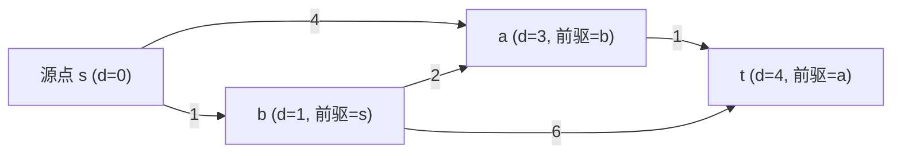
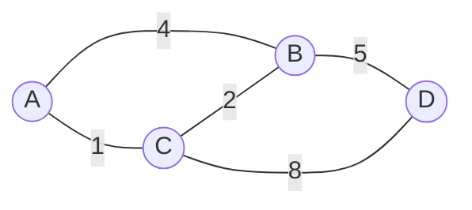
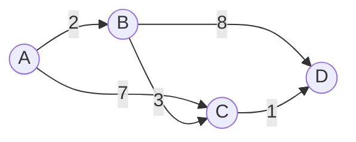
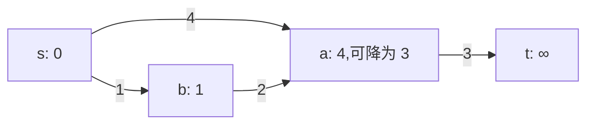
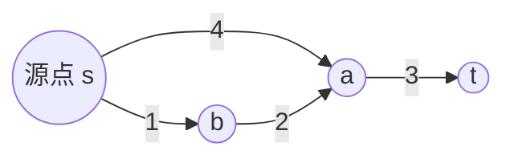
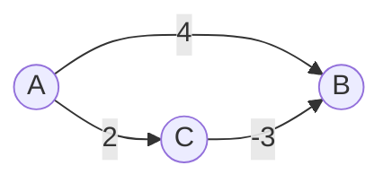
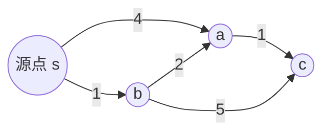
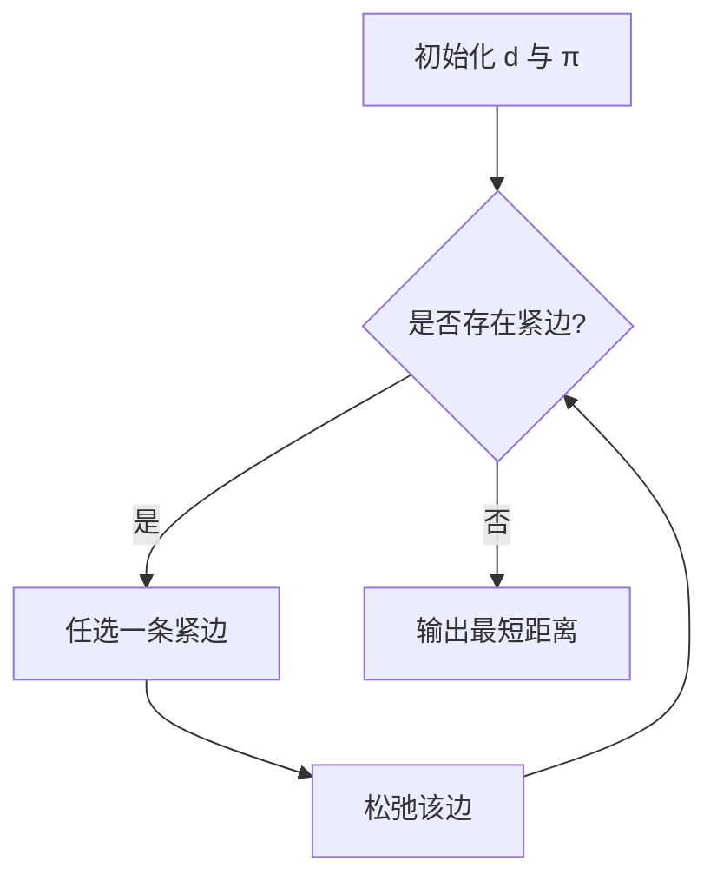

# SPL Run: build_concept_book

- **Adapter:** claude_cli
- **Model:** claude-sonnet-5-5
- **Tokens:** 0 in / 0 out
- **Latency:** 17610ms
- **Timestamp:** 2026-11-24 23:18:05

## Output

```output


---

## 距离与前驱标签

**定义。** 在单源最短路径算法(如 Dijkstra、Bellman-Ford)中,算法并不一次性得到答案,而是为每个顶点 $v$ 维护两个随时可被更新的变量:

- **距离标签** $d[v]$:从源点 $s$ 到 $v$ 目前已发现的最短路径长度的**上界**(估计值);
- **前驱标签** $\pi[v]$:这条当前最优路径上 $v$ 的前一个顶点。

初始化为
$$d[s]=0,\qquad d[v]=\infty\ (v\ne s),\qquad \pi[v]=\text{NIL}.$$

算法的核心操作是**松弛**(relaxation)。对边 $(u,v)$,权重为 $w(u,v)$,若
$$d[u]+w(u,v)<d[v],$$
则令 $d[v]\leftarrow d[u]+w(u,v)$,$\pi[v]\leftarrow u$。距离标签只会减小,且始终满足 $d[v]\ge\delta(s,v)$,其中 $\delta(s,v)$ 是真实最短距离。算法结束时 $d[v]=\delta(s,v)$,并且沿 $\pi$ 反向回溯即可还原路径。

**例题。** 图中有边:$s\to a$(4),$s\to b$(1),$b\to a$(2),$a\to t$(1),$b\to t$(6)。

| 步骤 | $d[s]$ | $d[a]$ | $d[b]$ | $d[t]$ | $\pi[a]$ | $\pi[b]$ | $\pi[t]$ |
|---|---|---|---|---|---|---|---|
| 初始 | 0 | $\infty$ | $\infty$ | $\infty$ | NIL | NIL | NIL |
| 松弛 $s\to a$, $s\to b$ | 0 | 4 | 1 | $\infty$ | $s$ | $s$ | NIL |
| 松弛 $b\to a$ | 0 | 3 | 1 | $\infty$ | $b$ | $s$ | NIL |
| 松弛 $b\to t$ | 0 | 3 | 1 | 7 | $b$ | $s$ | $b$ |
| 松弛 $a\to t$ | 0 | 3 | 1 | 4 | $b$ | $s$ | $a$ |

在第三行中,$d[b]+w(b,a)=1+2=3<4$,所以 $a$ 的距离与前驱同时被改写。注意:$d$ 与 $\pi$ **总是成对更新**,否则距离与路径会不一致。


*最终标签状态:沿前驱指针 $t\to a\to b\to s$ 反向回溯,得到最短路径 $s\to b\to a\to t$,长度为 4。*

**问题求解应用。** 求 $t$ 的最短路径时,分两步:

1. 读取 $d[t]=4$,即最短路径长度;
2. 从 $t$ 出发反复取 $\pi$:$t\to\pi[t]=a\to\pi[a]=b\to\pi[b]=s$,反转后得到路径 $s,b,a,t$。

这也是检验结果的方法:路径上各边权重之和必须等于 $d[t]$,即 $1+2+1=4$ ✓。若不相等,说明某次松弛漏更新了 $\pi$ 或 $d$。

**为何正确。** 松弛保证 $d[v]$ 永远不小于真实距离(上界性质),而每个顶点的 $\pi$ 指向使其 $d$ 值被最后一次改进的顶点。算法终止后,所有边都满足 $d[v]\le d[u]+w(u,v)$,于是 $d[v]=\delta(s,v)$,前驱指针构成以 $s$ 为根的**最短路径树**。每个顶点只需存储一个前驱,就能用 $O(|V|)$ 空间表示全部最短路径,而不必为每个目标顶点单独保存整条路径。

**练习。** 若把边 $b\to a$ 的权重改为 5,各顶点的最终 $d$ 与 $\pi$ 是什么?(答案:$d[a]=4,\pi[a]=s$;$d[t]=5,\pi[t]=a$。)

---

## 边权(Edge Weight)

**定义。** 在图 $G=(V,E)$ 中,**边权**是由函数 $w: E \to \mathbb{R}$ 赋予每条边 $e=(u,v)$ 的一个数值 $w(e)$,可表示距离、费用、时间、容量损耗等。带有边权的图称为**加权图**。对一条路径 $P = (v_0, v_1, \dots, v_k)$,其**路径权重**(总代价)为沿途各边权之和:

$$
w(P)=\sum_{i=0}^{k-1} w(v_i, v_{i+1}).
$$

注意:路径的"边数"与"权重"是两个不同的量。边数最少的路径未必权重最小。

**例题。** 设城市图有边:$A\!-\!B$ 权 $4$,$A\!-\!C$ 权 $1$,$C\!-\!B$ 权 $2$,$B\!-\!D$ 权 $5$,$C\!-\!D$ 权 $8$。求 $A$ 到 $D$ 的最小权重路径。

枚举:

- $A\to B\to D$:$4+5=9$(2 条边)
- $A\to C\to D$:$1+8=9$(2 条边)
- $A\to C\to B\to D$:$1+2+5=8$(3 条边)

最优路径是边数最多的 $A\to C\to B\to D$,总权重 $8$。若把所有边权都当作 $1$(即只数边数),会错误地认为最优路径只有 2 条边。


*示例加权图:边上的数字即边权,最优路径 A→C→B→D 的总权重为 8。*

**问题求解应用。** 边权的符号与性质决定了应选用的算法:

1. **非负权重**:Dijkstra 算法适用。其正确性依赖于"加入更多边不会使路径变短",即 $w(e)\ge 0$。
2. **含负权边**(如套利中的收益、能量释放):需使用 Bellman–Ford 算法,它还能检测**负权环**——若存在可达的负权环,则最短路径无下界。
3. **乘性量转加性**:若边表示独立概率 $p_e$(如链路可靠性),要最大化路径总可靠性 $\prod p_e$,令 $w(e)=-\ln p_e$。因为
$$
-\ln\prod_i p_i=\sum_i\bigl(-\ln p_i\bigr),
$$
最大化乘积等价于最小化权重和,从而可直接套用最短路径算法。

**练习。** 三条链路的可靠性依次为 $0.9,\,0.8,\,0.5$,求这条路径的总可靠性及其对应的路径权重。
答案:总可靠性 $0.9\times0.8\times0.5=0.36$;路径权重 $-\ln 0.36\approx 1.02$。

**要点。** 建模时先问:"我要沿路径累加的是什么量?"把它定为边权,再按权重是否非负、是否可加来选择算法。

---

## 最短路径

**定义。** 设带权图 $G=(V,E,w)$,其中 $w:E\to\mathbb{R}$ 为边权。从顶点 $s$ 到顶点 $t$ 的一条路径 $P=(s=v_0,v_1,\dots,v_k=t)$ 的**长度**(权重)为

$$w(P)=\sum_{i=1}^{k} w(v_{i-1},v_i).$$

**最短路径**是所有 $s\to t$ 路径中 $w(P)$ 最小的那条,其权重记为最短距离 $\delta(s,t)=\min_P w(P)$。若 $t$ 不可达,则 $\delta(s,t)=\infty$。注意:"最短"指总权重最小,而不是经过的边数最少(后者是无权图的特例)。

**关键性质(最优子结构)。** 若 $s\to\dots\to u\to\dots\to t$ 是最短路径,则其中任一子路径也是相应两端点间的最短路径。由此得到**三角不等式**:对任意边 $(u,v)$,

$$\delta(s,v)\le \delta(s,u)+w(u,v).$$

这正是"松弛"操作的依据:若发现 $d[u]+w(u,v)<d[v]$,就更新 $d[v]\leftarrow d[u]+w(u,v)$。


*示例图:从 A 到 D 有多条路径,边上数字为权重。*

**例题。** 求上图中从 $A$ 到 $D$ 的最短路径。

枚举所有路径:
- $A\to B\to D$:$2+8=10$
- $A\to C\to D$:$7+1=8$
- $A\to B\to C\to D$:$2+3+1=6$

故最短路径为 $A\to B\to C\to D$,$\delta(A,D)=6$。注意:直接边数最少的路径并非最优。

用 Dijkstra 算法(要求 $w\ge0$)验证:初始 $d[A]=0$,其余为 $\infty$。
1. 取出 $A$:$d[B]=2,\ d[C]=7$。
2. 取出 $B$($d=2$):$d[C]=\min(7,2+3)=5$,$d[D]=10$。
3. 取出 $C$($d=5$):$d[D]=\min(10,5+1)=6$。
4. 取出 $D$:结束,$d[D]=6$。

**问题求解应用。** 选择算法时先看图的性质:

| 情形 | 算法 | 时间复杂度 |
|---|---|---|
| 无权图 | BFS | $O(V+E)$ |
| 非负权重 | Dijkstra(二叉堆) | $O((V+E)\log V)$ |
| 含负权边 | Bellman–Ford | $O(VE)$ |
| 所有点对 | Floyd–Warshall | $O(V^3)$ |

```python
import heapq
def dijkstra(G, s):
    d = {v: float("inf") for v in G}; d[s] = 0
    pq = [(0, s)]
    while pq:
        du, u = heapq.heappop(pq)
        if du > d[u]: continue
        for v, w in G[u]:
            if du + w < d[v]:
                d[v] = du + w
                heapq.heappush(pq, (d[v], v))
    return d
```

**为何 Dijkstra 要求非负权重?** 当 $w\ge0$ 时,一个顶点一旦以最小的 $d$ 被取出,后续路径只会增加长度,不可能再改进它,因此其距离已最终确定。若存在负边,这一论证失效。若图中存在总权重为负的环,则 $\delta$ 无下界,最短路径无定义,Bellman–Ford 可检测这种情形。

典型应用包括地图导航(边权为时间或距离)、网络路由(边权为延迟)以及状态空间搜索。将实际问题建模为带权图,是应用该概念的第一步。

---

## 松弛边(Tense Edge)

**定义。** 在带权有向图 $G=(V,E)$ 中,设 $\text{dist}(v)$ 表示算法当前对源点 $s$ 到顶点 $v$ 的最短距离的**暂定估计**(初始时 $\text{dist}(s)=0$,其余为 $\infty$)。若边 $uv$ 满足

$$\text{dist}(u) + w(uv) < \text{dist}(v),$$

则称 $uv$ 为**松弛边**(tense edge)。它说明:经过 $u$ 再走边 $uv$ 到达 $v$,比目前已知的任何路径都更短,所以 $\text{dist}(v)$ 还不是最优的。

对松弛边执行**松弛操作**(relaxation),即令

$$\text{dist}(v) \leftarrow \text{dist}(u) + w(uv),$$

之后该边不再松弛,此时 $\text{dist}(u)+w(uv)=\text{dist}(v)$。

**最优性判据。** 对所有 $v$,$\text{dist}(v)$ 都是 $s$ 到 $v$ 的真实最短距离,当且仅当:$\text{dist}(s)=0$,每个 $\text{dist}(v)$ 都对应一条真实存在的路径,且图中**不存在任何松弛边**。因此,Dijkstra、Bellman–Ford 等算法本质上都在不断寻找并消除松弛边。

**例题。** 图中有边 $s\to a$(权 4)、$s\to b$(权 1)、$b\to a$(权 2)、$a\to t$(权 3)。初始 $\text{dist}(s)=0$,其余为 $\infty$。

1. 检查 $sb$:$0+1<\infty$,是松弛边,更新 $\text{dist}(b)=1$。
2. 检查 $sa$:$0+4<\infty$,更新 $\text{dist}(a)=4$。
3. 检查 $ba$:$1+2=3<4$,是松弛边,更新 $\text{dist}(a)=3$。
4. 检查 $at$:$3+3=6<\infty$,更新 $\text{dist}(t)=6$。

此时再检查所有边:$sb$($0+1=1$)、$sa$($0+4=4>3$)、$ba$($1+2=3$)、$at$($3+3=6$),没有任何一条满足严格小于,图中已无松弛边,故 $\text{dist}(t)=6$ 是最短距离。


*边 $ba$ 是松弛边:$1+2<4$,所以 $a$ 的暂定距离应从 4 降为 3。*

**问题求解应用。** 松弛边既是"错误的证据",也是"改进的线索"。

- **检验答案。** 给定一组声称的最短距离,只需扫描全部 $|E|$ 条边。若发现一条松弛边,这组答案必定不是最优的,时间为 $O(|E|)$。
- **检测负环。** Bellman–Ford 算法对所有边做 $|V|-1$ 轮松弛。若之后仍存在松弛边,则图中有从 $s$ 可达的负权环。因为无负环时,最短路径至多含 $|V|-1$ 条边,$|V|-1$ 轮后必已收敛。
- **设计算法。** 不同算法的区别只在于**选择松弛边的顺序**:Dijkstra 总是从暂定距离最小的顶点出发松弛(要求权重非负),每条边只松弛一次;Bellman–Ford 则不加挑选地反复扫描所有边。

**练习。** 若 $\text{dist}(u)=5$,$w(uv)=2$,$\text{dist}(v)=7$,$uv$ 是松弛边吗?(答:不是,因为 $5+2=7$ 不满足严格小于。)

---

## 边松弛(Edge Relaxation)

**定义。** 在带权有向图 $G=(V,E,w)$ 中,最短路算法为每个顶点 $v$ 维护两个量:当前已知的最短路径长度估计 $\mathrm{dist}(v)$(初始为 $\infty$,源点 $s$ 为 $0$),以及该路径上 $v$ 的前驱 $\mathrm{pred}(v)$。对边 $uv$,若
$$
\mathrm{dist}(u)+w(u,v)<\mathrm{dist}(v),
$$
则称 $uv$ 是**紧张边(tense edge)**,因为经过 $u$ 到达 $v$ 比当前记录的路径更短。**松弛**操作就是利用这条紧张边改进估计:

```
RELAX(u, v):
    if dist(u) + w(u,v) < dist(v):
        dist(v) ← dist(u) + w(u,v)
        pred(v) ← u
```

若 $uv$ 不紧张,则什么也不做。松弛只会使 $\mathrm{dist}(v)$ 减小,且 $\mathrm{dist}(v)$ 始终是某条真实路径的长度,因此它永远满足上界性质 $\mathrm{dist}(v)\ge\delta(s,v)$,其中 $\delta(s,v)$ 是真实最短距离。

**例题。** 设源点 $s$,边权为 $w(s,a)=4,\ w(s,b)=1,\ w(b,a)=2,\ w(a,t)=3$。初始 $\mathrm{dist}(s)=0$,其余为 $\infty$。

1. 松弛 $sa$:$0+4<\infty$,故 $\mathrm{dist}(a)=4,\ \mathrm{pred}(a)=s$。
2. 松弛 $sb$:$\mathrm{dist}(b)=1,\ \mathrm{pred}(b)=s$。
3. 松弛 $ba$:$1+2=3<4$,边紧张,故 $\mathrm{dist}(a)=3,\ \mathrm{pred}(a)=b$。
4. 松弛 $at$:$3+3=6<\infty$,故 $\mathrm{dist}(t)=6,\ \mathrm{pred}(t)=a$。

沿 $\mathrm{pred}$ 回溯 $t\to a\to b\to s$,得到最短路径 $s\to b\to a\to t$,长度为 $6$。注意第 1 步得到的 $\mathrm{dist}(a)=4$ 只是暂时的估计,第 3 步将其改进。


*示例图:边 $ba$ 在 $\mathrm{dist}(a)=4$ 时是紧张边,松弛后 $a$ 的估计降为 $3$。*

**问题求解应用。** 松弛是各类最短路算法共用的基本操作,算法之间的差别只在于松弛的**顺序**:

- **Bellman–Ford**:重复 $|V|-1$ 轮,每轮对所有边松弛一次,可处理负权边,时间 $O(|V||E|)$。若之后仍存在紧张边,说明图中有从 $s$ 可达的负权环。
- **Dijkstra**:每次取出 $\mathrm{dist}$ 最小的未确定顶点 $u$,只松弛 $u$ 的出边,要求边权非负。使用二叉堆时为 $O((|V|+|E|)\log|V|)$。
- **DAG 最短路**:按拓扑序处理顶点并松弛其出边,每条边恰好松弛一次,时间 $O(|V|+|E|)$。

**路径松弛性质**:若 $s=v_0\to v_1\to\cdots\to v_k=v$ 是一条最短路径,且松弛操作按 $v_0v_1,\ v_1v_2,\ \dots,\ v_{k-1}v_k$ 的相对顺序发生(中间可穿插其他松弛),则最终 $\mathrm{dist}(v)=\delta(s,v)$。这说明了 Bellman–Ford 为何 $|V|-1$ 轮就够:最短路径至多含 $|V|-1$ 条边,每一轮至少推进路径上的一条边。

**练习。** 在上例中把 $w(b,a)$ 改为 $-5$。依次松弛 $sa,\ sb,\ ba,\ at$,求最终的 $\mathrm{dist}(t)$ 与 $\mathrm{pred}$ 链。(答案:$\mathrm{dist}(a)=-4$,$\mathrm{dist}(t)=-1$,路径仍为 $s\to b\to a\to t$。)

---

## 负边权

**定义。** 在加权有向图 $G=(V,E)$ 中,若某条边 $(u,v)$ 的权重 $w(u,v)<0$,就称它为**负边权**。权重通常表示"代价",负权则表示这一步转移*带来收益*,例如套利交易中的获利、化学反应中释放的能量,或工作流中某个步骤抵消了前面的开销。路径 $P=(v_0,v_1,\dots,v_k)$ 的总权重为

$$w(P)=\sum_{i=0}^{k-1} w(v_i,v_{i+1}).$$

最短路径问题就是求使 $w(P)$ 最小的路径。

**为什么需要特别对待。** Dijkstra 算法依赖一个前提:一旦某个顶点被"确定",其距离就不会再减小。负边权会破坏这个前提,因为后面的负边可能让已确定的距离继续变小。因此含负边权的图应使用 Bellman–Ford 算法,它对所有边反复松弛:

$$d[v]\leftarrow \min\bigl(d[v],\; d[u]+w(u,v)\bigr),$$

共进行 $|V|-1$ 轮,时间复杂度为 $O(|V|\cdot|E|)$。

**负环。** 若图中存在总权重为负的回路,则可以无限绕行使总权重趋于 $-\infty$,此时最短路径没有定义。Bellman–Ford 在第 $|V|$ 轮若仍有边可以松弛,就说明存在可达的负环。

**例题。** 考虑边 $A\to B$ 权重 $4$,$A\to C$ 权重 $2$,$C\to B$ 权重 $-3$,求 $A$ 到 $B$ 的最短路径。

直接走 $A\to B$ 的代价是 $4$;经过 $C$ 的代价是 $2+(-3)=-1$。所以最短距离为 $-1$。Dijkstra 会先以距离 $4$ 确定 $B$(因为 $4>2$ 时先处理 $C$ 其实可行,但在更复杂的图中顺序出错就会得到错误结果),而 Bellman–Ford 总能正确处理。


*图:从 $A$ 到 $B$ 的两条路径,经过 $C$ 的路径因负边权而总代价更低(−1)。*

**问题求解应用。** 设汇率图中,边权取 $-\ln(\text{汇率})$。一条货币兑换回路的汇率乘积大于 $1$,等价于

$$\sum -\ln r_i<0,$$

即图中存在负环。于是"是否存在套利机会"就转化为"是否存在负环",可用 Bellman–Ford 检测。

**解题步骤小结:**
1. 判断图中是否有负边;若有,不要使用 Dijkstra。
2. 用 Bellman–Ford 执行 $|V|-1$ 轮松弛。
3. 再多做一轮:若仍有距离变小,则存在负环,最短路径无定义;否则 $d[\cdot]$ 即为最终结果。

**要点:** 负边权本身并不可怕,真正的危险是负环。理解这一区别,是正确选择最短路径算法的关键。

---

## 单源最短路径问题

**定义。** 设有向加权图 $G=(V,E)$,权重函数 $w:E\to\mathbb{R}$,并指定一个源点 $s\in V$。路径 $p=\langle v_0,v_1,\dots,v_k\rangle$ 的权重为
$$w(p)=\sum_{i=1}^{k} w(v_{i-1},v_i).$$
从 $s$ 到 $v$ 的**最短路径权重**定义为
$$\delta(s,v)=\begin{cases}\min\{w(p): s\overset{p}{\leadsto}v\} & \text{若 } v \text{ 可从 } s \text{ 到达},\\ +\infty & \text{否则。}\end{cases}$$
**单源最短路径(SSSP)问题**要求:对每个 $v\in V$,求出 $\delta(s,v)$,并给出一条实现它的路径。若 $s$ 可到达某个权重和为负的环,则相关的 $\delta(s,v)=-\infty$,最短路径没有良好定义。

**关键性质:最优子结构。** 若 $p=\langle s,\dots,u,\dots,v\rangle$ 是最短路径,则其任一子路径(如 $s\leadsto u$)也是最短路径。因此全部最短路径可以用一棵以 $s$ 为根的**最短路径树**来存储:对每个顶点只需记录前驱 $\pi[v]$。

**松弛(relaxation)。** 维护估计值 $d[v]\ge\delta(s,v)$,初始 $d[s]=0$,其余为 $+\infty$。对边 $(u,v)$ 的松弛操作为:若 $d[u]+w(u,v)<d[v]$,则令 $d[v]\leftarrow d[u]+w(u,v)$,$\pi[v]\leftarrow u$。各种 SSSP 算法的差别,仅在于松弛的顺序不同。

**例题。** 设顶点为 $s,a,b,c$,边权为 $s\to a:4$,$s\to b:1$,$b\to a:2$,$a\to c:1$,$b\to c:5$。

初始:$d=(s{:}0,\ a{:}\infty,\ b{:}\infty,\ c{:}\infty)$。
1. 松弛 $s\to a$、$s\to b$:$d[a]=4$,$d[b]=1$。
2. 松弛 $b\to a$:$1+2=3<4$,所以 $d[a]=3$,$\pi[a]=b$。
3. 松弛 $b\to c$:$d[c]=6$;再松弛 $a\to c$:$3+1=4<6$,所以 $d[c]=4$,$\pi[c]=a$。

结果:$\delta(s,a)=3$,$\delta(s,b)=1$,$\delta(s,c)=4$。沿 $\pi$ 回溯得到 $c$ 的最短路径 $s\to b\to a\to c$。注意:直接边 $s\to a$ 并非最优。

**问题求解:如何选择算法。** 先判断图的特征,再选择方法:

| 图的特征 | 算法 | 时间复杂度 |
|---|---|---|
| 所有 $w\ge 0$ | Dijkstra(二叉堆) | $O((V+E)\log V)$ |
| 允许负权,需检测负环 | Bellman–Ford | $O(VE)$ |
| 有向无环图(DAG) | 按拓扑序松弛 | $O(V+E)$ |
| 无权图 | 广度优先搜索 | $O(V+E)$ |

例如,路由网络中的延迟都是非负的,应选 Dijkstra;金融套利中取对数后的汇率权重可能为负,需要 Bellman–Ford 来检测负环(即套利机会)。


*例题中的图:最短路径树由边 $s\to b$、$b\to a$、$a\to c$ 构成。*

**小结。** SSSP 问题的核心是:维护距离估计、用松弛逐步逼近 $\delta(s,v)$,并借助最优子结构得到一棵最短路径树。算法的选择取决于权重是否为负、图是否有环。

---

## 福特通用算法

**定义。** 设带权有向图 $G=(V,E)$,边权为 $w(u,v)$,源点为 $s$。对每个顶点 $v$ 维护距离上界 $d[v]$,初始时 $d[s]=0$,其余 $d[v]=\infty$。若某条边 $(u,v)$ 满足
$$d[u]+w(u,v)<d[v],$$
则称它为**紧边**(tense edge)。对紧边做**松弛**:令 $d[v]\leftarrow d[u]+w(u,v)$,并记 $\pi[v]\leftarrow u$。

福特通用算法只有一条规则:**只要存在紧边,就任选一条松弛,直到没有紧边为止。** 它没有规定选边的顺序。


*图:福特通用算法的循环结构。各种具体算法的区别只在于“任选一条紧边”这一步如何选择。*

**不变量与正确性。** 在整个过程中始终有 $d[v]\ge\delta(s,v)$,其中 $\delta(s,v)$ 是真实最短距离。理由是:松弛只会设置成某条真实路径的长度。若图中没有从 $s$ 可达的负环,算法终止时没有紧边,即对所有边 $d[v]\le d[u]+w(u,v)$。沿任一最短路径 $s=v_0,\dots,v_k=v$ 逐边累加,得到 $d[v]\le\delta(s,v)$。因此 $d[v]=\delta(s,v)$。

**例题。** 边为 $s\to a\,(4)$,$s\to b\,(1)$,$b\to a\,(2)$,$a\to t\,(1)$。初始 $d[s]=0$,其余为 $\infty$。

1. 松弛 $(s,a)$:$d[a]=4$。
2. 松弛 $(a,t)$:$d[t]=5$。
3. 松弛 $(s,b)$:$d[b]=1$。
4. $(b,a)$ 仍是紧边,因为 $1+2=3<4$。松弛后 $d[a]=3$。
5. $(a,t)$ 又变紧,因为 $3+1=4<5$。松弛后 $d[t]=4$。

此时没有紧边,得 $d[a]=3$,$d[b]=1$,$d[t]=4$。第 1、2 步的结果后来被改写,说明选边顺序不当会造成多余的松弛。

**问题求解应用。** 选边策略决定算法的效率:

- **Dijkstra**:总是松弛从 $d$ 最小的未处理顶点出发的边。在非负权图上,每条边只松弛一次,用二叉堆实现时间为 $O((V+E)\log V)$。
- **Bellman–Ford**:每一轮按固定顺序扫描全部边,共 $|V|-1$ 轮,时间为 $O(VE)$。它允许负权边,第 $|V|$ 轮若仍有紧边,就说明存在负环。
- **DAG 最短路**:按拓扑序处理顶点,每条边只松弛一次,时间为 $O(V+E)$。

**判断练习。** 若图含有从 $s$ 可达的负环,则总有紧边存在。算法永不终止,$d$ 值无限下降。因此在实际使用中,Bellman–Ford 的轮数上限正是用来检测这种情况。

**要点。** 正确性只依赖“松弛到无紧边为止”这一条规则,效率则完全取决于选边顺序。

---

## 负环

**定义。** 在带权有向图 $G=(V,E)$ 中,若存在一条有向回路 $C = (v_0, v_1, \dots, v_k = v_0)$,其边权之和满足
$$
w(C)=\sum_{i=0}^{k-1} w(v_i, v_{i+1}) < 0,
$$
则称 $C$ 为**负环**(负权回路)。

**为什么最短路不存在。** 设某条从 $s$ 到 $t$ 的路径经过(或能到达并返回)负环 $C$。每多绕环一圈,路径总权重就减少 $|w(C)|$。绕 $n$ 圈后的权重为
$$
d_n = d_0 + n\,w(C) \xrightarrow{n\to\infty} -\infty .
$$
因此不存在下界,$\delta(s,t)=-\infty$,最短路没有定义。注意:只有"从 $s$ 可达、且能到达 $t$ 的负环"才会影响 $s\to t$;与该路径无关的负环不影响它。

**例题。** 考虑边:$s\to a$(权 $2$)、$a\to b$(权 $-4$)、$b\to a$(权 $1$)、$b\to t$(权 $3$)。

回路 $a\to b\to a$ 的权重为 $-4+1=-3<0$,是负环。

- 不绕环:$s\to a\to b\to t$,权重 $2-4+3=1$。
- 绕一圈:$s\to a\to b\to a\to b\to t$,权重 $1-3=-2$。
- 绕两圈:权重 $-5$,依此类推,趋向 $-\infty$。

所以 $\delta(s,t)=-\infty$。

**问题求解:用 Bellman–Ford 检测负环。** 在没有负环时,最短路至多含 $|V|-1$ 条边,因此对所有边做 $|V|-1$ 轮松弛后,距离值应已收敛。算法如下:

1. 令 $d[s]=0$,其余为 $\infty$。
2. 重复 $|V|-1$ 轮:对每条边 $(u,v)$,若 $d[u]+w(u,v)<d[v]$,则更新 $d[v]$。
3. 再做第 $|V|$ 轮:若仍有边能被松弛,则从 $s$ 可达一个负环。

```python
def has_negative_cycle(n, edges, s):
    INF = float("inf")
    d = [INF] * n
    d[s] = 0
    for _ in range(n - 1):
        for u, v, w in edges:
            if d[u] + w < d[v]:
                d[v] = d[u] + w
    return any(d[u] + w < d[v] for u, v, w in edges)
```

对上例(顶点 $s,a,b,t$ 编号 $0,1,2,3$),第 $4$ 轮仍可松弛边 $(b,a)$,故返回 `True`。时间复杂度为 $O(|V|\,|E|)$。

**应用。** 在外汇套利中,取边权 $-\log(\text{汇率})$,则一条乘积大于 $1$ 的兑换回路恰好对应一个负环:检测到负环,就等于发现了套利机会。


*图:$a\to b\to a$ 构成总权重为 $-3$ 的负环,每绕一圈 $s\to t$ 的路径权重就再减小 $3$。*

---

## Bellman Ford(贝尔曼-福特算法)

**定义。** 给定带权有向图 $G=(V,E)$、权重函数 $w:E\to\mathbb{R}$(允许负权)和源点 $s$,Bellman-Ford 算法求出 $s$ 到每个顶点的最短路径距离 $d(v)$。它是 Ford 通用松弛框架的一个具体实例:维护估计值 $d[v]$,初始 $d[s]=0$,其余为 $+\infty$,并反复对边 $(u,v)$ 执行**松弛**:

$$
\text{若 } d[u]+w(u,v)<d[v],\ \text{则令 } d[v]\leftarrow d[u]+w(u,v).
$$

算法将所有边松弛 $|V|-1$ 轮,时间复杂度为 $O(VE)$。之后再扫描一遍所有边:若仍有某条边可被松弛,则图中存在从 $s$ 可达的**负环**。

**为什么 $V-1$ 轮足够。** 不含环的最短路径至多有 $|V|-1$ 条边。用归纳法:第 $k$ 轮结束后,所有"最短路径恰好用 $\le k$ 条边"的顶点,其 $d[v]$ 已等于真实距离。第 $k+1$ 轮中,路径 $s\to\cdots\to u\to v$ 的前缀已正确,松弛 $(u,v)$ 即得到 $v$ 的正确值。若存在负环,则沿环走一圈总权重为负,距离可无限下降,因此第 $V$ 轮仍会有更新——这就是检测依据。

**例题。** 顶点 $\{s,a,b,c\}$,边:$s\to a$(4),$s\to b$(5),$a\to c$(3),$b\to a$($-2$),$c\to b$(1)按此顺序松弛。

- 初始:$d=(s{:}0,\ a{:}\infty,\ b{:}\infty,\ c{:}\infty)$
- 第 1 轮:$s\to a$ 得 $a=4$;$s\to b$ 得 $b=5$;$a\to c$ 得 $c=7$;$b\to a$ 得 $a=3$;$c\to b$:$7+1=8>5$,不变。
- 第 2 轮:$a\to c$ 得 $c=6$;其余不变。
- 第 3 轮:无更新。
- 检测:再扫一遍无可松弛的边,故无负环。

最终 $d=(0,3,5,6)$。注意 Dijkstra 在此会出错,因为它假定已确定的顶点不会再被改善,而负边 $b\to a$ 恰好违反了这一点。

**问题求解应用。** 在货币套利中,令汇率 $r_{ij}$ 对应边权 $w(i,j)=-\ln r_{ij}$。一条兑换回路获利,当且仅当 $\prod r_{ij}>1$,等价于 $\sum w<0$,即存在**负环**。于是套利检测化为 Bellman-Ford 的负环检测。

```python
def bellman_ford(n, edges, s):
    d = [float("inf")] * n
    d[s] = 0
    for _ in range(n - 1):
        for u, v, w in edges:
            if d[u] + w < d[v]:
                d[v] = d[u] + w
    for u, v, w in edges:
        if d[u] + w < d[v]:
            return None  # 存在负环
    return d
```

**小结。** 当图含负边,或需要判断负环时,选用 Bellman-Ford;当权重均非负时,Dijkstra 更快。实现时可加"某轮无更新则提前退出"的优化。

---

## 先进先出队列

**定义。** 先进先出(FIFO,First-In-First-Out)队列是一种线性数据结构:元素只能从**队尾**加入(入队,$\text{enqueue}$),只能从**队首**移除(出队,$\text{dequeue}$)。最先进入的元素最先被处理,就像排队买票。两种基本操作在合理实现(链表或循环数组)下的时间复杂度均为 $O(1)$。

在图遍历中,队列用来决定顶点的处理顺序。**广度优先搜索(BFS)** 正是依靠这一性质:先发现的顶点先展开,因此算法总是先访问距离起点 $s$ 为 $k$ 的所有顶点,再访问距离为 $k+1$ 的顶点。


*图:元素从队尾进入、从队首离开,先到者先被处理。*

**例题。** 无向图的边为 $A\!-\!B,\ A\!-\!C,\ B\!-\!D,\ C\!-\!D,\ D\!-\!E$,从 $A$ 开始做 BFS,邻居按字母序处理。

1. 初始:队列 $[A]$,已访问 $\{A\}$。
2. 出队 $A$,将未访问邻居 $B,C$ 入队:队列 $[B,C]$。
3. 出队 $B$,入队 $D$:队列 $[C,D]$。
4. 出队 $C$,其邻居 $D$ 已访问,不再入队:队列 $[D]$。
5. 出队 $D$,入队 $E$:队列 $[E]$。
6. 出队 $E$,队列为空,结束。

访问顺序为 $A,B,C,D,E$。关键规则:**入队时就标记已访问**,以免同一顶点被重复入队。

```python
from collections import deque

def bfs(graph, s):
    dist = {s: 0}
    q = deque([s])
    while q:
        u = q.popleft()          # 出队, O(1)
        for v in graph[u]:
            if v not in dist:
                dist[v] = dist[u] + 1
                q.append(v)      # 入队, O(1)
    return dist
```

注意:应使用 `deque`,而不是列表的 `list.pop(0)`,后者每次出队需 $O(n)$ 时间。

**问题求解应用。** 在无权图中求最短路径时,FIFO 顺序保证了一个重要结论:任何顶点第一次被发现时,所用的边数就是它到 $s$ 的最短距离 $\delta(s,v)$。原因在于队列中的距离值始终单调不降,且最多只相差 1,即队列内容形如 $[k,k,\dots,k,\,k+1,\dots,k+1]$。若把队列换成后进先出的栈,算法就变成深度优先搜索,这一保证随之失效。

在上例中,$E$ 的距离为 $dist[E]=3$,对应路径 $A\to B\to D\to E$。

由于每个顶点至多入队、出队一次,每条边至多被检查常数次,BFS 的总时间复杂度为 $O(|V|+|E|)$。

**练习。** 对同一个图从 $E$ 出发做 BFS,写出每一步的队列内容与最终访问顺序。

---

## Moores 算法

**定义。** Moore 算法(又称基于队列的 Bellman-Ford,常称 SPFA)用于求解带权有向图中从源点 $s$ 出发的单源最短路径。标准 Bellman-Ford 每一轮都扫描全部 $|E|$ 条边;Moore 算法观察到:只有在上一阶段**距离刚被缩短**的顶点,其出边才可能产生新的松弛。因此它维护一个先进先出队列 $Q$,只重新扫描队内顶点的出边。

**算法。**

1. 初始化 $d[s]=0$,其余 $d[v]=\infty$;将 $s$ 入队。
2. 取出队首 $u$。对每条边 $(u,v)$,权重为 $w(u,v)$,若
$$d[u]+w(u,v)<d[v],$$
则更新 $d[v]\leftarrow d[u]+w(u,v)$,并在 $v$ 不在队中时将其入队。
3. 队列为空时终止。

允许负权边,但要求不存在从 $s$ 可达的负权环。

**例题。** 设顶点 $s,a,b,c$,边:$s\to a$ (4),$s\to b$ (1),$b\to a$ (2),$a\to c$ (1)。

- 初始:$d=(s{:}0,\ a{:}\infty,\ b{:}\infty,\ c{:}\infty)$,$Q=[s]$。
- 取出 $s$:$d[a]=4,\ d[b]=1$,$Q=[a,b]$。
- 取出 $a$:$d[c]=5$,$Q=[b,c]$。
- 取出 $b$:$d[a]$ 可由 $1+2=3<4$ 改进为 $3$,$a$ 重新入队,$Q=[c,a]$。
- 取出 $c$:无出边。
- 取出 $a$:$d[c]=3+1=4<5$,更新,$c$ 入队;再取出 $c$ 后队空。

结果:$d=(0,3,1,4)$。注意 $a$ 与 $c$ 被处理了两次,这正是"距离变小才重新入队"的体现。

**问题求解应用。**

*复杂度。* 设每个顶点最多入队 $|V|-1$ 次(无负环时可证:顶点 $v$ 的距离每次改进都对应一条更多边数的路径,而最短路径至多含 $|V|-1$ 条边),则最坏情况为
$$O(|V|\cdot|E|),$$
与 Bellman-Ford 相同。但在稀疏图或随机图上,每个顶点平均仅入队常数次,实际接近 $O(|E|)$,所以往往快得多。

*检测负环。* 记录每个顶点的入队次数 $\text{cnt}[v]$。若某顶点入队达到 $|V|$ 次,则说明存在从 $s$ 可达的负权环,算法应报告并终止。否则队列会无限运行。

*何时选用。* 
- 图中有负权边、Dijkstra 不适用时,首选 Moore 算法作为快速的实用方法。
- 对抗性输入(如精心构造的网格图)可令其退化到最坏情况;若无负权边,且需要稳定的性能保证,应改用带堆的 Dijkstra,复杂度 $O((|V|+|E|)\log|V|)$。

```python
from collections import deque

def moore(n, adj, s):
    d = [float("inf")] * n
    d[s] = 0
    q, inq, cnt = deque([s]), [False] * n, [0] * n
    inq[s] = True
    while q:
        u = q.popleft(); inq[u] = False
        for v, w in adj[u]:
            if d[u] + w < d[v]:
                d[v] = d[u] + w
                if not inq[v]:
                    q.append(v); inq[v] = True
                    cnt[v] += 1
                    if cnt[v] >= n:
                        raise ValueError("存在负权环")
    return d
```

**小结。** Moore 算法用"只处理变化过的顶点"这一思想剪掉了 Bellman-Ford 的大量冗余扫描:最坏情况不变,平均表现显著更好,并可用入队次数顺带检测负环。

---

## Payoff

### Moore 算法达成了什么

在带权有向图 $G=(V,E)$ 中,给定源点 $s$,Moore 算法(队列版 Bellman–Ford,常称 Bellman–Ford–Moore)求出 $s$ 到每个顶点的最短路径长度。它的核心是**松弛**操作:若

$$d(u)+w(u,v)<d(v),$$

就更新 $d(v)\leftarrow d(u)+w(u,v)$,并把 $v$ 放入队列。只有距离刚变小的顶点才需要再被检查。

```python
from collections import deque

def moore(graph, s):
    d = {v: float("inf") for v in graph}
    d[s] = 0
    q, inq = deque([s]), {s}
    while q:
        u = q.popleft(); inq.discard(u)
        for v, w in graph[u]:
            if d[u] + w < d[v]:
                d[v] = d[u] + w
                if v not in inq:
                    q.append(v); inq.add(v)
    return d
```

该算法允许**负权边**,这一点 Dijkstra 算法做不到。无负环时,它至多经过 $O(|V|\,|E|)$ 次松弛后停止。若图中存在从 $s$ 可达的负环,某个顶点会被无限次入队,这就是检测负环的依据。

### 为什么它是自然的终点

前面各节建立了图、路径、最优子结构和松弛不变量:每个 $d(v)$ 始终是真实最短距离的上界。Moore 算法把这些部件合在一起,并把"动态规划的递推"和"工作队列"的实现结合起来。

### 应用领域

下面列出的应用,是该算法最典型的几个去处。

- **网络路由**:距离向量协议(如 RIP)在每个路由器上做的就是分布式松弛。
- **金融套利**:把汇率 $r_{ij}$ 取 $w_{ij}=-\log r_{ij}$。负环 $\sum w<0$ 等价于 $\prod r>1$,即存在套利机会。
- **差分约束系统**:不等式 $x_j-x_i\le c_{ij}$ 可以转成边 $i\to j$,权重为 $c_{ij}$。有可行解当且仅当无负环,此时 $d(\cdot)$ 就是一组解。
- **调度与时序分析**:任务间的最早、最晚时间约束也是差分约束,可以用同样的方法检查。

### 邀请

请任选一个应用深入练习。建议从套利开始:取三种货币的汇率表,构造 $w_{ij}=-\log r_{ij}$,运行上面的程序,并加一个入队次数计数器,当某顶点入队超过 $|V|$ 次时报告负环。然后用 $\sum w_{ij}$ 沿环验证结果是否小于 $0$。这个小项目会用到前面所有的概念。
```
