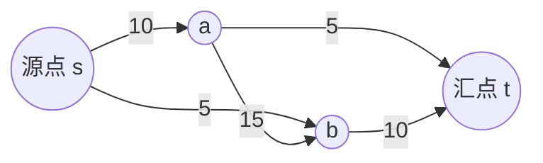
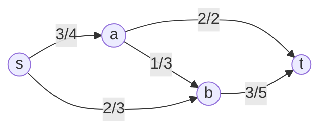
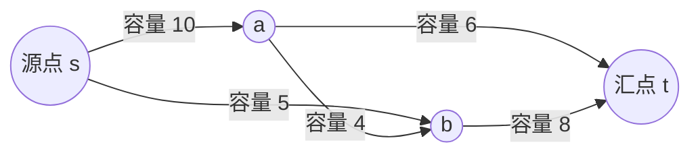
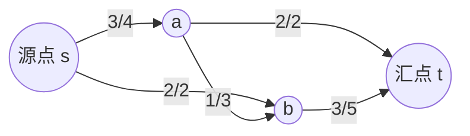
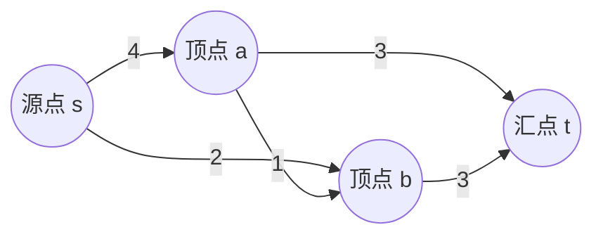

# SPL Run: build_concept_book

- **Adapter:** claude_cli
- **Model:** claude-sonnet-5-5
- **Tokens:** 0 in / 0 out
- **Latency:** 9530ms
- **Timestamp:** 2026-11-24 23:18:38

## Output

```output


---

## 流网络

**定义。** 流网络(flow network)是一个有向图 $G=(V,E)$,带有两个特殊顶点:**源点** $s$ 和**汇点** $t$,以及一个非负**容量函数** $c:E\to\mathbb{R}_{\ge 0}$。直观上,边 $(u,v)$ 像一根水管,$c(u,v)$ 是它单位时间内最多能输送的量。若 $(u,v)\notin E$,约定 $c(u,v)=0$。

在网络上,一个**流** $f:E\to\mathbb{R}_{\ge0}$ 必须满足两条规则:

1. **容量限制**:对每条边,$0\le f(u,v)\le c(u,v)$。
2. **流量守恒**:对每个 $v\in V\setminus\{s,t\}$,
$$\sum_{u} f(u,v)=\sum_{w} f(v,w),$$
即流入等于流出,中间顶点不储存也不产生流量。

流的**值**定义为从源点净流出的量:
$$|f|=\sum_{v} f(s,v)-\sum_{v} f(v,s).$$
最大流问题就是在所有合法流中求使 $|f|$ 最大者。

**示例。** 考虑顶点 $s,a,b,t$,容量为 $c(s,a)=10$,$c(s,b)=5$,$c(a,b)=15$,$c(a,t)=5$,$c(b,t)=10$。


*图:示例流网络,边上的数字为容量。*

试取流:$f(s,a)=8$,$f(s,b)=2$,$f(a,t)=5$,$f(a,b)=3$,$f(b,t)=5$。检验:

- 容量限制:每条边的流量都不超过容量,例如 $f(a,b)=3\le15$。
- 守恒:在 $a$ 处流入 $8$,流出 $5+3=8$;在 $b$ 处流入 $2+3=5$,流出 $5$。

流值 $|f|=8+2=10$。它合法,但不一定最大。

**问题求解应用。** 如何判断 $10$ 是否已是最优?考虑**割** $(S,T)$:把顶点分成 $s\in S$、$t\in T$ 两部分,其容量为 $c(S,T)=\sum_{u\in S,\,v\in T}c(u,v)$。取 $S=\{s,a,b\}$,$T=\{t\}$,则只有进入 $t$ 的边穿过割,容量为 $5+10=15$。取 $S=\{s\}$,割容量为 $10+5=15$。取 $S=\{s,a\}$,$T=\{b,t\}$,穿过的边为 $(s,b),(a,b),(a,t)$,容量 $5+15+5=25$。

任何流的值都不超过任何割的容量,因为流必须穿过割。因此 $|f|\le 15$。我们能否达到 $15$?令 $f(s,a)=10$,$f(s,b)=5$,$f(a,t)=5$,$f(a,b)=5$,$f(b,t)=10$:在 $a$ 处 $10=5+5$,在 $b$ 处 $5+5=10$,守恒成立,且 $|f|=15$,等于割 $(\{s,a,b\},\{t\})$ 的容量。

这正是**最大流最小割定理**:最大流的值等于最小割的容量。实际建模时,凡是"在容量约束下从起点向终点输送尽可能多的东西"的问题,如管道输油、网络带宽、二分图匹配、项目选择,都可以先画成流网络,再用 Ford–Fulkerson 或 Edmonds–Karp 等增广路径算法求解,并用最小割证明结果最优。

---

## 流(Flow)

**定义。** 设有向图 $G=(V,E)$,每条边 $e$ 有容量 $c(e)\ge 0$,并指定源点 $s$ 与汇点 $t$。**流**是一个函数 $f:E\to\mathbb{R}_{\ge 0}$,满足:

1. **容量约束**:对每条边 $e$,$0\le f(e)\le c(e)$;
2. **流量守恒**:对每个 $v\in V\setminus\{s,t\}$,
$$\sum_{(u,v)\in E} f(u,v)=\sum_{(v,w)\in E} f(v,w),$$
即流入等于流出。

流的**值**定义为从源点净流出的量:
$$|f|=\sum_{(s,w)\in E} f(s,w)-\sum_{(u,s)\in E} f(u,s).$$

可以把它想象成水管网络:边是水管,容量是管道粗细,除了水源 $s$ 和出口 $t$ 之外,任何接头处都不能存水,也不能凭空产水。

**例题。** 考虑图中的网络,边上标注为 $f/c$(流量/容量):


*图:一个带容量的网络,每条边标注"流量/容量"。*

验证:

- 容量约束:每条边的 $f\le c$,成立。
- 在 $a$ 处:流入 $3$,流出 $2+1=3$,守恒。
- 在 $b$ 处:流入 $2+1=3$,流出 $3$,守恒。
- 流的值:$|f|=3+2=5$。再检查汇点:流入 $2+3=5$,与 $|f|$ 相等。

这并非巧合。对任意流,由于中间顶点守恒,所有顶点的"净流出"求和为零,因此 $s$ 的净流出恰好等于 $t$ 的净流入。

**问题求解应用。** 问题:这个网络的流值最多能达到多少?

*步骤一:找上界。* 考虑把顶点分成 $S=\{s,a,b\}$ 与 $T=\{t\}$ 两部分(一个"割")。所有流到 $t$ 的水必须经过 $a\to t$ 和 $b\to t$,容量之和为 $2+5=7$,所以 $|f|\le 7$。再取割 $S=\{s\}$:出边容量 $4+3=7$,同样 $|f|\le 7$。

*步骤二:尝试达到上界。* 令 $f(s,a)=4,\ f(s,b)=3$,$f(a,t)=2$,$f(a,b)=2$,$f(b,t)=5$。检查 $a$:入 $4$,出 $2+2=4$;检查 $b$:入 $3+2=5$,出 $5$。均守恒,且 $|f|=7$。

因此最大流值为 $7$。这里体现了**最大流—最小割定理**的核心思想:任何流的值不超过任意割的容量,当二者相等时,流即为最大。解决此类问题的一般策略是:先验证守恒,再沿残量网络寻找增广路径(如 Ford–Fulkerson 算法),直到找到一个容量与流值相等的割为止。

---

## 容量函数

**定义。** 在流网络 $G=(V,E)$ 中，**容量函数**是一个映射
$$c: E \to \mathbb{R}_{\ge 0},$$
它给每条有向边 $(u,v)\in E$ 指定一个非负数 $c(u,v)$，表示这条边最多能承载多少流量。对于不存在的边，约定 $c(u,v)=0$。容量函数是网络的"硬件规格"。它由问题给定，在求解过程中不会改变。要优化的对象是**流** $f$，它必须服从容量函数的约束：

$$0 \le f(u,v) \le c(u,v)\quad \text{对所有 }(u,v)\in E.$$

这条不等式称为**容量约束**。再加上除源点 $s$ 和汇点 $t$ 以外各顶点的**流量守恒**，即 $\sum_{u} f(u,v)=\sum_{w} f(v,w)$，就构成了合法流的完整定义。

**例题。** 考虑网络：$c(s,a)=10$，$c(s,b)=5$，$c(a,b)=4$，$c(a,t)=6$，$c(b,t)=8$。

下面这个流是否合法？$f(s,a)=9$，$f(s,b)=3$，$f(a,b)=4$，$f(a,t)=5$，$f(b,t)=7$。

1. 容量约束：逐条检查，$9\le10$，$3\le5$，$4\le4$，$5\le6$，$7\le8$，全部成立。
2. 在 $a$ 处守恒：流入 $9$，流出 $4+5=9$，成立。
3. 在 $b$ 处守恒：流入 $3+4=7$，流出 $7$，成立。

所以该流合法，流值为 $f(a,t)+f(b,t)=12$。边 $(a,b)$ 已满载，称为**饱和边**。


*图：例题中的流网络，边上标注的是容量函数的取值。*

**问题求解应用。** 容量函数直接给出流值的上界。任取一个把 $s$ 与 $t$ 分开的顶点划分 $(S,T)$，其中 $s\in S$，$t\in T$，则任何合法流的值都不超过**割容量**
$$c(S,T)=\sum_{u\in S,\,v\in T} c(u,v).$$

取 $S=\{s,a,b\}$、$T=\{t\}$，得 $c(S,T)=c(a,t)+c(b,t)=6+8=14$，所以流值最大为 $14$。再取 $S=\{s\}$，得 $c(S,T)=10+5=15$，这个界更松。取 $S=\{s,a\}$，得 $c(s,b)+c(a,b)+c(a,t)=5+4+6=15$，也不如 $14$ 紧。三个割里最小的是 $14$，但它是否真能达到，还要再核对。

我们尝试把例题中的流改进：令 $f(s,a)=10$，$f(s,b)=4$，$f(a,b)=4$，$f(a,t)=6$，$f(b,t)=8$。

- 容量约束：$10\le10$，$4\le5$，$4\le4$，$6\le6$，$8\le8$，成立。
- 在 $a$ 处：流入 $10$，流出 $4+6=10$。
- 在 $b$ 处：流入 $4+4=8$，流出 $8$。

这是合法流，流值为 $14$，与割容量 $14$ 相等。因此 $14$ 就是最大流值。这体现了最大流最小割定理：当流值等于某个割容量时，两者同时达到最优。

**小结。** 容量函数规定每条边的上限。检验一个流是否合法，要逐边比较 $f\le c$，并检查守恒条件。估计最大流时，容量函数通过割容量给出上界。

---

## 可行流

**定义。** 设有向图 $G=(V,E)$ 带有容量函数 $c:E\to\mathbb{R}_{\ge 0}$,并指定源点 $s$ 与汇点 $t$。函数 $f:E\to\mathbb{R}$ 称为**可行流**,如果它同时满足两个条件:

1. **容量约束**:对每条边 $e$,有 $0\le f(e)\le c(e)$。
2. **流量守恒**:对每个 $v\in V\setminus\{s,t\}$,有
$$\sum_{e\text{ 进入 }v} f(e)=\sum_{e\text{ 离开 }v} f(e).$$

流的**值**为 $|f|=\sum_{e\text{ 离开 }s}f(e)-\sum_{e\text{ 进入 }s}f(e)$。部分教材在"周围语境"中只强调容量约束,但要使 $f$ 真正表示"从 $s$ 到 $t$ 的流",守恒条件同样必不可少。

**例题。** 图中有四个顶点 $s,a,b,t$,边的容量为:$c(s,a)=4$,$c(s,b)=2$,$c(a,b)=3$,$c(a,t)=2$,$c(b,t)=5$。判断下面的 $f$ 是否可行:

$f(s,a)=3,\ f(s,b)=2,\ f(a,b)=1,\ f(a,t)=2,\ f(b,t)=3$。

- 容量检查:$3\le4,\ 2\le2,\ 1\le3,\ 2\le2,\ 3\le5$,且都不小于 0,通过。
- 守恒检查:顶点 $a$ 流入 $3$,流出 $1+2=3$;顶点 $b$ 流入 $2+1=3$,流出 $3$。通过。

因此 $f$ 是可行流,其值为 $|f|=3+2=5$。


*边标签"流量/容量"。每条边都满足 $0\le f(e)\le c(e)$,且 $a$、$b$ 处流入等于流出。*

**解题应用。** 面对一个候选流,按固定顺序检验:

1. 逐边核对 $0\le f(e)\le c(e)$;任何一条边违反即不可行。
2. 对每个中间顶点计算"流入 − 流出",必须为 0。
3. 满足以上两点后,再计算 $|f|$。

若把上例改为 $f(s,a)=4$、其余不变,则顶点 $a$ 流入 4、流出 3,守恒被破坏,不可行。修正方法是把 $f(a,b)$ 增至 $2$:此时 $a$ 流出 $2+2=4$,但 $b$ 流入变成 $2+2=4$,流出需为 4,于是令 $f(b,t)=4\le5$。新流值为 $|f|=4+2=6$,仍可行,并且比原来更大。

可行流是最大流问题的**搜索空间**:所有可行流构成一个由线性不等式定义的凸多面体,最大流算法(如 Ford–Fulkerson)正是在其中不断增大 $|f|$,同时始终保持可行性。另一个重要事实是,任何可行流都满足 $|f|\le c(S,\bar S)$,其中 $(S,\bar S)$ 是任意 $s$–$t$ 割。这给出了流值的上界,也是最大流最小割定理的基础。

---

## 流量值

**定义。** 设 $G=(V,E)$ 是带容量 $c(u,v)\ge 0$ 的流网络,$s$ 为源点,$t$ 为汇点。对一个可行流 $f$(满足容量约束与除 $s,t$ 外各顶点的流量守恒),其**流量值**定义为从源点净流出的总流量:

$$|f| = \sum_{v\in V} f(s,v) - \sum_{v\in V} f(v,s).$$

这里 $f(u,v)$ 表示边 $(u,v)$ 上的流量,第二项减去流回源点的部分,因此 $|f|$ 是"净"流出量。

**核心性质。** 由于中间顶点流量守恒,流入 $t$ 的净流量与流出 $s$ 的净流量相等:

$$|f| = \sum_{v\in V} f(v,t) - \sum_{v\in V} f(t,v).$$

*理由:* 对所有顶点求"净流出"之和,每条边的流量一次记为正、一次记为负,总和为 $0$。中间顶点的净流出均为 $0$,所以 $s$ 的净流出加上 $t$ 的净流出等于 $0$,即 $|f|=-(t\text{ 的净流出})$,也就是 $t$ 的净流入。

**例题。** 网络有边 $s\to a$(流量 4)、$s\to b$(流量 2)、$a\to b$(流量 1)、$a\to t$(流量 3)、$b\to t$(流量 3)。

- 检查守恒:顶点 $a$ 流入 4,流出 $1+3=4$;顶点 $b$ 流入 $2+1=3$,流出 3。均成立。
- 源点净流出:$|f| = 4+2 = 6$。
- 汇点净流入:$3+3 = 6$。两者一致。

**问题求解应用。** 假设某条边的流量是未知量 $x$,而网络中其余流量已知。可以先利用守恒方程求出 $x$,再用 $|f|$ 验证结果。

例如,将上例中 $a\to b$ 的流量改记为 $x$,已知 $s\to a$ 为 4、$a\to t$ 为 3。对顶点 $a$ 应用守恒:$4 = 3 + x$,得 $x=1$。再对顶点 $b$:流入 $2+x=3$,流出 $b\to t$ 也为 3,验证通过。

另一个常见用途是**检验与优化**:任何割 $(S,T)$($s\in S,\ t\in T$)的净流量都等于 $|f|$,因此

$$|f| \le c(S,T)=\sum_{u\in S,\,v\in T} c(u,v).$$

在上例中取 $S=\{s\}$,若 $c(s,a)+c(s,b)=6$,则 $|f|=6$ 已达到上界,该流即为最大流。这正是最大流最小割定理的出发点:流量值永远不超过任意割的容量,当两者相等时即找到了最优解。


*示例流网络:边上的数字为流量。源点净流出 $4+2=6$,汇点净流入 $3+3=6$,即 $|f|=6$。*

---

## 最大流问题

**定义。** 设有向图 $G=(V,E)$,每条边 $e$ 有容量 $c(e)\ge 0$,并指定源点 $s$ 与汇点 $t$。一个 $(s,t)$-流是函数 $f:E\to\mathbb{R}_{\ge 0}$,满足:

1. **容量约束**:$0\le f(e)\le c(e)$;
2. **流量守恒**:对每个 $v\in V\setminus\{s,t\}$,有 $\sum_{e\text{ 入 }v} f(e)=\sum_{e\text{ 出 }v} f(e)$。

流的**值**为 $|f|=\sum_{e\text{ 出 }s} f(e)-\sum_{e\text{ 入 }s} f(e)$。**最大流问题**就是:在所有可行的 $(s,t)$-流中,求 $|f|$ 最大的流。

**割与对偶。** $(s,t)$-割是把顶点分成 $S\ni s$ 与 $T=V\setminus S\ni t$,其容量为 $c(S,T)=\sum_{u\in S,\,v\in T} c(u,v)$。任意可行流的值都不超过任意割的容量,因此

$$\max_f |f| = \min_{(S,T)} c(S,T).$$

这就是**最大流最小割定理**:最大流的值等于最小割的容量。

**求解思路。** 给定流 $f$,定义残量网络:边 $(u,v)$ 的剩余容量为 $c(u,v)-f(u,v)$,并允许沿反向边撤销已有流量。若残量网络中存在 $s\to t$ 的**增广路径**,就沿它推送瓶颈容量的流量。当不再存在增广路径时,流达到最大。Edmonds–Karp 算法每次用 BFS 选最短增广路径,时间复杂度为 $O(VE^2)$。

**例题。** 顶点为 $s,a,b,t$,边容量为:$s\to a:3$,$s\to b:2$,$a\to b:1$,$a\to t:2$,$b\to t:3$。

- 路径 $s\to a\to t$,瓶颈为 $2$,推送 $2$。
- 路径 $s\to b\to t$,瓶颈为 $2$,推送 $2$。
- 路径 $s\to a\to b\to t$:$s\to a$ 剩余 $1$,$a\to b$ 为 $1$,$b\to t$ 剩余 $1$,瓶颈为 $1$,推送 $1$。

此时总流量为 $5$。再找增广路径:$s$ 的出边 $s\to a$(剩 $0$)与 $s\to b$(剩 $0$)均已饱和,无路可走,因此 $|f|=5$。

**验证。** 取 $S=\{s\}$,割容量为 $3+2=5$,与流值相等,所以 $5$ 确为最大流值,同时 $\{s\}$ 给出一个最小割。

**应用。** 许多问题都能归约为最大流:

- **二分图最大匹配**:左右两侧顶点各连到 $s$ 与 $t$,所有边容量设为 $1$,最大流值即最大匹配数。
- **网络带宽与运输调度**:求两地之间的最大吞吐量。
- **最小割应用**:找出使网络断开所需删除的最小代价边集,例如图像分割。

**解题要点。** 先建模(确定顶点、容量、$s$ 与 $t$),再反复在残量网络中找增广路径,最后用最小割核对答案。若容量均为整数,则必存在整数最大流,这也是匹配问题可以用最大流求解的原因。

---

## 收获

**最大流问题**(maximum flow problem)是整本书的自然终点:它把图、容量、守恒与对偶这些概念汇聚到一个可精确求解的优化问题上。

### 一、它解决什么问题

给定有向图 $G=(V,E)$,每条边 $(u,v)$ 有容量 $c(u,v)\ge 0$,并指定源点 $s$ 与汇点 $t$。一个**流** $f$ 须满足:

- 容量约束:$0\le f(u,v)\le c(u,v)$;
- 流量守恒:对任意 $v\ne s,t$,有 $\sum_{u} f(u,v)=\sum_{w} f(v,w)$。

流的值为 $|f|=\sum_{v} f(s,v)-\sum_{v} f(v,s)$。最大流问题就是求使 $|f|$ 最大的可行流。

**为什么是终点?** 因为它体现了**最大流最小割定理**:

$$\max_f |f| = \min_{S\ni s,\ t\notin S}\ \sum_{u\in S,\ v\notin S} c(u,v).$$

这里"最大化"与"最小化"两个看似相反的问题得到同一个值,这是对偶性的最简洁例子。前面学过的路径、连通性、割与线性约束,都在此统一。

### 二、与应用的联系:Ford–Fulkerson 算法

**Ford–Fulkerson 算法**把定义转化为可执行的步骤:

1. 令所有边的流为 $0$;
2. 在**残量图**中寻找一条 $s\to t$ 的增广路径(残量容量 $c_f(u,v)=c(u,v)-f(u,v)$,且反向边的残量为 $f(u,v)$);
3. 沿该路径推送瓶颈容量 $\delta=\min c_f$;
4. 重复,直到不存在增广路径。

**小例子**:边 $s\to a$(容量 3)、$s\to b$(2)、$a\to t$(2)、$b\to t$(3)、$a\to b$(1)。

- 路径 $s,a,t$:$\delta=2$;
- 路径 $s,b,t$:$\delta=2$;
- 路径 $s,a,b,t$:$s\to a$ 剩 1,$a\to b$ 为 1,$b\to t$ 剩 1,故 $\delta=1$。

总流值为 $5$。此时 $S=\{s,a,b\}$ 的割容量为 $2+3=5$,与流值相等,于是同时证明了最优性。这正是算法终止条件的含义:无增广路径 $\Leftrightarrow$ 存在容量等于流值的割。

**复杂度**:若容量为整数,每次增广至少增加 $1$,因此至多 $|f^*|$ 次迭代,总时间为 $O(E\cdot|f^*|)$。若用广度优先选路(Edmonds–Karp),则与容量无关,为 $O(VE^2)$。此外,整数容量保证存在整数最优流,这是二分图匹配等问题得以归约的关键。

**解题应用**:遇到"最多能同时运送多少""最少需要切断几条线"之类的问题时,可以按三步处理:建图(设源、汇)、设容量、运行增广。例如二分图最大匹配,只需把每条匹配边的容量设为 $1$,再加上源和汇即可。

### 三、邀请

不妨从**Ford–Fulkerson 算法**开始深入:亲手在上面的例子里改动容量,看增广路径的选取顺序如何影响迭代次数;再尝试把二分图匹配归约为最大流,并用代码实现。你会发现,一个简单的"沿着还有余量的路走下去"的想法,背后是一整套优美的理论。
```
