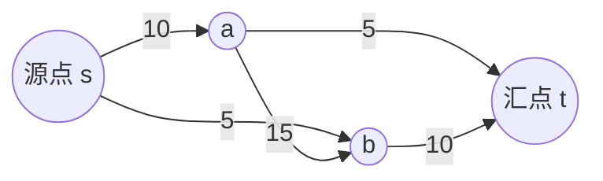
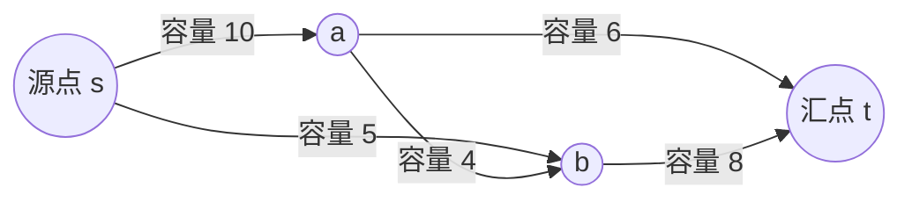
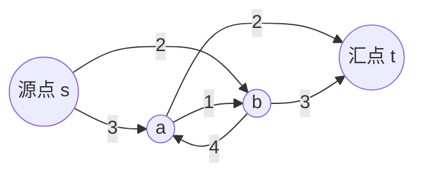
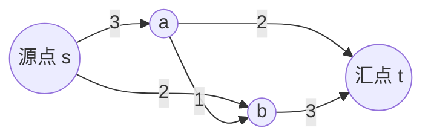

# SPL Run: build_concept_book

- **Adapter:** claude_cli
- **Model:** claude-sonnet-5-5
- **Tokens:** 0 in / 0 out
- **Latency:** 8581ms
- **Timestamp:** 2026-11-24 23:18:48

## Output

```output


---

## 流网络

**定义。** 流网络(flow network)是一个有向图 $G=(V,E)$,带有两个特殊顶点:**源点** $s$ 和**汇点** $t$,以及一个非负**容量函数** $c:E\to\mathbb{R}_{\ge 0}$。直观上,边 $(u,v)$ 像一根水管,$c(u,v)$ 是它单位时间内最多能输送的量。若 $(u,v)\notin E$,约定 $c(u,v)=0$。

在网络上,一个**流** $f:E\to\mathbb{R}_{\ge0}$ 必须满足两条规则:

1. **容量限制**:对每条边,$0\le f(u,v)\le c(u,v)$。
2. **流量守恒**:对每个 $v\in V\setminus\{s,t\}$,
$$\sum_{u} f(u,v)=\sum_{w} f(v,w),$$
即流入等于流出,中间顶点不储存也不产生流量。

流的**值**定义为从源点净流出的量:
$$|f|=\sum_{v} f(s,v)-\sum_{v} f(v,s).$$
最大流问题就是在所有合法流中求使 $|f|$ 最大者。

**示例。** 考虑顶点 $s,a,b,t$,容量为 $c(s,a)=10$,$c(s,b)=5$,$c(a,b)=15$,$c(a,t)=5$,$c(b,t)=10$。


*图:示例流网络,边上的数字为容量。*

试取流:$f(s,a)=8$,$f(s,b)=2$,$f(a,t)=5$,$f(a,b)=3$,$f(b,t)=5$。检验:

- 容量限制:每条边的流量都不超过容量,例如 $f(a,b)=3\le15$。
- 守恒:在 $a$ 处流入 $8$,流出 $5+3=8$;在 $b$ 处流入 $2+3=5$,流出 $5$。

流值 $|f|=8+2=10$。它合法,但不一定最大。

**问题求解应用。** 如何判断 $10$ 是否已是最优?考虑**割** $(S,T)$:把顶点分成 $s\in S$、$t\in T$ 两部分,其容量为 $c(S,T)=\sum_{u\in S,\,v\in T}c(u,v)$。取 $S=\{s,a,b\}$,$T=\{t\}$,则只有进入 $t$ 的边穿过割,容量为 $5+10=15$。取 $S=\{s\}$,割容量为 $10+5=15$。取 $S=\{s,a\}$,$T=\{b,t\}$,穿过的边为 $(s,b),(a,b),(a,t)$,容量 $5+15+5=25$。

任何流的值都不超过任何割的容量,因为流必须穿过割。因此 $|f|\le 15$。我们能否达到 $15$?令 $f(s,a)=10$,$f(s,b)=5$,$f(a,t)=5$,$f(a,b)=5$,$f(b,t)=10$:在 $a$ 处 $10=5+5$,在 $b$ 处 $5+5=10$,守恒成立,且 $|f|=15$,等于割 $(\{s,a,b\},\{t\})$ 的容量。

这正是**最大流最小割定理**:最大流的值等于最小割的容量。实际建模时,凡是"在容量约束下从起点向终点输送尽可能多的东西"的问题,如管道输油、网络带宽、二分图匹配、项目选择,都可以先画成流网络,再用 Ford–Fulkerson 或 Edmonds–Karp 等增广路径算法求解,并用最小割证明结果最优。

---

## 容量函数

**定义。** 在流网络 $G=(V,E)$ 中，**容量函数**是一个映射
$$c: E \to \mathbb{R}_{\ge 0},$$
它给每条有向边 $(u,v)\in E$ 指定一个非负数 $c(u,v)$，表示这条边最多能承载多少流量。对于不存在的边，约定 $c(u,v)=0$。容量函数是网络的"硬件规格"。它由问题给定，在求解过程中不会改变。要优化的对象是**流** $f$，它必须服从容量函数的约束：

$$0 \le f(u,v) \le c(u,v)\quad \text{对所有 }(u,v)\in E.$$

这条不等式称为**容量约束**。再加上除源点 $s$ 和汇点 $t$ 以外各顶点的**流量守恒**，即 $\sum_{u} f(u,v)=\sum_{w} f(v,w)$，就构成了合法流的完整定义。

**例题。** 考虑网络：$c(s,a)=10$，$c(s,b)=5$，$c(a,b)=4$，$c(a,t)=6$，$c(b,t)=8$。

下面这个流是否合法？$f(s,a)=9$，$f(s,b)=3$，$f(a,b)=4$，$f(a,t)=5$，$f(b,t)=7$。

1. 容量约束：逐条检查，$9\le10$，$3\le5$，$4\le4$，$5\le6$，$7\le8$，全部成立。
2. 在 $a$ 处守恒：流入 $9$，流出 $4+5=9$，成立。
3. 在 $b$ 处守恒：流入 $3+4=7$，流出 $7$，成立。

所以该流合法，流值为 $f(a,t)+f(b,t)=12$。边 $(a,b)$ 已满载，称为**饱和边**。


*图：例题中的流网络，边上标注的是容量函数的取值。*

**问题求解应用。** 容量函数直接给出流值的上界。任取一个把 $s$ 与 $t$ 分开的顶点划分 $(S,T)$，其中 $s\in S$，$t\in T$，则任何合法流的值都不超过**割容量**
$$c(S,T)=\sum_{u\in S,\,v\in T} c(u,v).$$

取 $S=\{s,a,b\}$、$T=\{t\}$，得 $c(S,T)=c(a,t)+c(b,t)=6+8=14$，所以流值最大为 $14$。再取 $S=\{s\}$，得 $c(S,T)=10+5=15$，这个界更松。取 $S=\{s,a\}$，得 $c(s,b)+c(a,b)+c(a,t)=5+4+6=15$，也不如 $14$ 紧。三个割里最小的是 $14$，但它是否真能达到，还要再核对。

我们尝试把例题中的流改进：令 $f(s,a)=10$，$f(s,b)=4$，$f(a,b)=4$，$f(a,t)=6$，$f(b,t)=8$。

- 容量约束：$10\le10$，$4\le5$，$4\le4$，$6\le6$，$8\le8$，成立。
- 在 $a$ 处：流入 $10$，流出 $4+6=10$。
- 在 $b$ 处：流入 $4+4=8$，流出 $8$。

这是合法流，流值为 $14$，与割容量 $14$ 相等。因此 $14$ 就是最大流值。这体现了最大流最小割定理：当流值等于某个割容量时，两者同时达到最优。

**小结。** 容量函数规定每条边的上限。检验一个流是否合法，要逐边比较 $f\le c$，并检查守恒条件。估计最大流时，容量函数通过割容量给出上界。

---

## 割(Cut)

**定义。** 在带有源点 $s$ 和汇点 $t$ 的流网络 $G=(V,E)$ 中,一个 **$s$-$t$ 割** 是把顶点集划分为两个不相交的子集 $S$ 和 $T=V\setminus S$,且满足 $s\in S$、$t\in T$。割的**容量**定义为从 $S$ 指向 $T$ 的所有边的容量之和:

$$
c(S,T)=\sum_{u\in S,\;v\in T,\;(u,v)\in E} c(u,v).
$$

注意:只计算 $S\to T$ 方向的边,从 $T$ 指向 $S$ 的边不计入容量。直观上,割就是"切断"网络、使 $s$ 无法再到达 $t$ 所需付出的代价。

**与流的关系。** 对任意可行流 $f$,穿过割的**净流量**等于流的值:

$$
|f| = \sum_{u\in S,v\in T} f(u,v)-\sum_{u\in T,v\in S} f(u,v)\le c(S,T).
$$

因此任何流的值都不超过任何割的容量。这正是最大流最小割定理的基础:最大流的值等于最小割的容量。

**例题。** 网络有顶点 $s,a,b,t$,边容量为:$c(s,a)=3$,$c(s,b)=2$,$c(a,b)=1$,$c(a,t)=2$,$c(b,t)=3$。

取 $S=\{s,a\}$,$T=\{b,t\}$。从 $S$ 到 $T$ 的边有 $(s,b)$、$(a,b)$、$(a,t)$,所以
$$
c(S,T)=2+1+2=5.
$$

再取 $S'=\{s\}$,$T'=\{a,b,t\}$,则 $c(S',T')=c(s,a)+c(s,b)=3+2=5$。

取 $S''=\{s,a,b\}$,$T''=\{t\}$,则 $c(S'',T'')=c(a,t)+c(b,t)=2+3=5$。

三个割的容量都是 5。

**问题求解应用。** 如何证明最大流恰为 5?

1. 构造一个流:$s\to a\to t$ 送 2 单位,$s\to a\to b\to t$ 送 1 单位,$s\to b\to t$ 送 2 单位。检查容量:$(s,a)$ 流量 3,$(s,b)$ 流量 2,$(a,b)$ 流量 1,$(a,t)$ 流量 2,$(b,t)$ 流量 3,均不超限,流值为 $2+1+2=5$。
2. 上面的割容量为 5,而任何流的值都不超过任何割的容量,所以 $|f|\le 5$。

流值 5 达到了割容量 5 的上界,因此该流是最大流,该割是最小割。**要点:** 找到一个流和一个割使两者数值相等,就同时证明了二者都已最优。

**常见错误。** 计算容量时误把 $T\to S$ 的边也加进去;或者忘了检查 $s\in S$、$t\in T$ 这个前提。

---

## 割容量(Cut Capacity)

**定义。** 设有向网络 $G=(V,E)$,每条边 $e$ 有非负容量 $c(e)$。一个 $(s,t)$-割是把顶点集划分为 $(S,T)$,其中 $s\in S$,$t\in T$,$T=V\setminus S$。该割的**容量**是所有"起点在 $S$、终点在 $T$"的边的容量之和:

$$
\operatorname{cap}(S,T)=\sum_{\substack{(u,v)\in E\\ u\in S,\ v\in T}} c(u,v).
$$

注意两点。第一,只计算从 $S$ 指向 $T$ 的边,从 $T$ 指向 $S$ 的反向边不计入。第二,割容量取决于划分 $(S,T)$,不同的划分有不同的容量。

**例题。** 考虑网络:$s\to a$(容量 3),$s\to b$(容量 2),$a\to b$(容量 1),$a\to t$(容量 2),$b\to t$(容量 3),另有一条回边 $b\to a$(容量 4)。

取 $S=\{s,a\}$,$T=\{b,t\}$。穿过割、方向由 $S$ 到 $T$ 的边有:

- $s\to b$:2
- $a\to b$:1
- $a\to t$:2

边 $b\to a$ 方向由 $T$ 到 $S$,不计入。因此
$$\operatorname{cap}(S,T)=2+1+2=5.$$

再取 $S'=\{s\}$,则穿过的边为 $s\to a$ 和 $s\to b$,容量为 $3+2=5$。取 $S''=\{s,a,b\}$,则穿过的边为 $a\to t$ 和 $b\to t$,容量为 $2+3=5$。


*示例网络。割 $S=\{s,a\}$ 只统计由 $S$ 指向 $T=\{b,t\}$ 的三条边,回边 $b\to a$ 不计入。*

**问题求解应用。** 割容量给出最大流的上界。对任意流 $f$ 和任意 $(s,t)$-割 $(S,T)$,从 $s$ 送到 $t$ 的流量都必须穿过该割,因此
$$|f|\le \operatorname{cap}(S,T).$$
这是弱对偶性:任何一个割的容量都是最大流值的上界。

**最大流最小割定理**更进一步:最大流的值等于所有 $(s,t)$-割中容量的最小值,
$$\max_f |f|=\min_{(S,T)}\operatorname{cap}(S,T).$$

在上例中,三个割的容量都是 5。构造流 $s\to a$:3,$s\to b$:2,$a\to t$:2,$a\to b$:1,$b\to t$:3,它满足流量守恒,总流量为 5。流值 5 达到了割容量的上界,所以这个流是最大流,而 $S=\{s,a\}$ 是一个最小割。

**解题步骤。** 要证明某个流是最优的,不必枚举所有割。只需找到一个容量等于该流值的割即可。具体做法是:先求出流,再在残量网络中从 $s$ 出发搜索,把能到达的顶点记为 $S$,其余记为 $T$,这个 $(S,T)$ 就是最小割。

---

## 最小割问题

**定义。** 设有向图 $G=(V,E)$,每条边 $e$ 有容量 $c(e)\ge 0$,并指定源点 $s$ 与汇点 $t$。一个 $(s,t)$-割是把顶点集划分为 $(S,\bar S)$,其中 $s\in S$,$t\in \bar S=V\setminus S$。割的容量定义为所有从 $S$ 指向 $\bar S$ 的边的容量之和:

$$
\operatorname{cap}(S,\bar S)=\sum_{(u,v)\in E,\ u\in S,\ v\in \bar S} c(u,v).
$$

**最小割问题**:在所有 $(s,t)$-割中,求容量最小的那一个。注意,只有"从 $S$ 到 $\bar S$"方向的边才计入容量,反向边不计。

**为什么重要。** 每个 $(s,t)$-流都必须穿过任意一个割,所以任何可行流的值都不超过任何割的容量。由此得到最大流最小割定理:

$$
\max_{f}\ |f| \;=\; \min_{(S,\bar S)} \operatorname{cap}(S,\bar S).
$$

因此,求出最大流,就同时得到了最小割的容量。

**例题。** 考虑下面的网络:$s\to a$(容量 3),$s\to b$(容量 2),$a\to b$(容量 1),$a\to t$(容量 2),$b\to t$(容量 3)。求最小割。

1. **求最大流。** 沿 $s\to a\to t$ 送 2 单位,沿 $s\to b\to t$ 送 2 单位,再沿 $s\to a\to b\to t$ 送 1 单位。此时 $s\to a$ 用了 3,$s\to b$ 用了 2,$a\to t$ 用了 2,$b\to t$ 用了 3。总流量为 5,且找不到增广路。
2. **从残量图找割。** 在残量图中,从 $s$ 出发已无法到达任何顶点,所以 $S=\{s\}$,$\bar S=\{a,b,t\}$。
3. **计算容量。** $\operatorname{cap}=c(s,a)+c(s,b)=3+2=5$,与最大流相等,所以这就是最小割。

作为对照,取 $S=\{s,a\}$,则容量为 $c(s,b)+c(a,b)+c(a,t)=2+1+2=5$,也是最小割。可见最小割不一定唯一。

**问题求解应用。** 求最小割的标准流程如下:

1. 建立网络,并指定 $s,t$。无向边要拆成两条方向相反、容量相同的有向边。
2. 用 Edmonds–Karp 算法(时间 $O(VE^2)$)或 Dinic 算法求最大流。
3. 在最终残量图中,从 $s$ 做一次 BFS,可达顶点集合记为 $S$。
4. 输出所有从 $S$ 指向 $\bar S$ 的原图边,这些边就是最小割边。它们的容量之和等于最大流值。

这一方法有很多应用。例如在图像分割中,可把像素视为顶点,把"前景/背景"的代价作为容量,最小割就给出代价最小的分割。在网络可靠性问题中,最小割给出"最少需要切断多少链路才能使 $s$ 与 $t$ 失去连通"。


*例题中的网络。割 $S=\{s\}$ 切断 $s\to a$ 与 $s\to b$,容量为 $3+2=5$,等于最大流值。*

---

## 收益(Payoff)

### 最小割问题实现了什么

最小割问题(minimum cut problem)回答的是:**要切断一个网络的联系,最少需要付出多大代价?** 给定有向图 $G=(V,E)$,每条边 $e$ 有容量 $c(e)\ge 0$,并指定源点 $s$ 与汇点 $t$。一个 $s$–$t$ 割是把顶点划分为 $(S,\bar S)$,其中 $s\in S$,$t\in\bar S$,其容量为

$$
\text{cap}(S,\bar S)=\sum_{u\in S,\ v\in \bar S} c(u,v).
$$

最小割就是容量最小的那个割。**最大流最小割定理**指出:$s$ 到 $t$ 的最大流值恰好等于最小割容量,

$$
\max_f |f| \;=\; \min_{(S,\bar S)} \text{cap}(S,\bar S).
$$

这是一个对偶结果:"最多能送多少"与"最少要切多少"是同一个数的两面。它之所以是自然的终点,是因为前面学过的残量网络、增广路径、流守恒、容量约束都在这里汇合。算法终止时,从 $s$ 在残量网络中可达的顶点集合就是 $S$,而且这个集合同时给出了最优性的证明。

### 一个小例子

设边容量为:$s\to a:3$,$s\to b:2$,$a\to t:2$,$b\to t:3$,$a\to b:1$。取 $S=\{s,a,b\}$,割边为 $a\to t$ 与 $b\to t$,容量 $2+3=5$。取 $S=\{s\}$,容量 $3+2=5$。再取 $S=\{s,a\}$,割边为 $s\to b,\ a\to t,\ a\to b$,容量 $2+2+1=5$。最大流为 5,与最小割一致,所以这些割都是最小割。

### 与各应用领域的联系

本节没有列出具体的应用领域,下面给出最小割最典型的几类场景,你可以把它们当作建模的模板:

- **网络可靠性**:边容量表示链路带宽或连接数,最小割给出网络的"瓶颈",也就是使 $s$ 与 $t$ 断开所需删去的最少链路。
- **图像分割**:每个像素是顶点,相邻像素之间的边容量表示相似度;从源点(前景标记)到汇点(背景标记)的最小割,把图像切成前景与背景,代价最小。
- **二分图匹配与任务调度**:加入超级源点和汇点后,最大流等于最大匹配,最小割对应 König 定理中的最小顶点覆盖。
- **项目选择**:收益为正的项目与成本为正的设备,用最小割决定选哪些项目,使净收益最大。

这些问题的共同套路是:**把约束写成容量,把决策写成割,再用最大流求解。**

### 邀请

请从上面选一个应用,亲手完成一次完整的建模:画出图,写出容量,用增广路径算法求出最大流,再从残量网络中读出最小割,并检验两者相等。我们建议从图像分割开始:取一幅 $4\times 4$ 的灰度小图,设定一个相似度函数,看看最小割如何自动画出前景与背景的边界。
```
