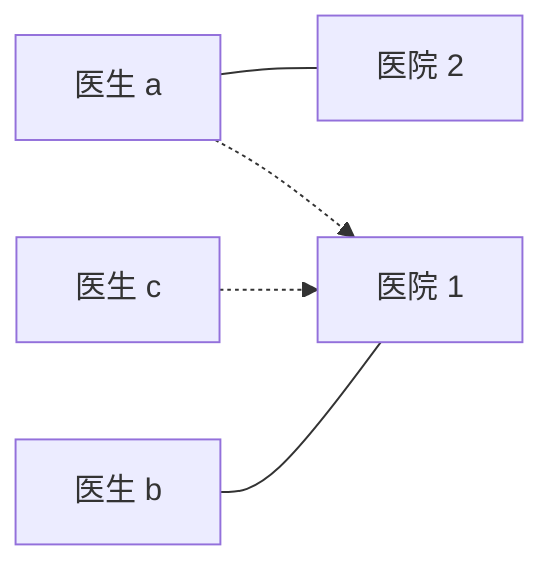
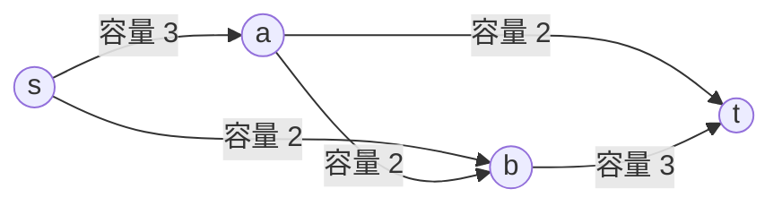
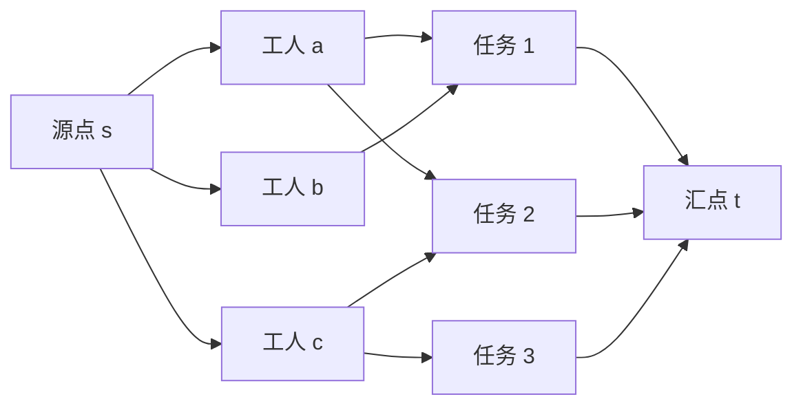
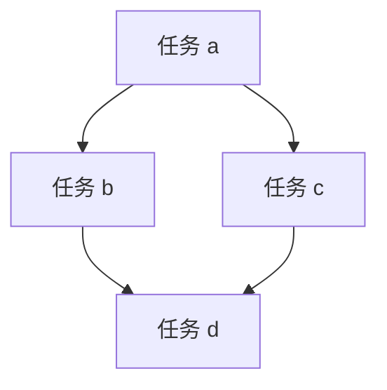
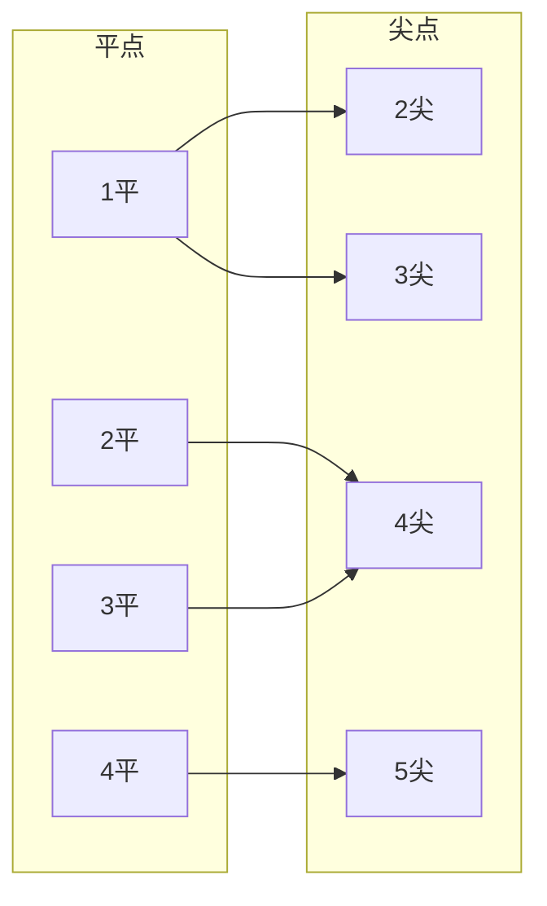
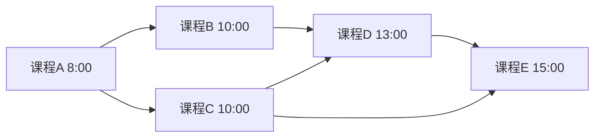

# SPL Run: build_concept_book

- **Adapter:** claude_cli
- **Model:** claude-sonnet-5-5
- **Tokens:** 0 in / 0 out
- **Latency:** 10233ms
- **Timestamp:** 2026-11-24 23:19:06

## Output

```output


---

## 匹配(Matching)

**定义。** 设图 $G=(V,E)$。**匹配** $M\subseteq E$ 是一组两两不共享顶点的边,即每个顶点至多与 $M$ 中的一条边相关联。在二部图 $G=(X\cup Y,E)$ 中(例如 $X$ 为医生、$Y$ 为医院),匹配就是把 $X$ 中的元素与 $Y$ 中的元素一对一配对,且每个参与者至多配一个。

几个常用术语:

- 若顶点 $v$ 被 $M$ 中某条边覆盖,称 $v$ 被**饱和**。
- $|M|$ 最大的匹配称为**最大匹配**。
- 若 $X$ 中每个顶点都被饱和,称 $M$ **完美匹配于 $X$**。若 $|X|=|Y|$ 且 $M$ 饱和所有顶点,则称 $M$ 为**完美匹配**。

**例题。** 三名医生 $a,b,c$ 与三家医院 $1,2,3$。可接受的配对为:$a$–1,$a$–2,$b$–1,$c$–1。

取 $M_1=\{a1,\,b1\}$。两条边都含医院 1,违反"至多一个"的要求,所以它不是匹配。

取 $M_2=\{a2,\,b1\}$。这是匹配,$|M_2|=2$。

能否再配上 $c$?$c$ 只能去医院 1,而医院 1 已被 $b$ 占用。设想沿"交错路径"调整:从未饱和的 $c$ 出发,经边 $c1$(不在 $M_2$ 中),再经边 $1b$(在 $M_2$ 中),到达 $b$。此时 $b$ 只能去医院 1,无法继续延伸,所以这条路径不能增广。因此最大匹配大小为 2,而不是 3。

**问题求解:Hall 定理。** 如何不靠试错就判断能否完美匹配于 $X$?对 $S\subseteq X$,记 $N(S)$ 为 $S$ 的所有邻居构成的集合。

> **Hall 定理。** 二部图中存在饱和 $X$ 的匹配,当且仅当对每个 $S\subseteq X$,都有 $|N(S)|\ge |S|$。

必要性显然:$S$ 中的 $|S|$ 个元素要配到互不相同的邻居,邻居数至少为 $|S|$。充分性可对 $|X|$ 用归纳法证明,这里略去。

回到例题。取 $S=\{b,c\}$,则 $N(S)=\{1\}$,$|N(S)|=1<2=|S|$。Hall 条件被破坏,所以不可能饱和全部医生。这与上面的结论一致,并且还指出了瓶颈所在:$b$ 与 $c$ 抢同一家医院。

**求最大匹配的算法。** 若匹配 $M$ 存在一条**增广路径**(起点与终点都未饱和,且路径上的边在 $M$ 外与 $M$ 内交替出现),把路径上的边在 $M$ 内外互换,就得到大小为 $|M|+1$ 的匹配。Berge 定理说明其逆也成立:$M$ 是最大匹配当且仅当不存在增广路径。反复寻找并翻转增广路径,即得到匈牙利算法,其时间复杂度为 $O(|V|\cdot|E|)$。

**小结。** 匹配刻画"一对一配对"。判断存在性用 Hall 条件,构造最优解则靠增广路径。


*图中实线为匹配 $M_2$,虚线为可接受但未选中的配对。医生 $c$ 只能去医院 1,而该医院已被 $b$ 占用,所以 $c$ 无法被饱和。*

---

## 最大流

**定义。** 设有向图 $G=(V,E)$ 中,每条边 $(u,v)$ 有容量 $c(u,v)\ge 0$,并指定源点 $s$ 与汇点 $t$。**流** $f$ 是满足下列两条约束的函数:

- 容量约束:$0\le f(u,v)\le c(u,v)$;
- 流量守恒:对每个 $v\notin\{s,t\}$,有 $\sum_{u} f(u,v)=\sum_{w} f(v,w)$。

流的**值**为 $|f|=\sum_{v} f(s,v)-\sum_{v} f(v,s)$。**最大流**就是使 $|f|$ 最大的流。

**割与最大流最小割定理。** 一个 $s$–$t$ 割 $(S,T)$ 把顶点分成 $s\in S$、$t\in T$ 两部分,其容量为 $c(S,T)=\sum_{u\in S,\,v\in T}c(u,v)$。任何流的值都不超过任何割的容量,因此 $|f|\le c(S,T)$。更强的结论是:

$$\max_f |f| = \min_{(S,T)} c(S,T).$$

**增广路算法(Ford–Fulkerson)。** 给定当前流 $f$,定义**残量网络** $G_f$,边 $(u,v)$ 的残量容量为 $c(u,v)-f(u,v)$,并添加反向边,其容量为 $f(u,v)$。只要 $G_f$ 中存在 $s\to t$ 的路径(**增广路**),就沿该路径推送其瓶颈容量。若路径选取为最短路(Edmonds–Karp),则复杂度为 $O(VE^2)$。更先进的算法,如 Orlin 算法,可达到 $O(VE)$。

### 流程示意


*一个五节点网络:图中的边标注了容量,最大流为 5。*

**例题。** 对上图求最大流。

1. 沿 $s\to a\to t$ 推送 $2$ 单位(瓶颈为 $a\to t$ 的容量 $2$)。
2. 沿 $s\to b\to t$ 推送 $2$ 单位(瓶颈为 $s\to b$ 的容量 $2$)。
3. 沿 $s\to a\to b\to t$ 推送 $1$ 单位。此时 $s\to a$ 剩余 $3-2=1$,$a\to b$ 剩余 $2$,$b\to t$ 剩余 $3-2=1$,瓶颈为 $1$。
4. 此后 $s$ 的出边中 $s\to a$ 已用完($2+1=3$),$s\to b$ 也已用完($2$),残量网络中再无增广路。

总流值为 $2+2+1=5$。**验证:** 取割 $S=\{s\}$,$T=\{a,b,t\}$,其容量为 $3+2=5$。流值等于割容量,所以由最大流最小割定理可知,$5$ 即为最大流。

**问题求解应用。** 许多看似无关的问题都能归约为最大流:

- **二分图最大匹配**:加入源点连向左侧所有顶点、右侧所有顶点连向汇点,所有边容量取 $1$,最大流的值即最大匹配数。
- **边不相交路径**:令每条边容量为 $1$,最大流的值等于 $s$ 到 $t$ 的最大边不相交路径数(Menger 定理)。
- **网络瓶颈识别**:算法终止后,从 $s$ 在残量网络中可达的顶点集合即为 $S$,所对应的最小割给出了系统中最脆弱的一组边。

解题要点是:先确定"什么是容量、什么要守恒",再建图,最后用割来验证答案。

---

## 二分图匹配

**定义。** 二分图 $G=(L\cup R,\,E)$ 的顶点集分为两部分 $L$ 与 $R$,且每条边都连接 $L$ 中一个顶点和 $R$ 中一个顶点。**匹配** $M\subseteq E$ 是一组两两不共享端点的边。**最大匹配**是边数 $|M|$ 最大的匹配。典型场景是任务分配:$L$ 为工人,$R$ 为任务,边表示"此人能胜任该任务",每人至多做一项任务,每项任务至多由一人完成。

**归约为最大流。** 构造流网络 $G'$:

1. 新增源点 $s$ 与汇点 $t$;
2. 对每个 $u\in L$ 加边 $s\to u$,对每个 $v\in R$ 加边 $v\to t$;
3. 原图每条边 $(u,v)$ 定向为 $u\to v$;
4. **所有边容量均为 $1$**。

容量为 1 保证每个顶点至多流入(或流出)一单位流量,这正是"不共享端点"的约束。

**定理(匹配与流的对应)。** $G$ 的最大匹配大小等于 $G'$ 的最大流值。

*证明要点。* 给定匹配 $M$,对每条 $(u,v)\in M$ 沿 $s\to u\to v\to t$ 送一单位流,得到值为 $|M|$ 的可行流。反之,由于容量均为整数,最大流存在整数解(整数流定理),每条边流量为 $0$ 或 $1$;由流守恒与单位容量,每个 $u\in L$ 至多有一条出边带流,每个 $v\in R$ 至多有一条入边带流,所以带流的中间边构成匹配,其大小等于流值。$\blacksquare$

**例题。** 设 $L=\{a,b,c\}$,$R=\{1,2,3\}$,边为 $a\!-\!1,\ a\!-\!2,\ b\!-\!1,\ c\!-\!2,\ c\!-\!3$。

先沿 $s\to a\to 1\to t$ 增广,再沿 $s\to b$ 尝试:$b$ 只能到 $1$,但 $1\to t$ 已满。在残量图中走 $s\to b\to 1\to a\to 2\to t$(经过反向边 $1\to a$,即把 $a$ 改配 $2$),得到 $a\!-\!2,\ b\!-\!1$。再增广 $s\to c\to 3\to t$,得到匹配 $\{a\!-\!2,\ b\!-\!1,\ c\!-\!3\}$,最大流值为 $3$,即完美匹配。

**复杂度。** 每次增广使流值至少加 $1$,而流值不超过 $\min(|L|,|R|)\le |V|$,每次增广用 BFS/DFS 耗时 $O(|E|)$,因此 Ford–Fulkerson 总时间为 $O(|V||E|)$。Hopcroft–Karp 算法每轮同时找一批最短增广路,可降到 $O(\sqrt{|V|}\,|E|)$。

**问题求解应用。** 遇到"一对一分配"类问题时:

- 识别两类对象与可行关系,建立二分图;
- 加上 $s,t$ 与单位容量,求最大流;
- 若最大流 $=|L|$,则所有 $L$ 中元素都能分配成功;否则由最大流最小割(König 定理给出 $|M|=$ 最小顶点覆盖)可指出"瓶颈"集合。

练习:若上例中删去边 $a\!-\!2$ 与 $c\!-\!2$,最大匹配是多少?(提示:此时顶点 $2$ 孤立,而 $a$ 只剩 $1$,$b$ 也只能到 $1$,因此 $\{a,b\}$ 竞争同一个顶点,最大匹配大小为 $2$。)


*例题对应的流网络:所有边容量均为 1,从 s 到 t 的最大流值即最大匹配的大小。*

---

## 有向无环图

**定义。** 有向图 $G=(V,E)$ 中，若不存在任何有向环（即不存在从某顶点出发沿边方向走回自身的路径），则称 $G$ 为**有向无环图**（Directed Acyclic Graph，DAG）。DAG 的核心性质是：顶点可以排成一个**拓扑序**，即线性序 $v_1,v_2,\dots,v_n$，使得每条边 $(v_i,v_j)\in E$ 都满足 $i<j$。

**定理。** 有向图 $G$ 是 DAG，当且仅当 $G$ 存在拓扑序。

*证明思路：* 若存在拓扑序，则沿任意有向路径下标严格递增，不可能回到起点，故无环。反之，若 $G$ 无环，则必有入度为 $0$ 的顶点（否则从任一点不断逆边回溯，有限个顶点中必会重复，从而形成环）。取出该顶点放在序列最前，删去它及其出边，剩余图仍是 DAG，对其归纳即可。$\square$

这一证明同时给出算法：**Kahn 算法**反复删除入度为 $0$ 的顶点，时间复杂度为 $O(|V|+|E|)$。若算法在删完所有顶点前停止，则图中必有环。

**例题。** 设 $V=\{a,b,c,d\}$，$E=\{(a,b),(a,c),(b,d),(c,d)\}$。

- 入度：$a:0,\ b:1,\ c:1,\ d:2$。
- 删除 $a$ 后，$b,c$ 入度变为 $0$；依次删除 $b,c$ 后，$d$ 入度变为 $0$。
- 得到拓扑序 $a,b,c,d$（$a,c,b,d$ 同样合法，拓扑序一般不唯一）。


*图：一个四顶点的 DAG；任务 $a$ 必须先于 $b,c$，二者都先于 $d$。*

**问题求解应用。** DAG 是最小不相交路径覆盖和项目选择问题的输入结构，原因在于"无环"带来了两点便利：

1. **可做动态规划。** 按拓扑序处理顶点，最长路可在 $O(|V|+|E|)$ 内求出：
$$
\mathrm{dp}[v]=\max_{(u,v)\in E}\bigl(\mathrm{dp}[u]+w(u,v)\bigr).
$$
对上例，若各边权均为 $1$，则 $\mathrm{dp}[a]=0$，$\mathrm{dp}[b]=\mathrm{dp}[c]=1$，$\mathrm{dp}[d]=2$，最长路长度为 $2$。

2. **依赖关系自然成立。** 在项目选择问题中，边 $(u,v)$ 表示"选择 $u$ 就必须选择 $v$"。无环保证依赖不会循环，每个可行选择集都是**闭包**（若含 $u$，则含 $u$ 的所有后继），从而可转化为最大权闭合子图，用最小割求解。

在最小不相交路径覆盖中，DAG 的无环性保证每个顶点只被一条路径经过一次。将每个顶点 $v$ 拆成出点 $v_{out}$ 与入点 $v_{in}$，每条边 $(u,v)$ 变成二分图中的边 $(u_{out},v_{in})$，则
$$
\text{最少路径数}=|V|-\text{最大匹配数}.
$$
对上例，最大匹配为 $2$（如 $a\to b$、$b\to d$ 或 $a\to b$、$c\to d$），故最少需 $4-2=2$ 条路径，例如 $a\to b\to d$ 与 $c$。

**小结。** 判断一个图是否为 DAG，就是判断它能否拓扑排序；一旦确认，就可以沿拓扑序做动态规划，或将问题归约为匹配与最小割。

---

## 不相交路径覆盖

**定义。** 设 $G=(V,E)$ 为有向无环图(DAG)。**路径覆盖**是一组有向路径,使每个顶点恰好属于其中一条路径(路径之间顶点不相交)。**最小不相交路径覆盖**要求路径条数最少。单个顶点也算一条长度为 0 的路径。

**归约到二分图匹配。** 将每个顶点 $v$ 拆成两个副本:"平点" $v^{\flat}$(作为边的**起点**)和"尖点" $v^{\sharp}$(作为边的**终点**)。对每条边 $(u,v)\in E$,在二分图中连边 $u^{\flat}-v^{\sharp}$。

匹配中的一条边 $u^{\flat}-v^{\sharp}$ 表示"路径从 $u$ 直接走到 $v$"。由于每个平点、尖点至多被匹配一次,每个顶点至多有一条出边和一条入边被选中,所以被选中的边恰好拼成不相交的路径(DAG 无环,不会形成圈)。

**定理。** 最小路径覆盖数
$$
k_{\min}=|V|-M,
$$
其中 $M$ 是该二分图的最大匹配大小。

**证明思路。** 初始时每个顶点单独成一条路径,共 $|V|$ 条。每选入一条匹配边,就把两条路径接成一条,路径数减 1。任何合法覆盖都对应一个匹配,其边数为 $|V|-(\text{路径数})$。因此路径数最少等价于匹配最大。$\blacksquare$

**例题。** 设 DAG 有顶点 $1,2,3,4,5$,边为 $1\to2,\ 1\to3,\ 3\to4,\ 2\to4,\ 4\to5$。

构造二分图,边为 $1^{\flat}-2^{\sharp}$,$1^{\flat}-3^{\sharp}$,$3^{\flat}-4^{\sharp}$,$2^{\flat}-4^{\sharp}$,$4^{\flat}-5^{\sharp}$。

求最大匹配:取 $1^{\flat}-2^{\sharp}$、$2^{\flat}-4^{\sharp}$、$4^{\flat}-5^{\sharp}$。再看 $3^{\flat}$,它唯一的邻点 $4^{\sharp}$ 已被占用;$1^{\flat}$ 也无法改选 $3^{\sharp}$ 而增加匹配数(因为 $2^{\sharp}$ 无其他来源)。可以验证 $M=3$ 是最大的,因为尖点 $4^{\sharp}$ 只能被一条边使用,而 $2^{\sharp},3^{\sharp}$ 只能来自 $1^{\flat}$,因此至多再匹配 1 个,总数不超过 3。

于是 $k_{\min}=5-3=2$。还原路径:$1\to2\to4\to5$ 与单点路径 $3$。

**问题求解应用。** 典型题目是"用最少的机器人/任务链覆盖所有任务节点,每个节点只被经过一次"。解题步骤:

1. 检查图是否为 DAG,并确认路径不得共享顶点。
2. 拆点建二分图,每条边 $(u,v)$ 对应 $u^{\flat}-v^{\sharp}$。
3. 用匈牙利算法或 Hopcroft–Karp 求最大匹配 $M$,时间复杂度为 $O(E\sqrt{V})$。
4. 答案为 $|V|-M$;沿匹配边从没有入边被选中的顶点出发,即可输出具体路径。

**常见误区。** 若允许路径**相交**(顶点可重复经过),应先对图求传递闭包再做同样的匹配,否则结果会偏大。本节的归约只适用于顶点不相交的情形。


*图:例题的拆点二分图。左侧为平点(出边端),右侧为尖点(入边端);最大匹配大小为 3。*

---

## 最少教师聘用问题

**定义。** 设有 $n$ 门课程,每门课有固定的开课时间段。若同一位教授在上完课程 $u$ 之后,还能赶上课程 $v$(即 $u$ 结束时间加上通勤时间不晚于 $v$ 的开始时间),就在 $u \to v$ 之间连一条有向边。由于时间只能向前,这样得到的**课程相容图** $G=(V,E)$ 是有向无环图(DAG)。

一位教授一学期的课表对应 $G$ 中的一条路径。若要求每门课恰由一位教授教授,则一个排课方案就是把 $V$ 划分为若干条**顶点不相交的路径**,即**最小不相交路径覆盖**。所需教授人数等于路径条数,我们要使其最小。

**核心定理。** 对 DAG $G$,最小不相交路径覆盖的路径数为
$$
k_{\min} = n - M,
$$
其中 $M$ 是下述二分图 $B$ 的最大匹配数:$B$ 的左部为每个顶点的"出点" $u^{+}$,右部为"入点" $v^{-}$,对每条边 $u\to v\in E$ 连边 $u^{+}v^{-}$。

**证明思路。** 一个不相交路径覆盖中,每条路径含 $|P|-1$ 条边,所以总边数为 $n-k$。这些边在 $B$ 中互不共享出点或入点(每个顶点至多有一个后继、一个前驱),构成一个大小为 $n-k$ 的匹配。反过来,$B$ 中任一匹配给每个顶点至多指定一个后继和一个前驱;因 $G$ 无环,选出的边不会成环,只会形成路径。于是匹配大小 $m$ 对应 $n-m$ 条路径。最小化 $k$ 就等价于最大化匹配。 $\square$

**例题。** 有 5 门课:$A$(8:00)、$B$(10:00)、$C$(10:00)、$D$(13:00)、$E$(15:00)。可行边为 $A\to B,\ A\to C,\ B\to D,\ C\to D,\ C\to E,\ D\to E$。

构造二分图,求最大匹配:取 $A^{+}B^{-}$、$B^{+}D^{-}$、$C^{+}E^{-}$、$D^{+}\!\!$ 此时无剩余右端可用,故先检查能否增广。重新选择:$A^{+}B^{-}$、$B^{+}D^{-}$、$D^{+}E^{-}$、$C^{+}$ 无可用的入点($B^-,D^-,E^-$ 均已被占用,$C^{+}$ 的邻点只有 $D^-,E^-$),尝试增广路 $C^{+}\to D^{-}\to B^{+}$,但 $B^{+}$ 的另一邻点只有 $D^-$,无法改道。因此 $M=3$。

于是 $k_{\min}=5-3=2$。对应方案:教授甲上 $A\to B\to D\to E$,教授乙上 $C$。

**问题求解应用。** 步骤如下:

1. 按时间与通勤约束建立 DAG;
2. 拆点建二分图 $B$;
3. 用匈牙利算法或 Hopcroft–Karp 算法求最大匹配,复杂度分别为 $O(VE)$ 与 $O(E\sqrt{V})$;
4. 答案为 $n-M$,沿匹配边串联即可还原每位教授的课表。


*课程相容 DAG:一条边表示同一位教授可以先后教授这两门课。最少教授人数等于最小不相交路径覆盖数。*

**注意。** 若允许一位教授与另一位的路径共享顶点(如课程可由多位教授轮流上),问题变为一般路径覆盖,需先做传递闭包。本节的"每门课恰一人"要求才对应不相交覆盖。

---

## 收获

### 为什么这是自然的终点

“最少教师聘任”(minimal_faculty_hiring)要解决的问题是：已知若干课程（或技能）必须有人讲授，每位候选教师能胜任其中一部分，求**人数最少**的聘任方案，使每门课都有人负责。

把课程集合记为 $U$，候选教师 $i$ 能教的课程集合记为 $S_i\subseteq U$。我们要找下标集合 $T$，使得

$$\bigcup_{i\in T} S_i = U,\qquad \text{且 } |T| \text{ 最小。}$$

这就是**集合覆盖问题**（set cover）。它之所以是本书的自然终点，是因为前面各章的工具在这里全部用上：集合与并集（建模）、贪心策略（近似求解）、归纳与界（证明质量）、复杂度（说明为何不能指望精确快速）。

### 一个小例子

设 $U=\{1,2,3,4,5,6\}$，三位教师为 $S_A=\{1,2,3,4\}$，$S_B=\{3,4,5\}$，$S_C=\{5,6\}$。贪心法每次选“覆盖最多未覆盖课程”的人：先选 $A$（4 门），再选 $C$（补上 5、6），共 2 人，且 $|T|=1$ 不可能，所以这里贪心恰好最优。

### 一般性结论

集合覆盖是 NP 难问题，但贪心算法有可证明的保证：设最优解为 $k$ 人，则贪心所得人数不超过

$$k\,H_n \le k(1+\ln n),\qquad H_n=\sum_{j=1}^{n}\frac1j .$$

证明思路：若最优解 $k$ 人覆盖了剩余 $r$ 门课，则其中必有一人至少覆盖 $r/k$ 门；贪心每步至少这么多，因此剩余课程数每步至少缩小为原来的 $1-\tfrac1k$ 倍，经过约 $k\ln n$ 步后剩余不足 1。

### 与各应用领域的联系

本概念目前没有列出具体的应用领域，因此这里不虚构条目，只给出同一结构常见的几类场景，供你对照：

- **传感器或基站布置**：每个设备“覆盖”一片区域，求最少设备数。
- **测试用例选择**：每个测试覆盖若干代码分支，求最小测试集。
- **团队组建**：每位成员掌握若干技能，求能覆盖全部技能的最小团队。

三者与聘任问题只是换了 $U$ 和 $S_i$ 的含义，建模与 $H_n$ 保证完全相同。

### 邀请

请选择一个场景深入：自己写出 $U$ 与各 $S_i$，用贪心法求解，再试着构造一个贪心**不是**最优的实例，并检验它与 $kH_n$ 的差距。这个练习会让你真正体会到“模型、算法、保证”三者如何连成一体。
```
