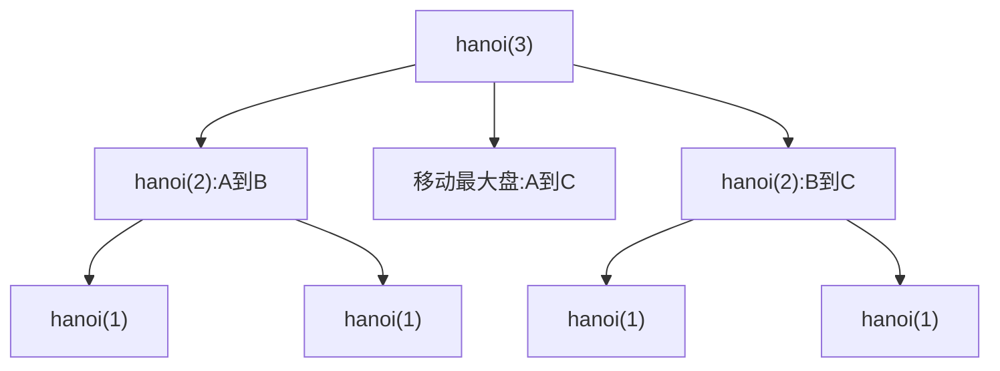
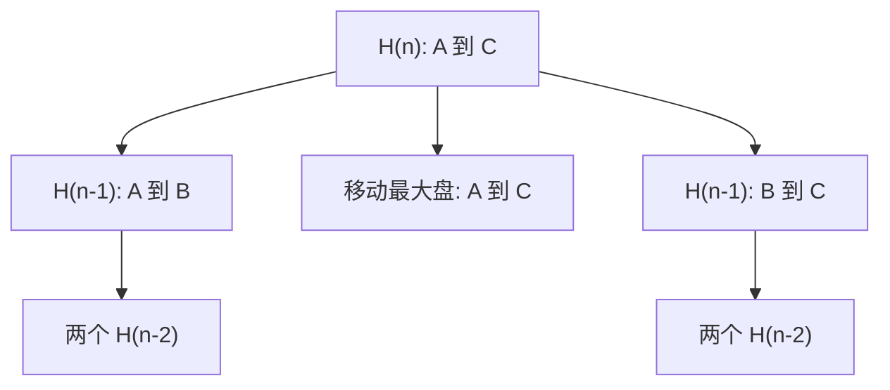

# SPL Run: build_concept_book

- **Adapter:** claude_cli
- **Model:** claude-sonnet-5-5
- **Tokens:** 0 in / 0 out
- **Latency:** 9233ms
- **Timestamp:** 2026-11-25 00:03:02

## Output

```output


---

## 基本情形(Base Case)

**定义。** 在递归问题中,**基本情形**(base case)是规模小到可以*直接求解*、无需再次归约的最简实例。递归定义由两部分构成:

1. **基本情形**:直接给出答案;
2. **递归步骤**:把规模为 $n$ 的问题归约为规模更小的同类问题。

若缺少基本情形,归约永远不会停止,程序会不断调用自身直到栈溢出。基本情形的作用,就是保证归约序列在有限步内**终止**。

**终止性的形式化。** 设问题规模 $n\in\mathbb{N}$,递归步骤把 $n$ 归约为 $n-1$。因为自然数没有无限递减序列,所以只要 $n=0$(或某个下界)被基本情形覆盖,递归必然终止。一般地,需要同时满足两个条件:

- 每次递归调用的规模**严格减小**;
- 无论如何减小,规模最终都会**落入**某个基本情形。

**例题 1:阶乘。** 定义
$$
n! = \begin{cases} 1, & n = 0 \\ n\cdot (n-1)!, & n \ge 1 \end{cases}
$$
计算 $3!$:
$$
3! = 3\cdot 2! = 3\cdot 2\cdot 1! = 3\cdot 2\cdot 1\cdot 0! = 3\cdot2\cdot1\cdot1 = 6.
$$
当 $n=0$ 时,基本情形直接返回 $1$,展开链条停止,然后逐层回代得到结果。取 $0!=1$ 并非任意规定:它使递推式 $1! = 1\cdot 0!$ 成立,并与"空积等于 $1$"一致。

**例题 2:斐波那契数列(需要两个基本情形)。** 
$$
F(n)=F(n-1)+F(n-2),\quad F(0)=0,\ F(1)=1.
$$
若只给出 $F(0)=0$,则计算 $F(1)$ 时需要 $F(-1)$,归约会跳过基本情形而无限下降。因为递归步骤一次回退**两**格,所以基本情形必须覆盖**两个**起点。

**问题求解应用:设计递归时的检查清单。**

```python
def sum_list(a):
    if not a:            # 基本情形:空列表
        return 0
    return a[0] + sum_list(a[1:])   # 规模 n → n-1
```

设计任何递归算法时,依次问自己:

1. **最小实例是什么?** 空列表、$n=0$、单个元素?
2. **递归步骤是否严格缩小规模?** `a[1:]` 比 `a` 短一个元素,满足。
3. **每条归约路径是否都会到达基本情形?** 若步长为 $2$(如 $n\to n-2$),只设 $n=0$ 会漏掉奇数。
4. **基本情形的值是否与递归步骤相容?** 求和用 $0$,求积用 $1$,即运算的单位元。

**常见错误。** 例如对 $n$ 为负数调用上面的阶乘,$n-1$ 越来越小,永远不会等于 $0$。解决办法是加强条件(如 `if n <= 0`)或先验证输入。

**小结。** 基本情形是递归的"锚点":它给出直接答案,并通过"规模严格减小 + 必达基本情形"保证算法终止,是归纳法中"奠基步骤"在算法中的对应物。

---

## 归纳证明

**定义。** 归纳证明是证明递归算法正确性的标准方法。递归算法对规模为 $n$ 的输入，先把问题化为更小的实例，再调用自身求解。这些调用可以暂时当作"递归仙子"（Recursion Fairy）：只要输入更小，仙子就会给出正确答案。这一假设就是**归纳假设**。证明分为两步：

1. **基础情形：** 算法对最小的输入（如 $n=0$ 或 $n=1$）直接给出正确结果。
2. **归纳步骤：** 假设算法对所有规模 $<n$ 的输入都正确（强归纳假设），证明它对规模为 $n$ 的输入也正确。

两步成立，就能得出算法对所有 $n\ge 0$ 都正确。注意，你不需要追踪递归调用内部的执行过程，只需要验证"相信仙子之后，当前这一层是否做对了"。

**例题：求和。** 考虑下面的算法，它计算数组 $A[1..n]$ 的元素和：

```python
def total(A, n):
    if n == 0:
        return 0
    return total(A, n - 1) + A[n]
```

**命题：** 对所有 $n\ge 0$，$\text{total}(A,n)=\sum_{i=1}^{n}A[i]$。

*基础情形。* $n=0$ 时返回 $0$，而空和为 $0$，成立。

*归纳步骤。* 设 $n\ge1$，并假设对 $n-1$ 命题成立，即 $\text{total}(A,n-1)=\sum_{i=1}^{n-1}A[i]$。算法返回

$$\text{total}(A,n-1)+A[n]=\sum_{i=1}^{n-1}A[i]+A[n]=\sum_{i=1}^{n}A[i].$$

因此命题对 $n$ 成立。由归纳法，命题对所有 $n\ge0$ 成立。$\blacksquare$

**问题求解应用：汉诺塔。** 下面的算法把 $n$ 个圆盘从柱 $s$ 经柱 $t$ 借助移到柱 $d$：

```python
def hanoi(n, s, d, t):
    if n == 0:
        return
    hanoi(n - 1, s, t, d)   # 先把上面 n-1 个移到辅助柱
    move(s, d)              # 移动最大的圆盘
    hanoi(n - 1, t, d, s)   # 再把 n-1 个移到目标柱
```

**命题：** $\text{hanoi}(n,s,d,t)$ 合法地把 $n$ 个圆盘从 $s$ 移到 $d$，并且移动次数为 $T(n)=2^n-1$。

*基础情形。* $n=0$ 时无需移动，$T(0)=0=2^0-1$。

*归纳步骤。* 假设对 $n-1$ 成立。第一次递归调用把上面 $n-1$ 个较小的圆盘合法移到 $t$。这时最大的圆盘单独留在 $s$，可直接移到空着的 $d$。因为最大圆盘在 $d$ 上不妨碍任何较小圆盘，第二次递归调用把那 $n-1$ 个圆盘合法移到 $d$ 上。次数满足递推式

$$T(n)=2T(n-1)+1=2(2^{n-1}-1)+1=2^n-1.$$

**常见错误：**
- 漏掉基础情形，或归纳步骤中的调用没有真正缩小规模，这会使论证循环。
- 在归纳假设里偷偷假设了待证的 $n$ 本身。
- 追踪递归的每一层，而不是直接信任仙子。这样不仅繁琐，也容易出错。

**练习：** 证明 $\text{power}(x,n)$（当 $n>0$ 时返回 $x\cdot\text{power}(x,n-1)$，$n=0$ 时返回 $1$）对所有 $n\ge0$ 计算 $x^n$。

---

## 还原

在化学反应中，**还原**指一种物质获得电子、或其中原子的氧化数降低的过程。还原总是与氧化同时发生——一种物质失去电子（被氧化），必然有另一种物质获得这些电子（被还原），二者合称氧化还原反应（redox reaction）。判断还原是否发生，最直接的方法是追踪原子的氧化数变化：氧化数降低，就是被还原。例如在反应

$$\text{Fe}_2\text{O}_3 + 3\text{CO} \rightarrow 2\text{Fe} + 3\text{CO}_2$$

中，铁原子的氧化数从 $+3$（在 $\text{Fe}_2\text{O}_3$ 中）降为 $0$（在单质 Fe 中），铁被还原；而碳原子的氧化数从 $+2$ 升为 $+4$，一氧化碳被氧化，充当**还原剂**（reducing agent），因为它把电子交给了铁的化合物，使自身被氧化。

**应用实例**：判断下列反应中哪种物质被还原：

$$\text{Zn} + \text{Cu}^{2+} \rightarrow \text{Zn}^{2+} + \text{Cu}$$

分析氧化数变化：锌从 $0$ 变为 $+2$，失去 2 个电子，被氧化；铜离子从 $+2$ 变为 $0$，获得 2 个电子，被还原。因此 $\text{Cu}^{2+}$ 是被还原的物质，而锌是还原剂。这类分析是解决电化学、金属活动性顺序以及电池原理问题的基本工具——例如判断两种金属放入同一溶液中谁会被氧化、谁的离子会被还原沉积出来，正是设计原电池（如丹尼尔电池）和判断金属腐蚀倾向的核心依据。

在生物体内，还原反应同样至关重要。细胞呼吸中，$\text{NAD}^+$ 被还原为 $\text{NADH}$，把糖代谢中释放的电子暂时储存起来，供电子传递链在有氧条件下重新氧化、释放能量合成 ATP；光合作用中，$\text{NADP}^+$ 被还原为 $\text{NADPH}$，为暗反应中二氧化碳的固定提供还原力。可见，"还原"不仅是一个化学计量概念，更是生命体内能量与物质转化网络的关键节点：识别一个反应中谁被还原、谁提供了电子，往往是理解代谢途径整体走向的第一步。

---

## 递归

**定义。** 递归(recursion)是归约(reduction)的一种特殊情形:把一个问题归约为一个或多个**规模更小的同类问题**,再由一位想象中的“递归仙子”(Recursion Fairy)去解决这些更小的实例。我们只需做两件事:

1. **基础情形**:对最小的实例直接给出答案;
2. **递归步骤**:假设仙子能正确解决所有更小的实例,说明如何用这些结果拼出原问题的答案。

关键在于**信任仙子**:不要去展开每一层调用,只需验证“若更小的实例正确,则当前实例正确”。这正是数学归纳法的结构,因此递归算法的正确性可用归纳法证明。

**例题:汉诺塔。** 将 $n$ 个盘子从柱 $A$ 移到柱 $C$,借助柱 $B$,每次只能移动一个盘子,且大盘不能压在小盘上。

- 基础情形:$n=0$ 时无需任何操作。
- 递归步骤:请仙子把上面的 $n-1$ 个盘子从 $A$ 移到 $B$;自己把最大的盘子从 $A$ 移到 $C$;再请仙子把 $n-1$ 个盘子从 $B$ 移到 $C$。

```python
def hanoi(n, src, dst, tmp):
    if n == 0:
        return
    hanoi(n - 1, src, tmp, dst)   # 仙子:移走上面的 n-1 个
    print(f"{src} -> {dst}")      # 自己:移最大的盘子
    hanoi(n - 1, tmp, dst, src)   # 仙子:移回 n-1 个
```

**复杂度分析。** 设 $T(n)$ 为移动次数,则

$$T(0)=0,\qquad T(n)=2T(n-1)+1.$$

逐层展开可得 $T(n)=2T(n-1)+1=4T(n-2)+3=\cdots=2^{k}T(n-k)+(2^{k}-1)$。取 $k=n$,得

$$T(n)=2^{n}-1.$$

**归纳验证:** $n=0$ 时 $2^0-1=0$ 成立;若 $T(n-1)=2^{n-1}-1$,则 $T(n)=2(2^{n-1}-1)+1=2^n-1$。


*汉诺塔的递归调用树:每个规模为 $n$ 的问题分解为两个规模为 $n-1$ 的子问题加一次直接移动。*

**问题求解应用。** 设计递归算法时,可按以下步骤思考:

1. **明确子问题**:它必须与原问题同类,且规模严格更小;
2. **写出基础情形**:确保每条调用链都能到达它,否则会无限递归;
3. **只设计“合并”步骤**:假设仙子已给出正确的子问题答案,思考如何组合它们。

**练习:** 用同样的思路写出计算 $n!$ 的递归定义($0!=1$,$n!=n\cdot(n-1)!$),并证明它恰好进行 $n$ 次乘法。再思考:若 $T(n)=2T(n/2)+n$,解为何种量级?(提示:递归树每层代价为 $n$,共 $\log_2 n$ 层,故 $T(n)=\Theta(n\log n)$。)

递归的威力在于:复杂问题只需“一步合并 + 信任仙子”,而正确性与代价都可由归纳法和递推式严格分析。

---

## 汉诺塔

**定义。** 汉诺塔问题:有三根柱子 $A$、$B$、$C$,$A$ 上自下而上叠放着 $n$ 个大小各异的圆盘(大盘在下)。每次只能移动一个圆盘,且大盘永远不能压在小盘上。目标是把全部圆盘从 $A$ 移到 $C$。

**递归思路。** 设 $H(n, A, C, B)$ 表示借助 $B$ 把 $n$ 个盘从 $A$ 移到 $C$。最大的盘只有在其上方无盘、且目标柱为空时才能移动,因此必须:

1. 把上面的 $n-1$ 个盘从 $A$ 移到备用柱 $B$;
2. 把最大的盘从 $A$ 直接移到 $C$;
3. 把 $n-1$ 个盘从 $B$ 移到 $C$。

于是一个 $n$ 盘问题被化为两个 $(n-1)$ 盘问题,加上一步直接移动。

```python
def hanoi(n, src, dst, aux, moves):
    if n == 0:
        return
    hanoi(n - 1, src, aux, dst, moves)
    moves.append((src, dst))
    hanoi(n - 1, aux, dst, src, moves)
```


*图:$n$ 盘问题分解为两个 $n-1$ 盘子问题与一次直接移动,子问题继续按同样方式分解。*

**工作示例($n=3$)。** 调用 $H(3,A,C,B)$:先 $H(2,A,B,C)$ 把两个小盘移到 $B$(3 步:$A\to C$,$A\to B$,$C\to B$),再 $A\to C$ 移最大盘(1 步),最后 $H(2,B,C,A)$(3 步:$B\to A$,$B\to C$,$A\to C$)。共 $3+1+3=7$ 步。

**步数分析。** 设最少步数为 $T(n)$,则
$$T(0)=0,\qquad T(n)=2T(n-1)+1.$$
展开得 $T(n)+1 = 2\,(T(n-1)+1)$,故 $T(n)+1=2^n\,(T(0)+1)$,即
$$T(n)=2^n-1.$$

**最优性证明。** 用归纳法。最大盘至少要移动一次,而它移动时,其余 $n-1$ 个盘必须全部位于第三根柱子上,这至少需要先花 $T(n-1)$ 步;最大盘到达 $C$ 后,其余盘还要从备用柱移到它上面,又至少需要 $T(n-1)$ 步。因此 $T(n)\ge 2T(n-1)+1$,与上述递归给出的上界一致,所以 $2^n-1$ 就是最少步数。

**问题应用。**

*例 1:* 64 个盘需要多少步?若每秒移动一次,约需多少年?
$T(64)=2^{64}-1\approx1.8\times10^{19}$ 步,除以 $3.15\times10^{7}$ 秒/年,约 $5.8\times10^{11}$ 年,远超宇宙年龄。这说明该算法的时间复杂度 $\Theta(2^n)$ 是指数级增长,而且由最优性证明可知,任何算法都无法避免。

*例 2:* 第 $k$ 号盘(1 号最小)在最优解中移动多少次?
每次递归调用中最大盘恰好移动 1 次;$n$ 号盘移动 1 次,$(n-1)$ 号盘出现在两个子问题中,共移动 2 次,依此类推,第 $k$ 号盘移动 $2^{\,n-k}$ 次。验证:$\sum_{k=1}^{n}2^{\,n-k}=2^n-1$,与 $T(n)$ 吻合。

**小结。** 汉诺塔的核心是"化归":把问题缩小为同类的更小问题,并确保最小情形($n=0$)可直接解决。递归式 $T(n)=2T(n-1)+1$ 既描述了算法结构,也直接给出了其代价。

---

## 总结与回报(Payoff)

### 汉诺塔达成了什么

汉诺塔问题:有 $n$ 个大小各异的圆盘和三根柱子,每次只能移动一个圆盘,且大盘不得压在小盘上,要把全部圆盘从柱 A 移到柱 C。它的解法把整本书的核心思想凝聚在一个例子里:**把大问题化为同类型的小问题**。

设 $T(n)$ 为最少移动次数。要移动最大的盘,必须先把上面 $n-1$ 个盘移到辅助柱,再移动最大盘,最后把 $n-1$ 个盘移回其上:

$$T(n) = 2\,T(n-1) + 1,\qquad T(1)=1.$$

展开得 $T(n)=2^n-1$。例如 $n=3$ 时需要 $7$ 步,$n=10$ 时需要 $1023$ 步,$n=64$ 时约需 $1.8\times10^{19}$ 步。

```python
def hanoi(n, src, aux, dst, moves):
    if n == 0:
        return
    hanoi(n - 1, src, dst, aux, moves)   # 先清出上层
    moves.append((src, dst))             # 移动最大盘
    hanoi(n - 1, aux, src, dst, moves)   # 再叠回去
```

### 为什么它是自然的终点

汉诺塔同时用到了本书的三种工具:**递归定义**(问题由自身的较小版本表达)、**数学归纳法**(用归纳可证明 $T(n)=2^n-1$ 且这是最优的)、**递推关系求解**(把算法的结构翻译成增长速度)。学完它,你就能完整走一遍"设计算法 → 证明正确 → 分析代价"的流程,这正是解决问题的完整训练。

### 它与各应用领域的联系

本节没有列出具体的应用领域,下面给出三个与汉诺塔结构直接对应的方向,供你参考:

- **算法分析与计算复杂度:** $2^n-1$ 是指数增长的典型例子。它说明为什么有些问题"可解但不可行",也为分治法的递推分析(如归并排序的 $T(n)=2T(n/2)+O(n)$)提供对照。
- **编程与调用栈:** 递归的 `hanoi` 在运行时逐层压栈、出栈,递归深度为 $n$。理解这一点,就能理解函数调用、回溯与深度优先搜索的内存开销。
- **状态空间与图论:** 所有合法的圆盘摆放构成 $3^n$ 个顶点的图,最短解就是图中的最短路径。这个图呈自相似的谢尔宾斯基三角形结构,把递归与分形、搜索问题联系起来。

### 邀请:选一个方向深入

试着做一个小练习:用上面的代码对 $n=1,2,3,4$ 统计移动次数,验证 $2^n-1$,再把柱子增加到四根(Frame–Stewart 问题),看最少步数如何急剧下降。你也可以选择上面任一方向,从"汉诺塔状态图"入手,画出 $n=2$ 的 $9$ 个状态及其连线,亲自找出最短路径。从这里出发,你会看到递归思想如何延伸到整个计算机科学。
```
