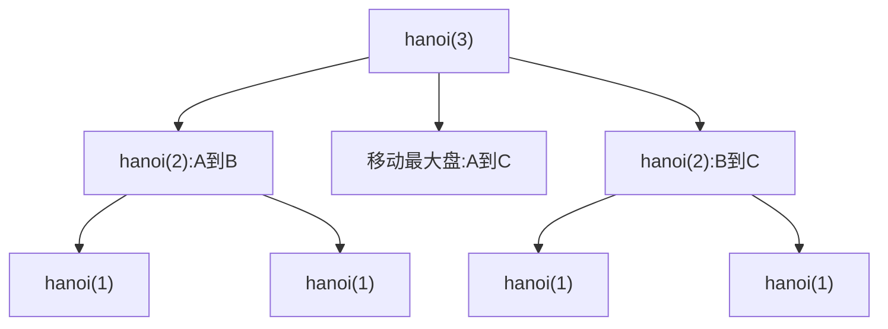
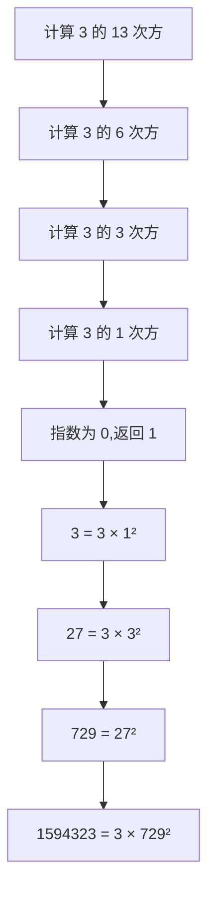

# SPL Run: build_concept_book

- **Adapter:** claude_cli
- **Model:** claude-sonnet-5-5
- **Tokens:** 0 in / 0 out
- **Latency:** 8900ms
- **Timestamp:** 2026-11-25 00:03:12

## Output

```output


---

## 基本情形(Base Case)

**定义。** 在递归问题中,**基本情形**(base case)是规模小到可以*直接求解*、无需再次归约的最简实例。递归定义由两部分构成:

1. **基本情形**:直接给出答案;
2. **递归步骤**:把规模为 $n$ 的问题归约为规模更小的同类问题。

若缺少基本情形,归约永远不会停止,程序会不断调用自身直到栈溢出。基本情形的作用,就是保证归约序列在有限步内**终止**。

**终止性的形式化。** 设问题规模 $n\in\mathbb{N}$,递归步骤把 $n$ 归约为 $n-1$。因为自然数没有无限递减序列,所以只要 $n=0$(或某个下界)被基本情形覆盖,递归必然终止。一般地,需要同时满足两个条件:

- 每次递归调用的规模**严格减小**;
- 无论如何减小,规模最终都会**落入**某个基本情形。

**例题 1:阶乘。** 定义
$$
n! = \begin{cases} 1, & n = 0 \\ n\cdot (n-1)!, & n \ge 1 \end{cases}
$$
计算 $3!$:
$$
3! = 3\cdot 2! = 3\cdot 2\cdot 1! = 3\cdot 2\cdot 1\cdot 0! = 3\cdot2\cdot1\cdot1 = 6.
$$
当 $n=0$ 时,基本情形直接返回 $1$,展开链条停止,然后逐层回代得到结果。取 $0!=1$ 并非任意规定:它使递推式 $1! = 1\cdot 0!$ 成立,并与"空积等于 $1$"一致。

**例题 2:斐波那契数列(需要两个基本情形)。** 
$$
F(n)=F(n-1)+F(n-2),\quad F(0)=0,\ F(1)=1.
$$
若只给出 $F(0)=0$,则计算 $F(1)$ 时需要 $F(-1)$,归约会跳过基本情形而无限下降。因为递归步骤一次回退**两**格,所以基本情形必须覆盖**两个**起点。

**问题求解应用:设计递归时的检查清单。**

```python
def sum_list(a):
    if not a:            # 基本情形:空列表
        return 0
    return a[0] + sum_list(a[1:])   # 规模 n → n-1
```

设计任何递归算法时,依次问自己:

1. **最小实例是什么?** 空列表、$n=0$、单个元素?
2. **递归步骤是否严格缩小规模?** `a[1:]` 比 `a` 短一个元素,满足。
3. **每条归约路径是否都会到达基本情形?** 若步长为 $2$(如 $n\to n-2$),只设 $n=0$ 会漏掉奇数。
4. **基本情形的值是否与递归步骤相容?** 求和用 $0$,求积用 $1$,即运算的单位元。

**常见错误。** 例如对 $n$ 为负数调用上面的阶乘,$n-1$ 越来越小,永远不会等于 $0$。解决办法是加强条件(如 `if n <= 0`)或先验证输入。

**小结。** 基本情形是递归的"锚点":它给出直接答案,并通过"规模严格减小 + 必达基本情形"保证算法终止,是归纳法中"奠基步骤"在算法中的对应物。

---

## 归纳证明

**定义。** 归纳证明是证明递归算法正确性的标准方法。递归算法对规模为 $n$ 的输入，先把问题化为更小的实例，再调用自身求解。这些调用可以暂时当作"递归仙子"（Recursion Fairy）：只要输入更小，仙子就会给出正确答案。这一假设就是**归纳假设**。证明分为两步：

1. **基础情形：** 算法对最小的输入（如 $n=0$ 或 $n=1$）直接给出正确结果。
2. **归纳步骤：** 假设算法对所有规模 $<n$ 的输入都正确（强归纳假设），证明它对规模为 $n$ 的输入也正确。

两步成立，就能得出算法对所有 $n\ge 0$ 都正确。注意，你不需要追踪递归调用内部的执行过程，只需要验证"相信仙子之后，当前这一层是否做对了"。

**例题：求和。** 考虑下面的算法，它计算数组 $A[1..n]$ 的元素和：

```python
def total(A, n):
    if n == 0:
        return 0
    return total(A, n - 1) + A[n]
```

**命题：** 对所有 $n\ge 0$，$\text{total}(A,n)=\sum_{i=1}^{n}A[i]$。

*基础情形。* $n=0$ 时返回 $0$，而空和为 $0$，成立。

*归纳步骤。* 设 $n\ge1$，并假设对 $n-1$ 命题成立，即 $\text{total}(A,n-1)=\sum_{i=1}^{n-1}A[i]$。算法返回

$$\text{total}(A,n-1)+A[n]=\sum_{i=1}^{n-1}A[i]+A[n]=\sum_{i=1}^{n}A[i].$$

因此命题对 $n$ 成立。由归纳法，命题对所有 $n\ge0$ 成立。$\blacksquare$

**问题求解应用：汉诺塔。** 下面的算法把 $n$ 个圆盘从柱 $s$ 经柱 $t$ 借助移到柱 $d$：

```python
def hanoi(n, s, d, t):
    if n == 0:
        return
    hanoi(n - 1, s, t, d)   # 先把上面 n-1 个移到辅助柱
    move(s, d)              # 移动最大的圆盘
    hanoi(n - 1, t, d, s)   # 再把 n-1 个移到目标柱
```

**命题：** $\text{hanoi}(n,s,d,t)$ 合法地把 $n$ 个圆盘从 $s$ 移到 $d$，并且移动次数为 $T(n)=2^n-1$。

*基础情形。* $n=0$ 时无需移动，$T(0)=0=2^0-1$。

*归纳步骤。* 假设对 $n-1$ 成立。第一次递归调用把上面 $n-1$ 个较小的圆盘合法移到 $t$。这时最大的圆盘单独留在 $s$，可直接移到空着的 $d$。因为最大圆盘在 $d$ 上不妨碍任何较小圆盘，第二次递归调用把那 $n-1$ 个圆盘合法移到 $d$ 上。次数满足递推式

$$T(n)=2T(n-1)+1=2(2^{n-1}-1)+1=2^n-1.$$

**常见错误：**
- 漏掉基础情形，或归纳步骤中的调用没有真正缩小规模，这会使论证循环。
- 在归纳假设里偷偷假设了待证的 $n$ 本身。
- 追踪递归的每一层，而不是直接信任仙子。这样不仅繁琐，也容易出错。

**练习：** 证明 $\text{power}(x,n)$（当 $n>0$ 时返回 $x\cdot\text{power}(x,n-1)$，$n=0$ 时返回 $1$）对所有 $n\ge0$ 计算 $x^n$。

---

## 还原

在化学反应中，**还原**指一种物质获得电子、或其中原子的氧化数降低的过程。还原总是与氧化同时发生——一种物质失去电子（被氧化），必然有另一种物质获得这些电子（被还原），二者合称氧化还原反应（redox reaction）。判断还原是否发生，最直接的方法是追踪原子的氧化数变化：氧化数降低，就是被还原。例如在反应

$$\text{Fe}_2\text{O}_3 + 3\text{CO} \rightarrow 2\text{Fe} + 3\text{CO}_2$$

中，铁原子的氧化数从 $+3$（在 $\text{Fe}_2\text{O}_3$ 中）降为 $0$（在单质 Fe 中），铁被还原；而碳原子的氧化数从 $+2$ 升为 $+4$，一氧化碳被氧化，充当**还原剂**（reducing agent），因为它把电子交给了铁的化合物，使自身被氧化。

**应用实例**：判断下列反应中哪种物质被还原：

$$\text{Zn} + \text{Cu}^{2+} \rightarrow \text{Zn}^{2+} + \text{Cu}$$

分析氧化数变化：锌从 $0$ 变为 $+2$，失去 2 个电子，被氧化；铜离子从 $+2$ 变为 $0$，获得 2 个电子，被还原。因此 $\text{Cu}^{2+}$ 是被还原的物质，而锌是还原剂。这类分析是解决电化学、金属活动性顺序以及电池原理问题的基本工具——例如判断两种金属放入同一溶液中谁会被氧化、谁的离子会被还原沉积出来，正是设计原电池（如丹尼尔电池）和判断金属腐蚀倾向的核心依据。

在生物体内，还原反应同样至关重要。细胞呼吸中，$\text{NAD}^+$ 被还原为 $\text{NADH}$，把糖代谢中释放的电子暂时储存起来，供电子传递链在有氧条件下重新氧化、释放能量合成 ATP；光合作用中，$\text{NADP}^+$ 被还原为 $\text{NADPH}$，为暗反应中二氧化碳的固定提供还原力。可见，"还原"不仅是一个化学计量概念，更是生命体内能量与物质转化网络的关键节点：识别一个反应中谁被还原、谁提供了电子，往往是理解代谢途径整体走向的第一步。

---

## 递归

**定义。** 递归(recursion)是归约(reduction)的一种特殊情形:把一个问题归约为一个或多个**规模更小的同类问题**,再由一位想象中的“递归仙子”(Recursion Fairy)去解决这些更小的实例。我们只需做两件事:

1. **基础情形**:对最小的实例直接给出答案;
2. **递归步骤**:假设仙子能正确解决所有更小的实例,说明如何用这些结果拼出原问题的答案。

关键在于**信任仙子**:不要去展开每一层调用,只需验证“若更小的实例正确,则当前实例正确”。这正是数学归纳法的结构,因此递归算法的正确性可用归纳法证明。

**例题:汉诺塔。** 将 $n$ 个盘子从柱 $A$ 移到柱 $C$,借助柱 $B$,每次只能移动一个盘子,且大盘不能压在小盘上。

- 基础情形:$n=0$ 时无需任何操作。
- 递归步骤:请仙子把上面的 $n-1$ 个盘子从 $A$ 移到 $B$;自己把最大的盘子从 $A$ 移到 $C$;再请仙子把 $n-1$ 个盘子从 $B$ 移到 $C$。

```python
def hanoi(n, src, dst, tmp):
    if n == 0:
        return
    hanoi(n - 1, src, tmp, dst)   # 仙子:移走上面的 n-1 个
    print(f"{src} -> {dst}")      # 自己:移最大的盘子
    hanoi(n - 1, tmp, dst, src)   # 仙子:移回 n-1 个
```

**复杂度分析。** 设 $T(n)$ 为移动次数,则

$$T(0)=0,\qquad T(n)=2T(n-1)+1.$$

逐层展开可得 $T(n)=2T(n-1)+1=4T(n-2)+3=\cdots=2^{k}T(n-k)+(2^{k}-1)$。取 $k=n$,得

$$T(n)=2^{n}-1.$$

**归纳验证:** $n=0$ 时 $2^0-1=0$ 成立;若 $T(n-1)=2^{n-1}-1$,则 $T(n)=2(2^{n-1}-1)+1=2^n-1$。


*汉诺塔的递归调用树:每个规模为 $n$ 的问题分解为两个规模为 $n-1$ 的子问题加一次直接移动。*

**问题求解应用。** 设计递归算法时,可按以下步骤思考:

1. **明确子问题**:它必须与原问题同类,且规模严格更小;
2. **写出基础情形**:确保每条调用链都能到达它,否则会无限递归;
3. **只设计“合并”步骤**:假设仙子已给出正确的子问题答案,思考如何组合它们。

**练习:** 用同样的思路写出计算 $n!$ 的递归定义($0!=1$,$n!=n\cdot(n-1)!$),并证明它恰好进行 $n$ 次乘法。再思考:若 $T(n)=2T(n/2)+n$,解为何种量级?(提示:递归树每层代价为 $n$,共 $\log_2 n$ 层,故 $T(n)=\Theta(n\log n)$。)

递归的威力在于:复杂问题只需“一步合并 + 信任仙子”,而正确性与代价都可由归纳法和递推式严格分析。

---

## 快速幂

**定义。** 快速幂(fast exponentiation,又称"反复平方法")是一种计算 $a^n$ 的递归方法。朴素做法需要做 $n-1$ 次乘法;快速幂每一步把指数减半,只需 $O(\log n)$ 次乘法。其依据是下面的恒等式:

$$
a^n=\begin{cases}
1, & n=0,\\[4pt]
\left(a^{n/2}\right)^2, & n \text{ 为偶数},\\[4pt]
a\cdot\left(a^{(n-1)/2}\right)^2, & n \text{ 为奇数}.
\end{cases}
$$

这些等式直接来自指数律 $a^{m+k}=a^m a^k$。关键在于:子问题 $a^{\lfloor n/2\rfloor}$ 只算**一次**,再平方。若把它写成 $a^{n/2}\cdot a^{n/2}$ 并分别递归两次,就会退化回 $O(n)$。

```python
def power(a, n):
    if n == 0:
        return 1
    half = power(a, n // 2)      # 只递归一次
    return half * half if n % 2 == 0 else a * half * half
```

**例题。** 计算 $3^{13}$。把指数逐步减半:

$$
13 \to 6 \to 3 \to 1 \to 0.
$$

回代:

- $3^0=1$
- $3^1=3\cdot(3^0)^2=3$
- $3^3=3\cdot(3^1)^2=27$
- $3^6=(3^3)^2=729$
- $3^{13}=3\cdot(3^6)^2=3\cdot 531441=1594323$

共 4 层递归,最多 8 次乘法,而朴素方法需要 12 次。

**复杂度分析。** 设 $T(n)$ 为所需乘法次数,则
$$
T(n)\le T(\lfloor n/2\rfloor)+2,\qquad T(0)=0.
$$
指数每次至少减半,经过 $\lfloor\log_2 n\rfloor+1$ 步降为 0,因此 $T(n)\le 2\lfloor\log_2 n\rfloor+2=O(\log n)$。例如 $n=10^9$ 时,朴素方法需约 $10^9$ 次乘法,快速幂不超过 60 次。


*图:指数 13 的递归过程。向下每层指数减半,向上回代时做平方,奇数层再多乘一个 $a$。*

**问题求解应用。** 快速幂最常见的用途是模幂运算,例如求 $7^{1000000} \bmod 13$,或密码学(RSA)中的 $a^e \bmod m$。因为 $(xy)\bmod m=\big((x\bmod m)(y\bmod m)\big)\bmod m$,每次乘法后立即取模,中间结果始终小于 $m$,不会溢出:

```python
def power_mod(a, n, m):
    if n == 0:
        return 1 % m
    half = power_mod(a, n // 2, m)
    r = half * half % m
    return r if n % 2 == 0 else r * a % m
```

**练习。** (1) 用快速幂手算 $2^{10} \bmod 7$,写出每一层的结果。(2) 为什么把 `half * half` 写成 `power(a, n//2) * power(a, n//2)` 会使复杂度退化为 $O(n)$?(提示:写出此时的递推 $T(n)=2T(n/2)+1$。)

---

## 收获(Payoff)

**快速幂**把"求 $a^n$"的代价从 $n-1$ 次乘法降到 $O(\log n)$ 次。它依赖的恒等式只有一条:

$$
a^n=\begin{cases}1, & n=0,\\ \left(a^{n/2}\right)^2, & n \text{ 为偶数},\\ a\cdot\left(a^{(n-1)/2}\right)^2, & n \text{ 为奇数}.\end{cases}
$$

每一步把指数减半,所以递归深度为 $\lfloor\log_2 n\rfloor+1$。这也可以写成对 $n$ 的二进制展开做逐位扫描。

### 为什么它是自然的终点

前面的概念在这里汇合:

- **指数律** $a^{m+n}=a^m a^n$ 保证拆分是正确的。
- **二进制表示**决定了拆分的方式。
- **递推与复杂度分析**说明了这样做值得:$T(n)=T(n/2)+O(1)$ 给出 $T(n)=O(\log n)$。

**例:** 计算 $3^{13}$。因为 $13=1101_2$,所以

$$
3^{13}=3^{8}\cdot 3^{4}\cdot 3^{1}=6561\cdot 81\cdot 3=1594323.
$$

反复平方只需 $3,\,9,\,81,\,6561$ 这几个数,总共约 $6$ 次乘法,朴素算法则需要 $12$ 次。当 $n\approx 10^{18}$ 时,朴素算法在现实中不可行,快速幂只需约 $60$ 次乘法。

关键的一点是:这个算法只用到了乘法的**结合律**,没有用到别的性质。因此,只要对象之间的乘法满足结合律,它就适用。

### 与各应用领域的联系

题目没有列出具体的应用领域。下面是这一思想最常见的几个落脚点。

1. **模幂与密码学。** RSA 要计算 $c \equiv m^e \pmod N$,其中 $e$ 有数百位。每次乘法后立即取模,数值始终小于 $N$:

   ```python
   def power_mod(a, n, m):
       result, a = 1, a % m
       while n > 0:
           if n & 1:               # 当前二进制位为 1
               result = result * a % m
           a = a * a % m           # 平方
           n >>= 1
       return result
   ```

   Diffie–Hellman 密钥交换、Miller–Rabin 素性检验也依赖同一个循环。

2. **矩阵幂与递推数列。** 斐波那契数满足
   $$
   \begin{pmatrix}1&1\\1&0\end{pmatrix}^{n}=\begin{pmatrix}F_{n+1}&F_n\\F_n&F_{n-1}\end{pmatrix}.
   $$
   对矩阵做快速幂,可以在 $O(\log n)$ 次矩阵乘法内求出 $F_n$。线性递推、马尔可夫链的 $n$ 步转移概率也可以这样求。

3. **图与计数。** 邻接矩阵 $A$ 的幂 $A^k$ 的 $(i,j)$ 元素,等于从 $i$ 到 $j$ 的长度为 $k$ 的路径数。快速幂让很大的 $k$ 也能算出来。

4. **群与几何。** 椭圆曲线密码学中的"标量乘法" $kP$ 是同一算法的加法版本(倍加—累加)。变换的重复复合,如旋转 $R^n$,也可以这样计算。

### 问题求解中的启示

遇到"同一个运算重复 $n$ 次"的问题时,先问三个问题:

1. 这个运算满足结合律吗?
2. 能否把 $n$ 拆成二进制位?
3. 中间结果的大小可以控制吗(例如取模)?

三个答案都是肯定的,就能把线性代价压成对数代价。

### 邀请

选一个方向深入。**推荐从矩阵快速幂求斐波那契数列开始**:它只需要把上面代码中的数字乘法换成 $2\times2$ 矩阵乘法,而且你可以用 $F_{90}$ 之类的已知值验证结果。接着可以把取模版本接到 RSA 的小型实现上,亲手加密并解密一条消息。这时你会看到,一个只有几行的算法,支撑着整个现代密码系统。
```
