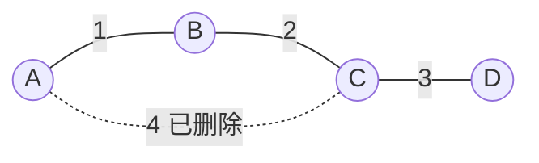
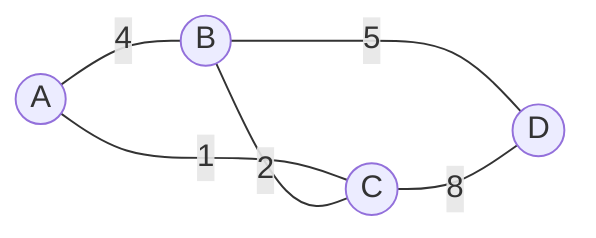
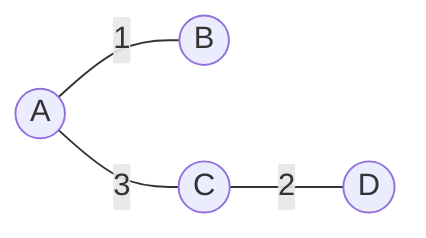
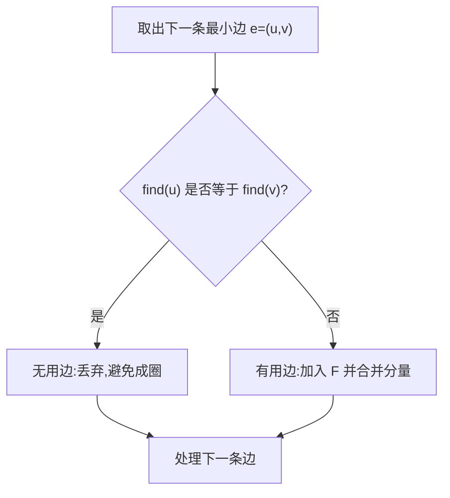
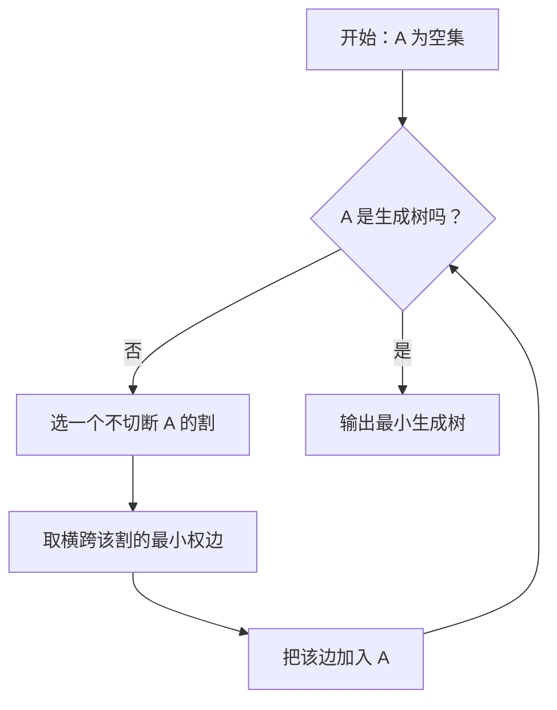

# SPL Run: build_concept_book

- **Adapter:** claude_cli
- **Model:** claude-sonnet-5-5
- **Tokens:** 0 in / 0 out
- **Latency:** 10645ms
- **Timestamp:** 2026-11-25 00:04:27

## Output

```output


---

## 中间生成森林

**定义。** 设 $G=(V,E,w)$ 是连通带权无向图。*中间生成森林*是 Kruskal、Prim、Borůvka 等算法在构造最小生成树(MST)过程中维护的一个无环子图 $F=(V,E_F)$,$E_F\subseteq E$。它始终满足**不变式**:存在 $G$ 的某棵 MST $T$,使得 $F\subseteq T$。算法每一步加入一条边,森林的连通分量逐渐合并。当 $|E_F|=|V|-1$ 时,$F$ 就是一棵完整的 MST。

森林有 $|V|$ 个顶点、$k$ 个连通分量时,恰有 $|V|-k$ 条边。起初 $F=(V,\varnothing)$,有 $|V|$ 个分量;每加一条安全边,分量数减 1。

**为什么这个不变式能被保持?(切割性质)** 设 $F\subseteq T$,$S\subset V$ 是一个"切割",且 $F$ 中没有边横跨 $(S,V\setminus S)$。设 $e$ 是横跨该切割的最小权边。则 $F\cup\{e\}$ 仍包含于某棵 MST。

*证明。* 若 $e\in T$,结论显然。否则 $T\cup\{e\}$ 含唯一一个环,该环必有另一条横跨切割的边 $e'\in T$,且 $w(e)\le w(e')$。令 $T'=T\setminus\{e'\}\cup\{e\}$,则 $T'$ 仍是生成树,$w(T')=w(T)-w(e')+w(e)\le w(T)$,所以 $T'$ 也是 MST。由于 $F$ 无边横跨该切割,$e'\notin F$,故 $F\cup\{e\}\subseteq T'$。$\blacksquare$

满足条件的 $e$ 称为**安全边**。

**例题。** 顶点 $\{A,B,C,D\}$,边权:$AB=1,\ BC=4,\ AC=2,\ CD=3,\ BD=5$。按 Kruskal 算法按权从小到大处理:

1. 加入 $AB$(1):$F=\{AB\}$,分量 $\{A,B\},\{C\},\{D\}$。
2. 加入 $AC$(2):分量 $\{A,B,C\},\{D\}$。
3. 考察 $BC$(4):$B,C$ 已在同一分量,加入会成环,**跳过**。
4. 加入 $CD$(3 已在 4 之前处理,实际顺序为 $CD$ 先于 $BC$):分量合并为 $\{A,B,C,D\}$。

最终 $F=\{AB,AC,CD\}$,边数 $3=|V|-1$,权重 $1+2+3=6$,即 MST。

**问题求解应用。** 判断一条候选边能否加入 $F$,只需两步:

- **判环**:若两端点属于 $F$ 的同一分量,则拒绝。可用并查集,单次操作近似 $O(\alpha(n))$。
- **判安全**:取一个不被 $F$ 横跨的切割,选其上的最小权边。Prim 算法取 $S=$ 当前树的顶点集;Borůvka 算法对每个分量取其出边中的最小权边。

*练习:* 在上例中,当 $F=\{AB\}$ 时,取 $S=\{A,B\}$,横跨边为 $AC(2),BC(4),BD(5)$。最小者 $AC$ 是安全边,这与 Kruskal 的选择一致。若边权出现并列,不变式依然成立,只是 MST 不唯一。

**小结:** 中间生成森林是 MST 算法正确性的"载体"。证明算法正确,只需证明初始空森林满足不变式,且每步加入的边都是安全边。

---

## 生成树

**定义。** 设 $G=(V,E)$ 是连通无向图。$G$ 的**生成树**是满足下列条件的子图 $T=(V,E')$,其中 $E'\subseteq E$:

1. $T$ 包含 $G$ 的全部顶点 $V$;
2. $T$ 连通且不含回路(即 $T$ 是树)。

生成树有一条核心性质:若 $|V|=n$,则每棵生成树恰有 $n-1$ 条边。原因是树恰有 $n-1$ 条边。少一条边,图就不连通。多一条边,就会形成回路。

连通图一定存在生成树。做法是:只要图中还有回路,就从回路上删去一条边。删边不会破坏连通性,直到无回路为止。

**例题。** 设 $G$ 的顶点为 $\{A,B,C,D\}$,边为 $AB,\ AC,\ BC,\ CD$,边权依次为 $1,\,4,\,2,\,3$。

$n=4$,所以生成树需要 $3$ 条边。$G$ 有回路 $A\!-\!B\!-\!C\!-\!A$,必须去掉其中一条边。

- 去掉 $AC$:保留 $\{AB,BC,CD\}$,总权重 $1+2+3=6$。
- 去掉 $BC$:保留 $\{AB,AC,CD\}$,总权重 $1+4+3=8$。
- 去掉 $AB$:保留 $\{AC,BC,CD\}$,总权重 $4+2+3=9$。

所以 $G$ 共有 $3$ 棵生成树。其中权重最小的是第一棵,总权重为 $6$。边 $CD$ 是桥,所有生成树都必须包含它。


*图中实线是权重最小的生成树 $\{AB,BC,CD\}$,虚线是被删去的边 $AC$。*

**问题求解应用。** 在实际问题里,生成树对应"用最少的连接把所有节点连通"。例如:要用光缆连接 $n$ 个城市,每条可铺设线路都有造价,求总造价最小的方案。这就是**最小生成树**(MST)问题。

**Kruskal 算法**的步骤如下:

1. 把所有边按权重从小到大排序。
2. 依次考察每条边。若加入它不会与已选边形成回路,就选中它。
3. 选满 $n-1$ 条边后停止。

对上面的例子,排序后依次是 $AB(1),BC(2),CD(3),AC(4)$。前三条边都不成环,被选中。选满 $3$ 条边后停止,总权重为 $6$,与枚举的结果一致。

这个算法正确,依据的是**割性质**。把顶点分成两个非空集合,跨越这两个集合的所有边中,权重最小的那条边一定属于某棵最小生成树。若排序后每条边的权重互不相同,这棵最小生成树还是唯一的。

**复杂度。** 排序需要 $O(|E|\log|E|)$ 时间。用并查集判断是否成环,几乎是常数时间。因此总时间由排序主导,为 $O(|E|\log|E|)$。

**检验自己。** 一个有 $10$ 个顶点的连通图,其生成树有几条边?答案是 $9$ 条。若某个子图有 $9$ 条边却不连通,它能是生成树吗?不能。它必然含有回路,所以不是树。

---

## 加权图

**定义。** 设 $G=(V,E)$ 是连通的无向图。若再给定函数 $w:E\to\mathbb{R}$,为每条边 $e\in E$ 指定实数 $w(e)$(称为**权重**),则三元组 $(V,E,w)$ 称为**加权图**。权重可表示距离、费用、时间或容量等。路径 $P=(v_0,v_1,\dots,v_k)$ 的**总权重**为

$$
w(P)=\sum_{i=1}^{k} w(\{v_{i-1},v_i\}).
$$

子图 $H$ 的权重同理,为其所有边权之和。因为 $G$ 连通,任意两个顶点之间至少有一条路径,所以"最短路径"和"最小生成树"这类问题总是有意义的。

**存储方式。** 常用邻接表 $\text{adj}[u]=\{(v,w(u,v))\}$,空间为 $O(|V|+|E|)$;稠密图可用权重矩阵 $W_{uv}=w(\{u,v\})$,空间为 $O(|V|^2)$。无向图中 $W$ 是对称的。


*示例加权图:顶点为 A、B、C、D,边上的数字是权重。*

**例题。** 对上图,求 A 到 D 的最短路径。

枚举从 A 到 D 的简单路径并计算总权重:

- $A\to B\to D$:$4+5=9$
- $A\to C\to D$:$1+8=9$
- $A\to C\to B\to D$:$1+2+5=8$

最短路径是 $A\to C\to B\to D$,权重为 $8$。注意,经过边数最多的路径反而最短。**可见在加权图中,"边数最少"与"权重最小"是不同的目标。**

**问题求解应用。** 同一个加权图可以回答两类不同的问题。

1. *最短路径*(如导航):求 $\min_P w(P)$。当所有权重非负时,可用 Dijkstra 算法,使用二叉堆时复杂度为 $O((|V|+|E|)\log|V|)$。
2. *最小生成树*(如铺设光缆):在 $G$ 的所有生成树 $T$ 中,求 $w(T)=\sum_{e\in T}w(e)$ 最小者。Kruskal 或 Prim 算法可在 $O(|E|\log|V|)$ 时间内解决。

对上图求最小生成树:按权重升序考察边,依次取 $AC\,(1)$、$BC\,(2)$,再考察 $AB\,(4)$,它会与已选的边构成环,舍去;取 $BD\,(5)$,此时已有 $|V|-1=3$ 条边,停止。总权重为 $1+2+5=8$。

两类问题的解不一定相同:此例中碰巧都是 8,但最短路径树和最小生成树一般并不一致。建模时应先问清目标:是"从一点到另一点代价最小",还是"以最小总代价连通所有点"?

**小结。** 加权图 $=$ 连通无向图 $+$ 边权函数 $w$。路径与子图的代价都由边权求和得到,不同的优化目标(最短路径、最小生成树)对应不同的算法。

---

## 最小生成树

**定义。** 设 $G=(V,E)$ 是连通的无向加权图,边 $e$ 的权重为 $w(e)$。**生成树**是包含 $G$ 全部顶点、且无圈连通的子图,恰有 $|V|-1$ 条边。**最小生成树**(MST)是所有生成树中总权重

$$w(T)=\sum_{e\in T} w(e)$$

最小的那一棵。若各边权重互不相同,则 MST 唯一。

**核心性质(割性质)。** 把顶点任意划分为 $S$ 与 $V\setminus S$,则横跨这两部分的所有边中,权重最小的边必属于某棵 MST。

*证明思路:* 设最小横跨边 $e$ 不在某棵 MST $T$ 中。把 $e$ 加入 $T$ 会形成唯一的圈,该圈必含另一条横跨边 $f$,且 $w(f)\ge w(e)$。用 $e$ 替换 $f$ 得到的新生成树,权重不超过 $w(T)$,因此仍是 MST。$\square$

由此得到两个贪心算法:

- **Kruskal 算法:** 将边按权重升序排列,依次加入,若会形成圈则跳过。用并查集判圈,复杂度为 $O(|E|\log|E|)$。
- **Prim 算法:** 从某顶点出发,每次加入连接"已选集合"与"未选集合"的最小边。用二叉堆实现,复杂度为 $O(|E|\log|V|)$。

**例题。** 图有顶点 $A,B,C,D$,边权为:$AB=1$,$BC=4$,$AC=3$,$CD=2$,$BD=5$。用 Kruskal 算法:

1. 取 $AB$(1):加入。
2. 取 $CD$(2):加入。
3. 取 $AC$(3):连接 $\{A,B\}$ 与 $\{C,D\}$,不成圈,加入。
4. 此时已有 $3=|V|-1$ 条边,停止。

所以 $w(T)=1+2+3=6$。若改选 $BC$(4)代替 $AC$,总权重为 7,更大。


*图:例题中的最小生成树,加粗保留的三条边总权重为 6;边 $BC$ 与 $BD$ 被舍弃。*

**问题求解应用。** 某公司要用光缆连接 5 栋楼,各楼之间铺设成本不同,要求任意两栋楼都能通信且总成本最低。把楼看作顶点、可铺设的线路看作边、成本看作权重,问题就转化为求 MST。解题步骤:

1. 建模:写出所有候选边及其成本。
2. 选算法:边数少(稀疏图)用 Kruskal,边数接近 $|V|^2$(稠密图)用 Prim。
3. 验证:检查所选边数是否为 $|V|-1$,且图保持连通无圈。

MST 还用于聚类(删去 MST 中最重的 $k-1$ 条边,得到 $k$ 个簇)、电路布线和网络设计。

**小结。** MST 要求在保持连通的前提下使总权重最小;割性质保证了"每步取局部最优"的贪心策略全局正确。

---

## 安全边(Safe Edge)

**定义。** 设 $G=(V,E)$ 是带权连通无向图,$F\subseteq E$ 是一个无环边集(一片森林,它是某棵最小生成树的子集)。$F$ 把顶点划分成若干连通分量。设 $C$ 是其中一个分量。若边 $e=(u,v)$ 恰有一个端点在 $C$ 内,则称 $e$ **离开** $C$。所有离开 $C$ 的边中权重最小的那条,称为 $F$ 的**安全边**(safe edge)。"安全"的含义是:把它加入 $F$ 之后,$F\cup\{e\}$ 仍然包含在某棵最小生成树中。

**安全边性质(切割性质的分量形式)。** 若 $F\subseteq T^*$($T^*$ 为某棵最小生成树),$e$ 是离开 $C$ 的最小权边,则存在最小生成树 $T'$ 满足 $F\cup\{e\}\subseteq T'$。

*证明思路。* 若 $e\in T^*$,结论显然。否则,在 $T^*$ 中加入 $e$ 会形成唯一的环。该环从 $C$ 内出发、经过 $e$ 到达 $C$ 外,必然还要通过另一条离开 $C$ 的边 $f$ 才能回到起点。因为 $e$ 是最小权离开边,所以 $w(e)\le w(f)$。令 $T'=T^*\setminus\{f\}\cup\{e\}$,它仍是生成树,且
$$w(T')=w(T^*)-w(f)+w(e)\le w(T^*).$$
$T^*$ 已是最小,故 $T'$ 也是最小生成树。又 $f$ 离开 $C$,所以 $f\notin F$,因此 $F\subseteq T'$。$\blacksquare$

**例题。** 取顶点 $\{A,B,C,D\}$,边权为 $w(AB)=1$,$w(BC)=4$,$w(AC)=3$,$w(CD)=2$,$w(BD)=5$。设当前 $F=\{AB\}$,分量为 $\{A,B\}$、$\{C\}$、$\{D\}$。

- 对分量 $\{A,B\}$:离开它的边是 $AC\,(3)$、$BC\,(4)$、$BD\,(5)$,最小者为 $AC$,所以 $AC$ 是安全边。
- 对分量 $\{C\}$:离开它的边是 $AC\,(3)$、$BC\,(4)$、$CD\,(2)$,最小者为 $CD$,所以 $CD$ 也是安全边。

把两条安全边同时加入,得到 $F=\{AB,AC,CD\}$,总权重为 $1+3+2=6$,恰有 $|V|-1=3$ 条边,即为最小生成树。

**问题求解应用。** 安全边性质是 Borůvka、Prim、Kruskal 三种算法正确性的共同基础:

- **Borůvka**:每一轮,为每个分量各选一条安全边并同时加入。每轮分量数至少减半,所以共需 $O(\log |V|)$ 轮,总时间为 $O(|E|\log|V|)$。
- **Prim**:始终只维护一个分量,每步加入离开它的最小权边。
- **Kruskal**:按权重升序扫描,第一条连接两个不同分量的边,正是其中一个分量的安全边。

*注意事项。* 若存在权重相同的边,必须用一致的规则(例如按边编号)打破平局。否则在 Borůvka 中,各分量可能选出会构成环的边。在边权互不相同的图中,最小生成树唯一,每条安全边必然属于这棵树。

**小结。** 要判断一条边能否放心加入,只需检查它是不是某个分量的最小权离开边。只要是,就可以加入。

---

## 无用边(Useless Edge)

**定义。** 在 Kruskal 算法中,设已选边集合 $F$ 构成一个森林。若边 $e=(u,v)\notin F$ 的两个端点 $u,v$ 已经位于 $F$ 的同一个连通分量中,则称 $e$ 为**无用边**。原因是 $F$ 中已有一条从 $u$ 到 $v$ 的路径,再加入 $e$ 就会形成圈,而树不能含圈,所以 $e$ 不可能属于最小生成树(MST)。

判定条件可写成
$$
\operatorname{find}(u)=\operatorname{find}(v)\ \Longrightarrow\ e\ \text{为无用边},
$$
其中 $\operatorname{find}$ 返回顶点所在分量的代表元(并查集操作)。

**为什么可以安全丢弃?** 按权值从小到大处理边时,连接 $u$ 与 $v$ 的那条路径上的每条边,权值都不超过 $w(e)$。由圈性质(cycle property):圈中权值最大的边可以从某棵 MST 中去掉。因此丢掉 $e$ 不会增加总权重。

**例题。** 图有顶点 $A,B,C,D$,边权为 $w(AB)=1,\ w(BC)=2,\ w(AC)=3,\ w(CD)=4$。按权值升序处理:

1. $AB$:$A,B$ 在不同分量,加入 $F$。
2. $BC$:$B$ 在 $\{A,B\}$,$C$ 单独成一类,加入 $F$,得到 $\{A,B,C\}$。
3. $AC$:此时 $\operatorname{find}(A)=\operatorname{find}(C)$,两端点已连通(经由 $A\!-\!B\!-\!C$),所以 $AC$ 是**无用边**,丢弃。
4. $CD$:$D$ 在另一分量,加入 $F$。

最终 MST 为 $\{AB,BC,CD\}$,总权重 $1+2+4=7$。若错误地加入 $AC$,就会形成圈 $A\!-\!B\!-\!C\!-\!A$,并多付出权重 3。

**问题求解应用。** 无用边的判定带来两个实用结论:

- **提前终止。** MST 恰有 $n-1$ 条边。每接受一条有用边,分量数减 1;当分量数降到 1 时,剩下的边都必然是无用边,可直接停止扫描。
- **复杂度。** 每条边只需做两次 $\operatorname{find}$。借助路径压缩与按秩合并,判定均摊代价为 $O(\alpha(n))$($\alpha$ 为反阿克曼函数,实际中不超过 5)。总时间由排序主导,为 $O(m\log m)$。

**练习。** 若所有边权互不相同,MST 唯一。请思考:此时某条边是否为无用边,会不会依赖处理顺序?(提示:权值相同的边可任意排序,但无用与否取决于它之前已接受了哪些边;权值互异时顺序固定,判定结果唯一。)


*图:Kruskal 算法对每条边的判定流程。端点已在同一分量时为无用边,否则加入森林 F。*

---

## 通用最小生成树算法

**定义。** 设 $G=(V,E)$ 是连通的无向带权图，权函数为 $w:E\to\mathbb{R}$。**最小生成树**（MST）是连接所有顶点、总权重 $w(T)=\sum_{e\in T}w(e)$ 最小的无环边集 $T$。所有经典 MST 算法共享同一种策略：维护一个边集 $A$，使其始终是某棵 MST 的子集（称为**循环不变式**），每一步添加一条**安全边**。

> 若 $A\cup\{(u,v)\}$ 仍然是某棵最小生成树的子集，则称 $(u,v)$ 是 $A$ 的**安全边**。

通用算法如下：

```
GENERIC-MST(G, w):
    A = ∅
    while A 尚未构成生成树:
        找出 A 的一条安全边 (u, v)
        A = A ∪ {(u, v)}
    return A
```

- **初始化**：$A=\varnothing$，它是任意 MST 的子集。
- **保持**：每次只加入安全边，因此不变式成立。
- **终止**：当 $|A|=|V|-1$ 时，$A$ 是一棵生成树，且包含于某棵 MST，因此它自身就是 MST。循环恰好执行 $|V|-1$ 次。

**如何识别安全边？** 核心是**割性质**：设 $A\subseteq E$ 包含于某棵 MST，$(S,V\setminus S)$ 是**不切断 $A$ 的任何边**的割。若 $(u,v)$ 是横跨该割的**最小权边**，则 $(u,v)$ 对 $A$ 是安全的。

*证明思路*：设 $T$ 是包含 $A$ 的 MST。若 $(u,v)\notin T$，把它加入 $T$ 会形成一个环，该环必有另一条横跨割的边 $(x,y)\in T$。令 $T'=T-\{(x,y)\}+\{(u,v)\}$，它仍是生成树。因为 $w(u,v)\le w(x,y)$，所以 $w(T')\le w(T)$。因此 $T'$ 也是 MST，且包含 $A\cup\{(u,v)\}$。$\blacksquare$

**例题。** 四个顶点 $a,b,c,d$，边权为：$w(a,b)=1$，$w(b,c)=4$，$w(a,c)=3$，$w(c,d)=2$，$w(b,d)=5$。

1. $A=\varnothing$。取割 $\{a\}\mid\{b,c,d\}$，横跨的边有 $(a,b)=1$ 和 $(a,c)=3$，最小者为 $(a,b)$。加入后 $A=\{(a,b)\}$。
2. 取割 $\{a,b\}\mid\{c,d\}$（不切断 $(a,b)$），横跨边有 $(a,c)=3$、$(b,c)=4$、$(b,d)=5$，最小者为 $(a,c)$。加入后 $A=\{(a,b),(a,c)\}$。
3. 取割 $\{a,b,c\}\mid\{d\}$，横跨边为 $(c,d)=2$ 和 $(b,d)=5$，选 $(c,d)$。

此时 $|A|=3=|V|-1$，$w(A)=1+3+2=6$，这就是 MST。

**问题求解应用。** 通用算法是一个“模板”，不同算法只是选择割的方式不同：

- **Kruskal 算法**：$A$ 是一片森林。每次选全局最小、且连接两个不同连通分量的边。割取为“其中一个分量 $\mid$ 其余顶点”。
- **Prim 算法**：$A$ 始终是一棵树。取割为“树内顶点 $\mid$ 树外顶点”，每次选横跨该割的最小边。

**练习**：在上例中，用 Prim 算法从 $d$ 出发，写出每一步所用的割和选中的边。（答案：$(c,d)$，然后 $(a,c)$，最后 $(a,b)$。）

要证明某个新算法正确，只需验证它每一步所选的边都是某个“不切断 $A$”的割上的最小权边。


*图：通用 MST 算法的流程。每次循环通过割性质找到一条安全边并加入 A，直到 A 成为生成树。*

---

## Boruvka 算法

### 定义

**Boruvka 算法**是一种求最小生成树(MST)的算法。设连通加权无向图 $G=(V,E)$,边权互不相同。算法维护一个森林 $F$,初始时每个顶点各自成为一个连通分量。每一轮执行两步:

1. 对 $F$ 的每个连通分量 $C$,找出恰好一条端点在 $C$ 内、另一端点在 $C$ 外的**最小权边**(即该分量的**安全边**)。
2. 将所有这些安全边**同时**加入 $F$,合并相应的分量。

重复上述过程,直到只剩一个分量。

**正确性**依据割性质:对任意分量 $C$,割 $(C, V\setminus C)$ 上的最小权边必属于 MST。边权互不相同时,MST 唯一,所有同时加入的安全边都属于它,且不会成环。(若有相同权值,需用固定的编号规则打破平局,否则可能成环。)

### 例题

设图有 6 个顶点 $A,\dots,F$,边权如下:
$AB=4,\ AC=1,\ BC=3,\ BD=2,\ CE=7,\ DE=5,\ DF=6,\ EF=8$。

**第 1 轮**(每个顶点为一个分量):
- $A$:$AC=1$;$B$:$BD=2$;$C$:$AC=1$;$D$:$BD=2$;$E$:$DE=5$;$F$:$DF=6$。
- 去重后加入 $\{AC, BD, DE, DF\}$,得到两个分量 $\{A,C\}$ 和 $\{B,D,E,F\}$。

**第 2 轮**:
- 分量 $\{A,C\}$ 的出边有 $AB=4,\ BC=3,\ CE=7$,最小为 $BC=3$。
- 分量 $\{B,D,E,F\}$ 的最小出边同样是 $BC=3$。
- 加入 $BC$,只剩一个分量。

MST 的总权重为 $1+2+5+6+3=17$。

### 问题求解应用

**复杂度分析。** 每轮扫描所有边一次,为每个分量记录最小出边,用时 $O(E)$(借助并查集判断端点所属分量)。关键在于轮数:每个分量至少与另一个分量合并,所以分量数每轮至少减半。设第 $k$ 轮后的分量数为 $n_k$,则

$$n_k \le \frac{n_0}{2^k} = \frac{V}{2^k}.$$

当 $n_k<2$ 时算法结束,故轮数为 $O(\log V)$,总时间为

$$T(V,E)=O(E\log V).$$

**何时选用它?**
- **并行/分布式计算**:各分量选择最小边的过程相互独立,可以同时进行。这是 Boruvka 算法相对 Kruskal 和 Prim 的主要优势。
- 它常作为更快的随机线性时间 MST 算法中的子步骤。

**练习。** 若将上例中的 $BC$ 权值改为 $4$(与 $AB$ 相同),第 2 轮会发生什么?请说明为什么需要平局规则,并给出一种方案(例如按边的编号排序)。

**要点。** 每轮并行加入所有安全边,分量数至少减半,所以只需 $O(\log V)$ 轮,总时间为 $O(E\log V)$。

---

## 收获

### 一、Borůvka 算法达成了什么

**定义。** 设 $G=(V,E,w)$ 是连通的无向加权图，且各边权值互不相同。Borůvka 算法求其**最小生成树**（MST）。它分轮进行：每一轮中，每个连通分量各自选出一条**离开该分量的最轻边**，然后把所有被选中的边同时加入森林，并合并相应的分量。

这一做法依据**割性质**：对任意割 $(S,V\setminus S)$，横跨该割的最轻边必属于 MST。每个分量选出的最轻边正是这样一种边，所以每一步都是安全的。

**复杂度。** 每一轮中，每个分量至少与另一个分量合并，所以分量数至少减半：

$$
c_{k+1}\le \frac{c_k}{2},\qquad c_0=|V|.
$$

因此最多进行 $\lceil\log_2 |V|\rceil$ 轮。每轮扫描全部边，用时 $O(|E|)$，总时间为

$$
O(|E|\log|V|).
$$

**为何是自然的终点。** Prim 算法从一个顶点开始逐步生长，Kruskal 算法按全局顺序逐条处理边。两者本质上都是串行的。Borůvka 算法把"每个分量独立选边"作为基本操作，这一步天然可以并行。割性质、分量合并、对数轮数这几个思想，在这里汇合成一个既正确又可并行的算法。

### 二、worked example

取顶点 $\{A,B,C,D\}$，边权为 $w(AB)=1,\ w(AC)=4,\ w(BC)=3,\ w(CD)=2,\ w(BD)=5$。

- **第 1 轮：** $A$ 选 $AB$（1），$B$ 选 $AB$（1），$C$ 选 $CD$（2），$D$ 选 $CD$（2）。加入 $AB, CD$，得到两个分量 $\{A,B\}$ 和 $\{C,D\}$。
- **第 2 轮：** 两个分量之间的边有 $AC(4),\ BC(3),\ BD(5)$，最轻的是 $BC$。加入后只剩一个分量。

MST 为 $\{AB, CD, BC\}$，总权重 $1+2+3=6$。只用了 $2=\lceil\log_2 4\rceil$ 轮，与上界一致。

### 三、与各应用领域的联系

本节没有列出具体的应用领域，下面是最典型的几类，供你对照。

1. **并行与分布式计算。** 各分量的选边互不依赖，可以分给不同处理器（或 GPU 线程）。轮数只有 $O(\log |V|)$，同步的次数很少，因此它是并行 MST 和图计算框架的首选基础。
2. **网络设计。** 铺设光纤、电网或管道时，要用最小成本连通所有节点。MST 给出最省的连通方案，而 Borůvka 算法可以在超大规模的网络上并行求解。
3. **聚类分析。** 从 MST 中删去最重的 $k-1$ 条边，就得到 $k$ 个簇（单链接聚类）。Borůvka 的分轮合并恰好对应层次聚类的"逐层并簇"。
4. **图像分割与计算机视觉。** 把像素看作顶点、相似度差作边权，分量合并就是区域生长。
5. **近似算法。** MST 是旅行商问题 2-近似算法的核心步骤。

### 四、问题求解练习

1. 对于上面的例子，改变 $w(BC)$ 为 6，重新手算各轮的选边，并验证结果仍是 MST。
2. 解释：若允许边权相同，为什么可能出现环？应该如何用"边编号"打破平局？
3. 证明：每轮之后分量数至少减半。（提示：每个分量至少与另一个分量配对。）

### 五、继续探索

选一个应用深入下去。**建议从聚类开始：** 取一组二维点，用 Borůvka 算法构造 MST，再删去最重的 $k-1$ 条边，对比它与 $k$-means 的结果。你会看到，同一个"安全选边"的思想，怎样同时支撑起网络设计、并行计算和数据分析。
```
