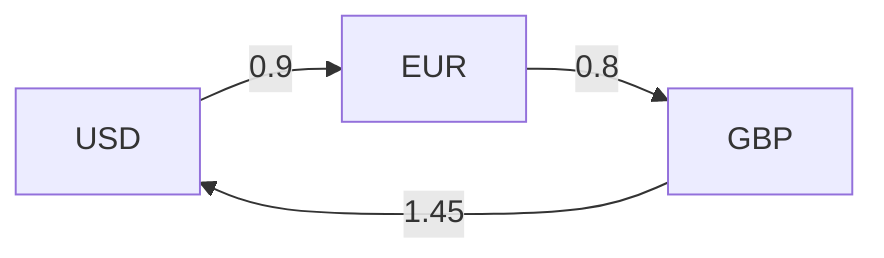

# SPL Run: build_concept_book

- **Adapter:** claude_cli
- **Model:** claude-sonnet-5-5
- **Tokens:** 0 in / 0 out
- **Latency:** 6246ms
- **Timestamp:** 2026-11-25 00:05:09

## Output

```output


---

## 贝尔曼-福特算法

### 定义

**贝尔曼-福特算法(Bellman–Ford Algorithm)** 是一种单源最短路径算法。给定带权有向图 $G=(V,E)$、权函数 $w:E\to\mathbb{R}$ 和源点 $s$,它能求出 $s$ 到所有顶点的最短距离 $d(v)$。与 Dijkstra 算法不同,它**允许负权边**,只要从 $s$ 出发不能到达**负权环**(环上权值之和为负)。若存在这样的环,算法能够检测并报告。

核心操作是**松弛**(relaxation):若 $d(u)+w(u,v)<d(v)$,则令 $d(v)\leftarrow d(u)+w(u,v)$。

算法步骤:

1. 初始化 $d(s)=0$,其余 $d(v)=+\infty$。
2. 重复 $|V|-1$ 轮:每轮对所有边 $(u,v)\in E$ 做一次松弛。
3. 再扫描一遍所有边:若仍有边可松弛,则图中存在从 $s$ 可达的负权环。

时间复杂度为 $O(VE)$,空间复杂度为 $O(V)$。

**正确性依据:** 不含环的最短路径至多有 $|V|-1$ 条边。归纳可证,第 $k$ 轮结束后,所有"至多用 $k$ 条边"的最短路径都已算出。所以 $|V|-1$ 轮之后,所有距离均已收敛。若第 $|V|$ 轮仍能松弛,说明存在无法收敛的负环。

### 示例

图中有顶点 $s,a,b,c$,边为:$s\to a$(4),$s\to b$(5),$a\to c$(3),$b\to a$($-2$),$c\to b$(1)。边的处理顺序固定为上述顺序。

初始:$d=(s{:}0,\ a{:}\infty,\ b{:}\infty,\ c{:}\infty)$。

- **第 1 轮:**
  - $s\to a$:$d(a)=4$。
  - $s\to b$:$d(b)=5$。
  - $a\to c$:$d(c)=7$。
  - $b\to a$:$5-2=3<4$,故 $d(a)=3$。
  - $c\to b$:$7+1=8>5$,不更新。
- **第 2 轮:**
  - $a\to c$:$3+3=6<7$,故 $d(c)=6$。
  - 其余边均无法再松弛。
- **第 3 轮:** 没有任何更新。

最终 $d=(0,\,3,\,5,\,6)$。注意 $s\to b\to a$ 的路径(总权 3)胜过直接边 $s\to a$(权 4),这就是负权边的作用。若 Dijkstra 在 $a$ 被确定为 4 之后不再回头修正,就会得出错误结果。

### 问题求解应用

**场景:货币套利检测。** 设汇率 $r_{ij}$ 表示 1 单位货币 $i$ 兑换成货币 $j$ 的数量。一条兑换环 $i_1\to i_2\to\cdots\to i_1$ 有利可图,当且仅当

$$r_{i_1i_2}\,r_{i_2i_3}\cdots r_{i_ki_1}>1.$$

两边取对数并取负号,令边权 $w(i,j)=-\ln r_{ij}$,则条件化为

$$\sum w(e)<0,$$

即图中存在**负权环**。于是,套利检测就变成了负环检测:先任选一个能到达所有货币的源点,运行 $|V|-1$ 轮松弛,再多扫描一遍。若仍有边可松弛,就存在套利机会。

**解题要点:**

- 需要处理负权边,或要判断负环时,使用贝尔曼-福特算法。
- 若某一轮没有任何更新,可**提前终止**,这在实践中常常显著加速。
- 若所有边权非负,Dijkstra($O((V+E)\log V)$)更快。
- 若要找出负环本身,可记录前驱指针,从仍可松弛的顶点沿前驱回溯 $|V|$ 步,必落在环上。

**练习:** 在上例中把 $c\to b$ 的权改为 $-5$。验证第 $|V|=4$ 轮仍有边可松弛,并写出由此检测到的负环。(提示:环 $b\to a\to c\to b$ 的权和为 $-2+3-5=-4<0$。)

---

## 负环

**定义。** 在带权有向图 $G=(V,E)$ 中,若存在一条有向回路 $C = (v_0, v_1, \dots, v_k = v_0)$,其边权之和满足
$$
w(C)=\sum_{i=0}^{k-1} w(v_i, v_{i+1}) < 0,
$$
则称 $C$ 为**负环**(负权回路)。

**为什么最短路不存在。** 设某条从 $s$ 到 $t$ 的路径经过(或能到达并返回)负环 $C$。每多绕环一圈,路径总权重就减少 $|w(C)|$。绕 $n$ 圈后的权重为
$$
d_n = d_0 + n\,w(C) \xrightarrow{n\to\infty} -\infty .
$$
因此不存在下界,$\delta(s,t)=-\infty$,最短路没有定义。注意:只有"从 $s$ 可达、且能到达 $t$ 的负环"才会影响 $s\to t$;与该路径无关的负环不影响它。

**例题。** 考虑边:$s\to a$(权 $2$)、$a\to b$(权 $-4$)、$b\to a$(权 $1$)、$b\to t$(权 $3$)。

回路 $a\to b\to a$ 的权重为 $-4+1=-3<0$,是负环。

- 不绕环:$s\to a\to b\to t$,权重 $2-4+3=1$。
- 绕一圈:$s\to a\to b\to a\to b\to t$,权重 $1-3=-2$。
- 绕两圈:权重 $-5$,依此类推,趋向 $-\infty$。

所以 $\delta(s,t)=-\infty$。

**问题求解:用 Bellman–Ford 检测负环。** 在没有负环时,最短路至多含 $|V|-1$ 条边,因此对所有边做 $|V|-1$ 轮松弛后,距离值应已收敛。算法如下:

1. 令 $d[s]=0$,其余为 $\infty$。
2. 重复 $|V|-1$ 轮:对每条边 $(u,v)$,若 $d[u]+w(u,v)<d[v]$,则更新 $d[v]$。
3. 再做第 $|V|$ 轮:若仍有边能被松弛,则从 $s$ 可达一个负环。

```python
def has_negative_cycle(n, edges, s):
    INF = float("inf")
    d = [INF] * n
    d[s] = 0
    for _ in range(n - 1):
        for u, v, w in edges:
            if d[u] + w < d[v]:
                d[v] = d[u] + w
    return any(d[u] + w < d[v] for u, v, w in edges)
```

对上例(顶点 $s,a,b,t$ 编号 $0,1,2,3$),第 $4$ 轮仍可松弛边 $(b,a)$,故返回 `True`。时间复杂度为 $O(|V|\,|E|)$。

**应用。** 在外汇套利中,取边权 $-\log(\text{汇率})$,则一条乘积大于 $1$ 的兑换回路恰好对应一个负环:检测到负环,就等于发现了套利机会。


*图:$a\to b\to a$ 构成总权重为 $-3$ 的负环,每绕一圈 $s\to t$ 的路径权重就再减小 $3$。*

---

## 套利检测

### 定义

**套利**是指在不承担风险的前提下,通过一系列交易获得正收益。在外汇市场中,设货币 $i$ 兑换货币 $j$ 的汇率为 $r_{ij}$(1 单位 $i$ 可换 $r_{ij}$ 单位 $j$)。若存在一条兑换环路 $c_1 \to c_2 \to \cdots \to c_k \to c_1$,使得

$$
r_{c_1c_2}\cdot r_{c_2c_3}\cdots r_{c_kc_1} > 1,
$$

则从任意一种货币出发沿此环路兑换一圈,就能凭空增值,这条环路就是**套利环**。

将货币视为顶点、汇率视为有向边,问题变成图上的"乘积大于 1 的环路"。乘积不便直接处理,于是取对数变换,令边权

$$
w_{ij} = -\log r_{ij}.
$$

因为 $\log$ 把乘积变为求和、且 $-\log$ 反转了不等号,所以

$$
\prod r > 1 \iff \sum \log r > 0 \iff \sum w < 0.
$$

**结论:套利环恰好对应图中的负权环。** 负权环可以用 Bellman–Ford 算法检测:对 $|V|-1$ 轮松弛后,若第 $|V|$ 轮仍能松弛某条边,则图中存在负权环。其时间复杂度为 $O(|V|\cdot|E|)$。

### worked example(例题)

三种货币的汇率为:USD→EUR 为 $0.9$,EUR→GBP 为 $0.8$,GBP→USD 为 $1.45$。

沿环路 USD→EUR→GBP→USD 的乘积:

$$
0.9 \times 0.8 \times 1.45 = 1.044 > 1.
$$

换成权重:$w_1=-\ln 0.9\approx 0.1054$,$w_2=-\ln 0.8\approx 0.2231$,$w_3=-\ln 1.45\approx -0.3716$。

$$
\sum w \approx 0.1054+0.2231-0.3716=-0.0431<0,
$$

这是一个负权环。投入 $1000$ USD,一圈后得 $1000\times1.044=1044$ USD,获利 $44$ USD(未计手续费)。

### 问题求解应用


*图:三种货币构成的兑换环路,汇率乘积为 $1.044>1$,存在套利机会。*

**解题步骤:**

1. 建图:对每个汇率 $r_{ij}$ 添加有向边 $i\to j$,权重 $-\ln r_{ij}$。
2. 初始化:所有顶点距离设为 $0$(等价于加一个虚拟源点,可发现所有连通分量中的负环)。
3. 运行 Bellman–Ford:松弛 $|V|-1$ 轮。
4. 再做一轮检查:若仍有边可松弛,存在套利;沿前驱指针回溯即可还原具体的货币环路。

```python
import math

def find_arbitrage(n, rates):          # rates: [(i, j, r), ...]
    dist, pred = [0.0] * n, [-1] * n
    x = -1
    for _ in range(n):
        x = -1
        for i, j, r in rates:
            if dist[i] - math.log(r) < dist[j] - 1e-12:
                dist[j] = dist[i] - math.log(r)
                pred[j], x = i, j
    if x == -1:
        return None                    # 无套利
    for _ in range(n):                 # 确保落入环内
        x = pred[x]
    cycle, v = [x], pred[x]
    while v != x:
        cycle.append(v); v = pred[v]
    return cycle[::-1]
```

**现实提示:** 实际交易中还需考虑手续费、买卖价差与成交滑点。可将每条边的汇率替换为扣除成本后的净汇率 $r'_{ij}=r_{ij}(1-f_{ij})$,再用同样的方法检测;只有净乘积仍大于 $1$,套利才真正可行。

---

## 回报(Payoff)

**套利检测**(arbitrage detection)是整本书的终点,因为它把前面各章的工具汇聚到一个可以直接求解的问题上:给定一组资产之间的汇率,判断能否通过一连串兑换,在无风险的前提下使资金增加。

### 它达成了什么

设有 $n$ 种货币,从货币 $i$ 兑换成货币 $j$ 的汇率为 $r_{ij}>0$。若存在一条回路 $i_1\to i_2\to\cdots\to i_k\to i_1$ 满足

$$
r_{i_1 i_2}\,r_{i_2 i_3}\cdots r_{i_k i_1} > 1,
$$

则循环兑换一圈后本金增长,这就是一个套利机会。

关键的转化是取对数。令边权 $w_{ij}=-\ln r_{ij}$,则乘积大于 $1$ 等价于

$$
\sum_{m} w_{i_m i_{m+1}} < 0 .
$$

于是套利检测变成了**图中负权回路的检测**。**Bellman–Ford 算法**在 $O(|V|\cdot|E|)$ 时间内解决这个问题:做 $|V|-1$ 轮松弛后,若第 $|V|$ 轮仍能松弛某条边,则图中存在负权回路。

这正是它成为“自然终点”的原因:它同时用到了对数的乘法—加法转换、图的表示、最短路径与动态规划,以及算法复杂度分析。

### 一个小例子

三种货币的汇率为 USD→EUR $=0.9$,EUR→GBP $=0.8$,GBP→USD $=1.4$。乘积为

$$
0.9\times0.8\times1.4=1.008>1,
$$

对应回路权重和为 $-\ln 1.008\approx-0.00797<0$,所以存在套利:每 $1$ 美元走一圈可得约 $1.008$ 美元。

### 与各应用领域的联系

本节没有列出具体的应用领域,下面按这一方法最常见的几个方向说明,供你选择:

- **外汇与加密货币市场**:把交易对看作有向边,实时检测三角或多边套利。实际中还需加入手续费与滑点,即把交易成本并入边权。
- **网络路由与资源调度**:路径的“收益”或“损耗”是乘性的(如丢包率、增益),同样可取对数后检测不一致的回路。
- **数据一致性检验**:单位换算或比价表中若出现矛盾,等价于出现“正收益回路”,可用同一算法发现。

### 问题求解练习

在上面的例子中,若 GBP→USD 汇率降为 $1.3$,套利是否仍然存在?请自己计算乘积并用对数权重验证。接着再加入每次兑换 $0.2\%$ 的手续费,看看机会是否消失。

### 邀请

请从上面三个方向中选一个深入探索:用 Python 实现 Bellman–Ford,在真实或模拟的汇率数据上运行,并输出找到的回路。你会发现,把一个金融直觉转化为图上的算法,正是本书所有工具的用武之地。
```
