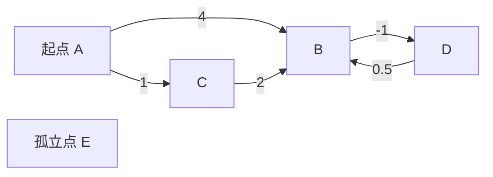

# SPL Run: build_concept_book

- **Adapter:** claude_cli
- **Model:** claude-sonnet-5-5
- **Tokens:** 0 in / 0 out
- **Latency:** 7369ms
- **Timestamp:** 2026-11-25 00:05:16

## Output

```output


---

## 快速矩阵乘法

### 定义

设 $A,B$ 为两个 $n\times n$ 矩阵,乘积 $C=AB$ 的元素为
$$c_{ij}=\sum_{k=1}^{n} a_{ik}b_{kj}.$$
按定义直接计算需要 $n^2$ 个元素、每个元素 $n$ 次乘法,总计 $\Theta(n^3)$ 次标量乘法。**快速矩阵乘法**指用分治思想把乘法次数降到 $o(n^3)$ 的算法。其中最著名的是 Strassen 算法(1969),其关键在于:**借助减法(即加法群中的逆元),用更少的乘法换取更多的加减法**。

### 分治与递推

设 $n$ 为 2 的幂,将矩阵分成四个 $\tfrac n2\times\tfrac n2$ 的子块:
$$A=\begin{pmatrix}A_{11}&A_{12}\\A_{21}&A_{22}\end{pmatrix},\quad B=\begin{pmatrix}B_{11}&B_{12}\\B_{21}&B_{22}\end{pmatrix}.$$
朴素分块需要 8 次子矩阵乘法,递推式为 $T(n)=8T(n/2)+\Theta(n^2)$,由主定理得 $T(n)=\Theta(n^3)$,没有任何改进。

Strassen 只用 7 次子矩阵乘法:
$$\begin{aligned}
M_1&=(A_{11}+A_{22})(B_{11}+B_{22}), & M_2&=(A_{21}+A_{22})B_{11},\\
M_3&=A_{11}(B_{12}-B_{22}), & M_4&=A_{22}(B_{21}-B_{11}),\\
M_5&=(A_{11}+A_{12})B_{22}, & M_6&=(A_{21}-A_{11})(B_{11}+B_{12}),\\
M_7&=(A_{12}-A_{22})(B_{21}+B_{22}).
\end{aligned}$$
再用加减法组合出结果:
$$C_{11}=M_1+M_4-M_5+M_7,\quad C_{12}=M_3+M_5,$$
$$C_{21}=M_2+M_4,\quad C_{22}=M_1-M_2+M_3+M_6.$$

### 复杂度分析

递推式变为 $T(n)=7T(n/2)+\Theta(n^2)$。因为 $\log_2 7\approx 2.807>2$,主定理(情形 1)给出
$$T(n)=\Theta\!\left(n^{\log_2 7}\right)\approx\Theta(n^{2.807}).$$

### 例题:验证并应用

**验证 $C_{12}$。** 代入定义:
$$M_3+M_5=A_{11}B_{12}-A_{11}B_{22}+A_{11}B_{22}+A_{12}B_{22}=A_{11}B_{12}+A_{12}B_{22},$$
正是 $C_{12}$ 的定义。注意 $A_{11}B_{22}$ 通过减法被抵消,这就是减法的作用。

**数值检验。** 取 $2\times2$ 矩阵(子块即标量)$A=\begin{pmatrix}1&2\\3&4\end{pmatrix}$,$B=\begin{pmatrix}5&6\\7&8\end{pmatrix}$:
$M_1=5\cdot13=65$,$M_2=7\cdot5=35$,$M_3=1\cdot(-2)=-2$,$M_4=4\cdot2=8$,$M_5=3\cdot8=24$,$M_6=2\cdot11=22$,$M_7=(-2)\cdot15=-30$。
于是 $C_{11}=65+8-24-30=19$,$C_{12}=-2+24=22$,$C_{21}=35+8=43$,$C_{22}=65-35-2+22=50$,与直接计算 $\begin{pmatrix}19&22\\43&50\end{pmatrix}$ 一致。

**问题:** 对 $n=1024$,估算两种方法的乘法次数之比。
朴素:$1024^3=2^{30}\approx1.07\times10^9$;Strassen(递归到 $1\times1$):$7^{10}\approx2.82\times10^8$。比值约 $3.8$。但实践中加减法与内存开销不可忽略,因此常在 $n$ 低于某个阈值(几十到几百)时改用朴素算法。

### 要点

- 为什么必须有减法?它允许项相互抵消,从而用 7 个乘积"凑出"8 个乘积的信息;在没有减法的半环(如布尔半环)中,这一技巧不能直接使用。
- 后续工作(Coppersmith–Winograd 等)将指数降至约 $2.37$,但常数极大,实际很少使用。

---

## 最短路径距离

**定义。** 在带权有向图 $G=(V,E,w)$ 中,一条从 $u$ 到 $v$ 的路径的权重是其所含各边权之和。**最短路径距离** $\operatorname{dist}(u,v)$ 定义为所有 $u\to v$ 路径权重的下确界:

$$
\operatorname{dist}(u,v)=
\begin{cases}
0, & u=v \text{(且无负环可达)},\\
+\infty, & \text{从 } u \text{ 无法到达 } v,\\
-\infty, & u \text{ 可到达 } v \text{,且途中可经过负权环},\\
\min_{p:u\leadsto v} w(p), & \text{其他情形}.
\end{cases}
$$

这四种取值各有含义:

- **不可达**:没有路径,按约定取 $+\infty$(空集的下确界)。
- **负环**:若某条 $u\to v$ 的路径上能经过权重和为负的环,则每绕一圈总权重就更小,下确界为 $-\infty$。
- **$\operatorname{dist}(u,u)=0$**:空路径不含任何边,权重为 $0$。若 $u$ 位于负环上,则 $\operatorname{dist}(u,u)=-\infty$。

**例题。** 设图有边 $A\to B$(权 $4$)、$A\to C$(权 $1$)、$C\to B$(权 $2$)、$B\to D$(权 $-1$),另有孤立点 $E$。

- $\operatorname{dist}(A,B)=\min\{4,\;1+2\}=3$。
- $\operatorname{dist}(A,D)=3+(-1)=2$。
- $\operatorname{dist}(A,A)=0$。
- $\operatorname{dist}(A,E)=+\infty$,因为 $E$ 不可达。

现在加入边 $D\to B$(权 $1$)。环 $B\to D\to B$ 的权重为 $-1+1=0$,不是负环,距离不变。若改为权 $0.5$,环权重为 $-0.5<0$,每绕一圈减少 $0.5$,于是 $\operatorname{dist}(A,B)=\operatorname{dist}(A,D)=-\infty$。

**问题求解应用。** 计算距离时,先判断情形,再选算法:

1. 所有边权非负:用 Dijkstra 算法,时间 $O(|E|+|V|\log|V|)$(斐波那契堆)或 $O(|E|\log|V|)$(二叉堆),不会出现 $-\infty$。
2. 含负权边:用 Bellman–Ford。把 $d[s]=0$、其余为 $+\infty$ 作为初值,对所有边松弛 $|V|-1$ 轮。若再松弛一轮仍有边能缩短,则存在从 $s$ 可达的负环。
3. 标记 $-\infty$:把第 $|V|$ 轮中被更新的顶点作为起点,沿边做搜索,所有可从它们到达的顶点距离都是 $-\infty$。

**为什么是 $|V|-1$ 轮?** 不含环的最短路径至多有 $|V|-1$ 条边。若不存在负环,最优路径不必重复顶点,$|V|-1$ 轮松弛就够了;第 $|V|$ 轮仍能改进,就说明某条"最优"路径其实包含环,且该环必为负环。

**实际应用:** 货币兑换中取 $w=-\log(\text{汇率})$,负环就对应套利机会;此时 $\operatorname{dist}=-\infty$ 恰好表示收益可无限放大(理论上)。

**小结。** 距离不一定是一个普通实数,它取值于 $\mathbb{R}\cup\{-\infty,+\infty\}$。解题时要先检查可达性和负环,再报告数值。


*图示:$B\to D\to B$ 构成权重为 $-0.5$ 的负环,使 $\operatorname{dist}(A,B)=\operatorname{dist}(A,D)=-\infty$;孤立点 $E$ 不可达,距离为 $+\infty$。*

---

## 最小加矩阵乘法(Min-Plus Matrix Multiplication)

**定义。** 在普通矩阵乘法 $C_{ij}=\sum_k A_{ik}B_{kj}$ 中,把"乘法"换成加法,把"求和"换成取最小值,就得到**最小加乘法**(也称热带矩阵乘法),记作 $\otimes$:

$$
(A\otimes B)_{ij}=\min_{k}\bigl(A_{ik}+B_{kj}\bigr).
$$

它是在半环 $(\mathbb{R}\cup\{\infty\},\ \min,\ +)$ 上的矩阵乘法:$\min$ 扮演"加法",$+$ 扮演"乘法",单位元分别为 $\infty$ 与 $0$。该运算满足结合律,因此可以定义幂 $A^{\otimes m}$。

**与最短路径的联系。** 设有向图有 $n$ 个顶点,令 $W_{ij}$ 为边 $i\to j$ 的权重,$W_{ii}=0$,无边则 $W_{ij}=\infty$。则 $(W\otimes W)_{ij}=\min_k(W_{ik}+W_{kj})$ 恰好是从 $i$ 到 $j$ **至多经过 2 条边**的最短路径长度。

**命题。** $(W^{\otimes m})_{ij}$ 等于从 $i$ 到 $j$ 至多使用 $m$ 条边的最短路径长度。

*证明(对 $m$ 归纳)。* $m=1$ 显然成立。假设对 $m$ 成立,则至多 $m+1$ 条边的最优路径可分解为"前 $m$ 条边到达某中间点 $k$,再走边 $k\to j$",故其长度为 $\min_k\bigl((W^{\otimes m})_{ik}+W_{kj}\bigr)=(W^{\otimes(m+1)})_{ij}$。$\blacksquare$

不含负环时,最短路径至多有 $n-1$ 条边,所以全源最短路径矩阵为 $W^{\otimes(n-1)}$。

**例题。** 三个顶点,$W_{12}=3,\ W_{23}=2,\ W_{13}=7$,其余非对角元为 $\infty$,即

$$
W=\begin{pmatrix}0&3&7\\ \infty&0&2\\ \infty&\infty&0\end{pmatrix}.
$$

计算 $(W\otimes W)_{13}=\min(0+7,\ 3+2,\ 7+0)=5$。这说明经过中间点 2 的路径 $1\to2\to3$(长度 5)优于直达边(长度 7)。因 $n-1=2$,所以 $W^{\otimes 2}$ 已是最终答案。

**问题求解应用。** 朴素地做 $n-2$ 次乘法,每次 $O(n^3)$,总计 $O(n^4)$。利用**重复平方**:依次计算 $W^{\otimes 2},W^{\otimes 4},W^{\otimes 8},\dots$,只需 $\lceil\log_2(n-1)\rceil$ 次乘法(多算的幂不会出错,因为"至多 $m$ 条边"对更大的 $m$ 仍保持正确),总复杂度为

$$
O(n^3\log n).
$$

这正是 Floyd–Warshall 算法($O(n^3)$)之外的另一种全源最短路径思路。其意义在于:最短路径问题被归结为矩阵幂,因此任何更快的最小加乘法都能直接加速它;同时,对角元 $(W^{\otimes m})_{ii}<0$ 可用于检测负环。

**练习。** 对上面的 $W$ 加上一条边 $W_{31}=-4$,计算 $(W\otimes W)_{11}$,并判断图中是否存在负环。(提示:$1\to2\to3\to1$ 的总权重为 $3+2-4=1>0$,但 $1\to3\to1$ 的权重为 $7-4=3$;请自行验证所有环的权重符号。)

---

## 传递闭包

**定义。** 设有向图 $G=(V,E)$,$|V|=n$,邻接矩阵 $A\in\{0,1\}^{n\times n}$,当 $(i,j)\in E$ 时 $A_{ij}=1$。$G$ 的**传递闭包**是满足下式的图 $G^*=(V,E^*)$:

$$(i,j)\in E^* \iff \text{在 } G \text{ 中存在从 } i \text{ 到 } j \text{ 的有向路径(长度}\ge 0\text{)}.$$

它回答的是"从 $i$ 出发,能不能到达 $j$?"这一**可达性**问题,与路径的长短无关。

**布尔矩阵乘法。** 在布尔半环中,用 $\lor$ 代替加法,用 $\land$ 代替乘法:

$$(A\otimes B)_{ij}=\bigvee_{k}\,(A_{ik}\land B_{kj}).$$

于是 $(A^m)_{ij}=1$ 当且仅当存在一条恰好长 $m$ 的路径。简单路径至多经过 $n-1$ 条边,所以

$$A^*=(I\lor A)^{\,n-1}$$

($I$ 为单位矩阵,用来表示长度为 0 的路径)。

**例题。** 设 $V=\{1,2,3,4\}$,边为 $1\to2,\ 2\to3,\ 3\to4$。令 $B=I\lor A$:

- $B^2=(I\lor A)^2$ 包含长度 $\le 2$ 的路径,新增 $1\to3$、$2\to4$。
- $B^4=(B^2)^2$ 包含长度 $\le 4$ 的路径,新增 $1\to4$。

所以 $A^*$ 是上三角全 1 矩阵:从 1 可到达 2、3、4,从 2 可到达 3、4,从 3 可到达 4。注意,只需**反复平方** $\lceil\log_2 n\rceil$ 次,而不必做 $n-1$ 次乘法。此处 $n=4$,平方 2 次即可。

**复杂度与归约。** 每次布尔矩阵乘法若用定义计算,需要 $O(n^3)$ 时间。设 $M(n)$ 是 $n\times n$ 布尔矩阵乘法的时间。反复平方给出

$$T_{\text{TC}}(n)=O\big(M(n)\log n\big).$$

更精细的结论是:

$$T_{\text{TC}}(n)=\Theta\big(M(n)\big)$$

(在 $M(n)$ 满足通常的正则性条件时)。

- **TC 可归约到乘法。** 先对强连通分量做缩点,得到有向无环图,再按分块递归,即可达到 $O(M(n))$。
- **乘法可归约到 TC。** 构造三层图,第一层到第二层的边由 $A$ 给出,第二层到第三层的边由 $B$ 给出。则第一层到第三层的可达关系恰好是 $A\otimes B$。

因此传递闭包与布尔矩阵乘法在渐近意义上难度相同。布尔乘法可借助整数乘法实现(把结果中非零的元素置 1)。使用 Strassen 算法时,$M(n)=O(n^{2.807})$。已知最快的矩阵乘法算法指数 $\omega<2.372$,于是 $T_{\text{TC}}(n)=O(n^{\omega})$。

**问题求解应用。** 比较三种方法:

| 方法 | 时间 |
|---|---|
| 从每个顶点做 DFS/BFS | $O(n(n+m))$,稀疏图上最优 |
| Floyd–Warshall(Warshall 算法) | $O(n^3)$,代码最简单 |
| 快速矩阵乘法 | $O(n^{\omega})$,理论上最优,适合稠密图 |

Warshall 算法的核心是三重循环:

```python
for k in range(n):
    for i in range(n):
        for j in range(n):
            R[i][j] = R[i][j] or (R[i][k] and R[k][j])
```

典型应用有:判断课程先修关系是否间接成立,判断软件模块之间是否存在依赖,以及判断 SPL 中某个工作流能否经由 `CALL` 链最终调用另一个工作流。

**练习。** 对环 $1\to2\to3\to1$,求 $A^*$。(提示:同一强连通分量内的所有顶点互相可达,所以 $A^*$ 是 $3\times3$ 全 1 矩阵。)

---

## 收获(Payoff)

### 传递闭包达成了什么

在前面的章节中,我们从"直接关系"出发:图中的一条边 $(u,v)$ 表示"$u$ 直接到达 $v$"。但现实问题几乎总是在问**间接**的事情:$A$ 最终能否影响 $C$?某个概念的全部先修知识是什么?传递闭包正是回答这类问题的工具。

**定义.** 给定有向图 $G=(V,E)$,其传递闭包是图 $G^+=(V,E^+)$,其中
$$(u,v)\in E^+ \iff G \text{ 中存在一条从 } u \text{ 到 } v \text{ 的长度 } \ge 1 \text{ 的路径}.$$
等价地,$E^+=\bigcup_{k\ge 1}E^k$,其中 $E^k$ 表示长度恰为 $k$ 的路径所对应的关系。若 $A$ 为邻接矩阵(布尔运算),则
$$A^+ = A \lor A^2 \lor \cdots \lor A^{n},\quad n=|V|.$$

**为什么它是自然的终点.** 前面学过的所有内容(关系、路径、矩阵乘法、可达性)在这里汇合:路径是对关系的反复复合,而传递闭包是"复合到不再产生新信息"的**不动点**。Warshall 算法用三重循环即可计算:

```python
def closure(A):
    n = len(A)
    for k in range(n):
        for i in range(n):
            for j in range(n):
                A[i][j] = A[i][j] or (A[i][k] and A[k][j])
    return A
```

时间复杂度为 $O(n^3)$。每一轮 $k$ 的含义是:"允许把前 $k$ 个顶点作为中转站"。

### 小例子

设先修关系为 $\text{向量}\to\text{矩阵}\to\text{特征值}$。直接边只有两条;闭包新增 $(\text{向量},\text{特征值})$。这条新边就是"学特征值之前必须先懂向量"这一事实,没有闭包,系统无法自动得出。

### 与各应用领域的联系

本节未列出具体的应用领域,但传递闭包的用途遵循同一模式:**把局部的、直接的断言,变成全局的、可查询的结论**。

- **知识图谱与课程规划**:闭包给出任一概念的完整先修集合,即学习路径。
- **依赖分析**:软件包、构建任务的全部直接与间接依赖,以及循环依赖检测(若 $(v,v)\in E^+$,则 $v$ 在环上)。
- **网络与安全**:信息或风险能否经多跳传播到某节点。
- **数据库与推理**:递归查询(如组织架构中的"所有下属")和规则推理。

### 练习

1. 对边集 $\{(1,2),(2,3),(3,1),(3,4)\}$ 计算 $E^+$,并说明哪些顶点在环上。
2. 说明为何只需计算到 $A^n$ 而不必更高次幂。

### 邀请

请选择以上一个领域,自己动手建一个小图(10 个节点即可),用 Warshall 算法求出闭包,再提出一个只有闭包才能回答的问题。从课程先修关系入手最直观:你会亲眼看到,一张稀疏的图如何展开成一幅完整的学习地图。
```
