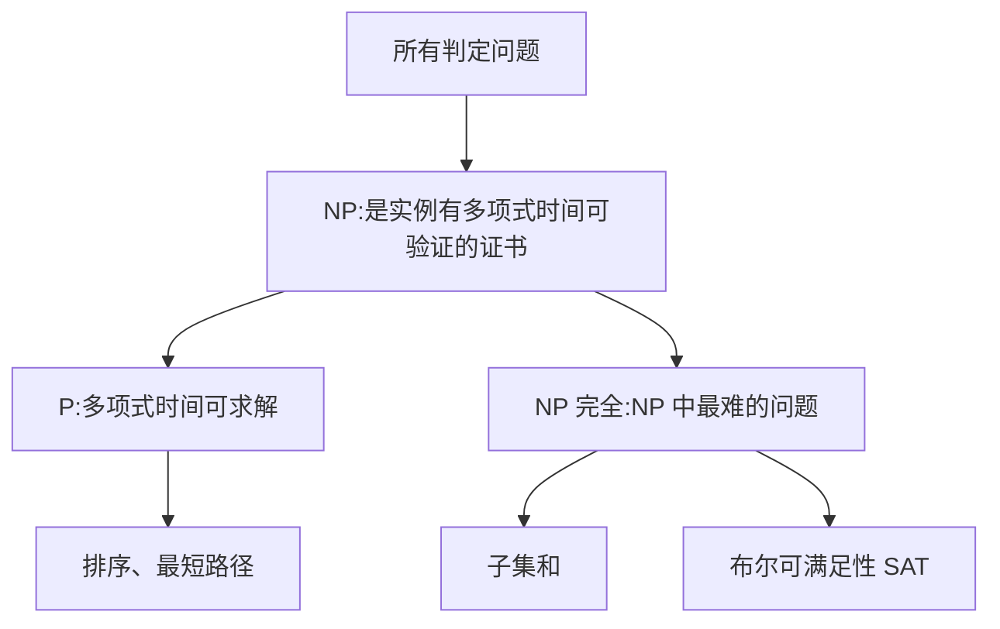
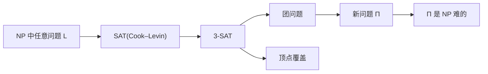
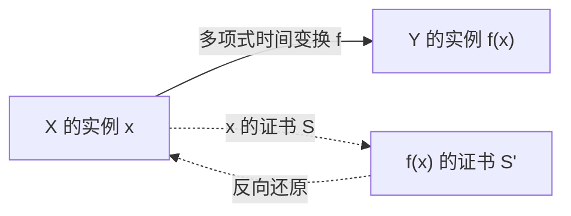
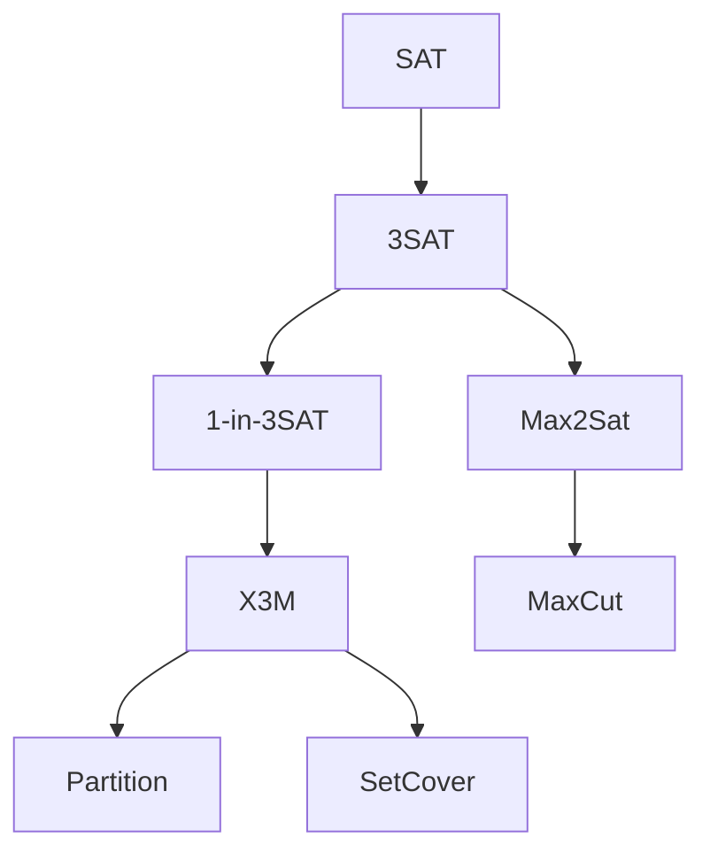

# SPL Run: build_concept_book

- **Adapter:** claude_cli
- **Model:** claude-sonnet-5-5
- **Tokens:** 0 in / 0 out
- **Latency:** 12259ms
- **Timestamp:** 2026-11-25 00:06:14

## Output

```output


---

## 判定问题

**定义。** 判定问题(decision problem)是输出只有一个布尔值("是"或"否")的计算问题。形式上,设 $\Sigma$ 为有限字母表,判定问题等价于一个**语言** $L \subseteq \Sigma^*$,其任务是:给定输入串 $x$,判断是否有 $x \in L$。算法 $A$ **判定** $L$,当且仅当对每个输入 $x$,$A$ 都会停机,并且

$$A(x)=\begin{cases}\text{是}, & x\in L\\ \text{否}, & x\notin L\end{cases}$$

判定问题之所以重要,是因为许多优化或搜索问题都可以改写成它的形式,复杂性理论(P、NP 等类)也正是以它为基础建立的。

**例题。** 考虑问题 PRIME:输入正整数 $n\ge 2$,问 $n$ 是否为素数?

- 输入 $n=91$。试除 $d=2,3,5$ 均不能整除;$d=7$ 时 $91=7\times 13$,故输出"否"。
- 输入 $n=97$。只需试除 $d\le\lfloor\sqrt{97}\rfloor=9$,即 $2,3,5,7$,均不整除,故输出"是"。

试除法只需检查到 $\sqrt n$,所以它做了 $O(\sqrt n)$ 次除法。注意,输入长度是 $\log_2 n$ 位,因此以输入长度衡量,这是**指数**时间。2002 年的 AKS 算法才证明了 PRIME $\in \mathrm{P}$。

**问题求解应用:把优化问题化为判定问题。** 最短路问题是"求 $s$ 到 $t$ 的最短路径长度",这是一个函数问题。把它改写为判定形式:

> 给定图 $G$、顶点 $s,t$ 和整数 $k$,是否存在长度 $\le k$ 的 $s$–$t$ 路径?

假设有一个判定该问题的算法。由于最短路长度是介于 $0$ 与 $W$(各边权之和)之间的整数,我们可以对 $k$ 做二分查找,仅调用该算法 $O(\log W)$ 次,就能求出最短路长度。因此,优化版本的难度至多比判定版本多一个多项式因子。这正是复杂性理论只研究判定问题却不损失一般性的原因。

**判定的三种结果。** 
1. **可判定且高效**:如 PRIME、图的连通性,属于 P。
2. **可验证但未知是否高效**:如子集和问题,给定"证书"(一个子集)可在多项式时间内验证,属于 NP。
3. **不可判定**:如停机问题,不存在对所有输入都能停机并给出正确答案的算法。


*图:利用判定问题的二分查找求解优化问题。*

**小结。** 判定问题把计算抽象为"是/否"的语言成员判断。它既是复杂性分类的基本单位,也是通过二分等手段求解更一般问题的构件。

---

## 多项式时间

**定义。** 设算法在输入规模为 $n$ 时的最坏情况运行时间为 $T(n)$。若存在常数 $c>0$ 与 $n_0$、$k$,使得对所有 $n\ge n_0$ 有
$$T(n)\le k\,n^{c},$$
即 $T(n)=O(n^c)$,则称该算法是**多项式时间**算法。所有可在多项式时间内求解的判定问题构成复杂度类 $\mathrm{P}$。在理论计算机科学中,多项式时间被视为"高效"的最低要求。

这一约定的合理性来自两点:第一,多项式对加法、乘法和复合封闭。若一个 $O(n^2)$ 的子程序被调用 $O(n^3)$ 次,总时间仍是多项式 $O(n^5)$,因此高效算法可以模块化组合。第二,它与具体计算模型基本无关,在图灵机、RAM 模型之间切换,只会改变指数 $c$,不会改变"是否多项式"这一性质。

**与指数时间的对比。** 设 $T_1(n)=n^3$,$T_2(n)=2^n$。若每秒执行 $10^9$ 步:

| $n$ | $n^3$ 所需时间 | $2^n$ 所需时间 |
|---|---|---|
| 20 | $8\times10^{-6}$ 秒 | 约 $10^{-3}$ 秒 |
| 60 | $2.2\times10^{-4}$ 秒 | 约 36 年 |
| 100 | $10^{-3}$ 秒 | 约 $4\times10^{13}$ 年 |

当 $n$ 增大时,指数算法很快变得不可行,而多项式算法依然可用。

**例题 1:判断时间复杂度。** 下列代码的运行时间是多项式的吗?

```python
def count_pairs(a):
    n, c = len(a), 0
    for i in range(n):
        for j in range(i + 1, n):
            if a[i] + a[j] == 0:
                c += 1
    return c
```

内层循环总次数为 $\sum_{i=0}^{n-1}(n-1-i)=\dfrac{n(n-1)}{2}$,所以 $T(n)=O(n^2)$,是多项式时间。

**例题 2:易错点——输入规模。** 判断整数 $N$ 是否为素数的试除法需要约 $\sqrt N$ 次除法。这是否是多项式时间?关键在于输入规模是**位数** $n=\lceil\log_2 N\rceil$,而不是 $N$ 本身。于是
$$\sqrt N = 2^{n/2},$$
这是关于输入规模的**指数**时间,不是多项式时间。(AKS 算法才给出了真正的多项式时间素性判定。)

**问题求解应用。** 面对一个新问题时,可以这样判断:

1. 明确输入规模 $n$(位数、顶点数、元素个数)。
2. 数出循环嵌套的层数或递归的总调用次数,写出 $T(n)$。
3. 若 $T(n)=O(n^c)$,$c$ 为常数,则为多项式;若含 $2^n$、$n!$ 等项,则不是。

例如,最短路径(Dijkstra,$O(n^2)$)属于多项式时间;而旅行商问题的暴力枚举需检查 $(n-1)!$ 条路线,远超任何多项式。

**注意。** 多项式时间只是理论上的"高效"。$O(n^{100})$ 在实践中同样不可用,而某些指数算法(如单纯形法)在实际中表现良好。但在大多数自然问题中,一旦找到多项式算法,其指数 $c$ 通常很小,因此这一标准仍然极为有用。

---

## NP 类

**定义。** 类 $\mathbf{NP}$ 是这样一类判定问题:若某个实例的答案为"是",则存在一个简短的**证书**(certificate,即"证明"),可以在多项式时间内被验证。形式上,语言 $L \in \mathbf{NP}$ 当且仅当存在多项式时间的验证算法 $V$ 和多项式 $p$,使得

$$x \in L \iff \exists\, w,\ |w| \le p(|x|),\ V(x, w) = 1,$$

且 $V$ 的运行时间为 $|x|$ 的多项式。注意:$\mathbf{NP}$ 的含义是"非确定性多项式时间"(Nondeterministic Polynomial time),**不是**"非多项式"。

关键区别在于:**验证**一个答案,与**找到**一个答案,难度可能相差很大。

**例题:子集和问题。** 给定整数集合 $S = \{3, 34, 4, 12, 5, 2\}$ 和目标值 $t = 9$,问是否存在子集,其元素之和恰为 $t$?

- 证书:子集 $\{4, 5\}$。
- 验证:检查 $4, 5 \in S$,且 $4 + 5 = 9$。这只需 $O(n)$ 步。

若要*找到*这个子集,朴素方法需检查 $2^n$ 个子集,时间为指数级。但只要有人给出证书,验证就是快速的。因此子集和问题属于 $\mathbf{NP}$。

**问题求解应用:判断一个问题是否属于 NP。** 按以下步骤操作:

1. 确定"是"实例的证书是什么(如一个子集、一条路径、一组赋值)。
2. 证明证书长度为输入规模的多项式。
3. 给出多项式时间的验证算法。

*练习:证明哈密顿回路问题属于 $\mathbf{NP}$。*
证书是顶点的一个排列 $v_1, \dots, v_n$。验证:(a) 每个顶点恰好出现一次,用时 $O(n)$ 或 $O(n^2)$;(b) 每对相邻顶点 $v_i, v_{i+1}$ 以及 $v_n, v_1$ 之间都有边,用时 $O(n)$ 次邻接查询。总时间为多项式,故属于 $\mathbf{NP}$。

**与其他类的关系。** 任何 $\mathbf{P}$ 中的问题都属于 $\mathbf{NP}$:验证者可以忽略证书,直接自己求解。所以

$$\mathbf{P} \subseteq \mathbf{NP}.$$

$\mathbf{P} = \mathbf{NP}$ 是否成立,是计算机科学中最著名的未解问题之一(克莱数学研究所千禧年大奖难题)。多数研究者相信 $\mathbf{P} \ne \mathbf{NP}$,但至今无人能够证明。


*图:P、NP 与 NP 完全问题的包含关系示意。P 是 NP 的子集,NP 完全问题是 NP 中最难的一批问题。*

**小结。** $\mathbf{NP}$ 刻画的是"答案易于检验"的问题。判断某问题是否属于 $\mathbf{NP}$,核心就是设计证书与多项式时间验证器。

---

## Karp 归约

**定义。** 设 $A, B \subseteq \Sigma^*$ 为两个判定问题(语言)。若存在一个多项式时间可计算的函数 $f:\Sigma^*\to\Sigma^*$,使得对每个输入 $x$ 都有
$$x \in A \iff f(x) \in B,$$
则称 $A$ **Karp 归约**(多项式时间多对一归约)到 $B$,记作 $A \le_p B$。关键要求有两点:$f$ 必须在多项式时间内可计算;$f$ 必须同时保持"是"实例与"否"实例(即"当且仅当")。

**核心定理。** 若 $A \le_p B$ 且 $B \in \mathrm{P}$,则 $A \in \mathrm{P}$。

*证明。* 给定 $x$,先用时间 $p(|x|)$ 计算 $f(x)$,于是 $|f(x)| \le p(|x|)$。再用 $B$ 的多项式时间判定器(运行时间 $q(\cdot)$)判定 $f(x)$,总时间为 $p(|x|)+q(p(|x|))$,仍是多项式。由等价性,其输出即为 $x\in A$ 的答案。$\square$

取逆否命题:若 $A$ 难(例如 NP 完全),则 $B$ 至少一样难。这正是证明 NP 完全性的标准方法。

**例题:从 3-SAT 归约到独立集(INDEPENDENT-SET)。** 给定含 $m$ 个子句的 3-CNF 公式 $\varphi$,构造图 $G$ 与整数 $k=m$:

1. 每个子句 $C_j=(\ell_1\vee\ell_2\vee\ell_3)$ 对应一个三角形,有 3 个顶点,分别对应它的 3 个文字。
2. 对每对互补的文字(如 $x_i$ 与 $\neg x_i$),在对应顶点间连一条边。

令 $f(\varphi)=(G,m)$。构造最多产生 $3m$ 个顶点和 $O(m^2)$ 条边,所以是多项式时间。

**正确性(两个方向都要证)。**
- ($\Rightarrow$)若 $\varphi$ 可满足,则从每个子句中选一个为真的文字,共 $m$ 个顶点。它们分属不同三角形,所以三角形内没有边;而互补文字不会同时为真,所以互补边也没有。因此它们构成大小为 $m$ 的独立集。
- ($\Leftarrow$)若 $G$ 有大小为 $m$ 的独立集,则每个三角形至多含其中一个顶点,所以恰好每个三角形含一个。令这些文字为真。互补边保证没有矛盾赋值,因此每个子句都被满足。

**问题求解应用。** 设 $\varphi=(x_1\vee x_2\vee x_3)\wedge(\neg x_1\vee \neg x_2\vee x_3)$,则 $m=2$,图中有 6 个顶点和 2 个三角形,另有互补边 $x_1\!-\!\neg x_1$、$x_2\!-\!\neg x_2$。取 $x_3$(第一个子句)和 $x_3$(第二个子句)这两个顶点:它们不相邻(相同文字不互补),所以是大小为 2 的独立集,对应赋值 $x_3=1$,确实满足 $\varphi$。

**常见错误。** 
- 只证明"可满足 $\Rightarrow$ 有独立集"而漏掉反方向;
- 把归约方向写反。要证明 $B$ 是 NP 难的,必须从**已知**的 NP 难问题 $A$ 归约到 $B$,即 $A\le_p B$。


*图示:Karp 归约把问题 A 的实例 x 转换为问题 B 的实例 f(x),B 的判定器的答案原样作为 A 的答案。*

---

## NP 难(NP-hard)

**定义。** 称问题 $\Pi$ 是 **NP 难**的,如果 NP 中的每一个问题 $L$ 都可以在多项式时间内归约到 $\Pi$,记作
$$
\forall L \in \mathrm{NP}:\; L \le_p \Pi .
$$
也就是说,只要有一个能解 $\Pi$ 的多项式时间算法,就能借助归约解决 NP 中的所有问题,从而得到 $\mathrm{P}=\mathrm{NP}$。

注意两点:

- NP 难表示"**至少和 NP 中最难的问题一样难**",而 $\Pi$ 本身不必属于 NP。例如停机问题是 NP 难的,却不可判定。
- 若 $\Pi$ 既是 NP 难的,又属于 NP,则称它是 **NP 完全**的($\mathrm{NP\text{-}complete}$)。

**传递性。** 若 $L_1 \le_p L_2$ 且 $L_2 \le_p L_3$,则 $L_1 \le_p L_3$。因此,只要已知某个问题 $A$ 是 NP 难的,再证明 $A \le_p \Pi$,就能推出 $\Pi$ 也是 NP 难的。第一个 NP 难问题由 Cook–Levin 定理给出:SAT 是 NP 完全的。

### 例题:证明"团问题"是 NP 难的

**团(CLIQUE)**:给定图 $G$ 和整数 $k$,问 $G$ 中是否存在 $k$ 个两两相邻的顶点。已知 3-SAT 是 NP 难的,下面证明 $\text{3-SAT} \le_p \text{CLIQUE}$。

**构造。** 设公式 $\varphi$ 有 $m$ 个子句,每个子句含 3 个文字。

1. 为每个子句中的每个文字建一个顶点,共 $3m$ 个。
2. 在两个顶点之间连边,当且仅当它们来自**不同子句**,并且**不互为矛盾**(例如不是 $x$ 与 $\lnot x$)。
3. 令 $k=m$。

**正确性。**

- 若 $\varphi$ 可满足:每个子句挑出一个为真的文字,这 $m$ 个文字来自不同子句,且彼此不矛盾,因此两两相邻,构成大小为 $m$ 的团。
- 反之,若存在大小为 $m$ 的团:团内顶点两两来自不同子句,所以每个子句恰好出一个顶点。令这些文字都为真,由于没有矛盾对,这样的赋值是自洽的,$\varphi$ 因此可满足。

该构造至多产生 $3m$ 个顶点和 $O(m^2)$ 条边,是多项式时间的。所以 CLIQUE 是 NP 难的。又因为给定顶点集可在多项式时间内验证,CLIQUE 属于 NP,故它是 NP 完全的。

### 解题应用

**如何用 NP 难性指导实践?** 遇到新问题时,可按下面的步骤处理:

1. 选一个已知的 NP 难问题 $A$(如 3-SAT、顶点覆盖、哈密顿回路)。
2. 构造多项式时间的归约 $A \le_p \Pi$,并证明"是/否"实例相互对应。
3. 得出 $\Pi$ 为 NP 难后,不要再寻找精确的多项式时间算法(除非你能证明 $\mathrm{P}=\mathrm{NP}$)。改用下列策略:
   - **近似算法**:例如顶点覆盖有 2-近似算法;
   - **启发式或参数化算法**:利用实例的特殊结构;
   - **限制输入**:如在树或平面图上,许多 NP 难问题可以高效求解。

**练习。** 旅行商问题(TSP)的判定版本为:是否存在总长不超过 $B$ 的回路?请从哈密顿回路出发,构造归约证明它是 NP 难的。
*提示:* 给原图中的边赋权 1,给不存在的边赋权 2,并取 $B=n$。


*图:NP 难性通过多项式时间归约沿箭头传递。只要从已知的 NP 难问题出发,构造出到新问题 $\Pi$ 的归约,就证明了 $\Pi$ 是 NP 难的。*

---

## 归约证明技术

### 定义

**归约证明技术**是证明某个问题 $A$ 是 NP 难的标准方法。设 $B$ 是一个已知的 NP 难问题。若能构造一个多项式时间可计算的函数 $f$，把 $B$ 的任意实例 $x$ 变换为 $A$ 的实例 $f(x)$，并满足

$$x \text{ 是 } B \text{ 的"是"实例} \iff f(x) \text{ 是 } A \text{ 的"是"实例},$$

就称 $B$ 多项式时间归约到 $A$，记作 $B \le_p A$。

其逻辑是：若 $A$ 能被多项式时间求解，则 $B$ 也能（先算 $f(x)$，再调用 $A$ 的算法）。这与 $B$ 是 NP 难相矛盾，除非 $\mathrm{P}=\mathrm{NP}$。所以 $A$ 至少和 $B$ 一样难。

**写证明的四个步骤：**
1. 选定一个已知 NP 难的问题 $B$。
2. 描述变换 $f$。
3. 证明 $f$ 在多项式时间内可计算。
4. 证明"是"实例与"是"实例互相对应，即正反两个方向都要证。

**常见错误：** 把方向写反。必须是"已知难题 $\to$ 目标问题"。从 $A$ 归约到 $B$ 什么也证明不了。

### 例题：独立集 NP 难

已知 3-SAT 是 NP 难的。**独立集问题**是：给定图 $G$ 和整数 $k$，问 $G$ 中是否存在 $k$ 个两两不相邻的顶点。

**构造 $f$：** 设 3-SAT 公式 $\varphi$ 有 $m$ 个子句。
- 每个子句对应一个三角形，三个顶点分别对应该子句的三个文字。
- 对每对互补文字 $x_i$ 与 $\lnot x_i$，在它们对应的顶点之间连一条边。
- 令 $k=m$。

顶点数至多 $3m$，边数为 $O(m^2)$，所以 $f$ 是多项式时间的。

**正向（$\Rightarrow$）：** 若 $\varphi$ 可满足，则在每个子句中选一个取值为真的文字，共 $m$ 个顶点。同一三角形里只选了一个顶点。互补文字不会同时为真，所以它们之间的边不会连接两个被选顶点。因此这 $m$ 个顶点构成独立集。

**反向（$\Leftarrow$）：** 若存在大小为 $m$ 的独立集，则每个三角形至多含其中一个顶点，所以恰好每个三角形各含一个。把被选文字赋值为真，由于互补文字之间有边，不会出现矛盾赋值。其余变量任意赋值。于是每个子句都有真文字，$\varphi$ 可满足。

### 问题求解应用

**问题：** 顶点覆盖问题要求选出至多 $k$ 个顶点，使每条边至少有一个端点被选中。证明它是 NP 难的。

**解：** 从独立集归约。对图 $G=(V,E)$ 和整数 $k$，令 $f(G,k)=(G,\,|V|-k)$。图本身不变，因此变换显然是多项式时间的。

关键事实：$S$ 是独立集 $\iff$ $V\setminus S$ 是顶点覆盖。

- 若 $S$ 独立，则任一条边不可能两个端点都在 $S$ 中，所以至少有一个端点在 $V\setminus S$ 中。
- 反过来，若 $V\setminus S$ 覆盖所有边，则 $S$ 中任意两点之间没有边。

所以 $G$ 有大小为 $k$ 的独立集，当且仅当 $G$ 有大小为 $|V|-k$ 的顶点覆盖。顶点覆盖因此是 NP 难的。

**策略总结：** 先找与目标问题"结构相近"的已知难题。简单的问题（如顶点覆盖）常常只需对参数做变换。较远的问题则需要用"小部件"（如上面的三角形）把约束编码进去。

---

## 归约的一般模式

**定义。** 设 $X$、$Y$ 是两个判定问题。多项式时间归约 $X \le_p Y$ 是一个多项式时间可计算的函数 $f$,把 $X$ 的实例 $x$ 变换为 $Y$ 的实例 $f(x)$,并满足:

$$x \in X \iff f(x) \in Y.$$

其意义在于:若 $Y$ 能在多项式时间内求解,则 $X$ 也能;反过来,若 $X$ 是 NP 难的,则 $Y$ 也是 NP 难的。**注意方向**:要证明 $Y$ 难,必须从一个已知的难问题 $X$ 归约到 $Y$。

**标准三步配方。**

1. **构造变换** $f$:把任意 $X$ 的实例 $x$ 机械地转换成 $Y$ 的实例 $f(x)$,并说明 $f$ 的运行时间是 $|x|$ 的多项式。
2. **正向(⇒)**:若 $x$ 是"是"实例,利用 $x$ 的证书(解)$S$ 构造 $f(x)$ 的证书 $S'$。
3. **反向(⇐)**:若 $f(x)$ 是"是"实例,利用其证书 $S'$ 还原出 $x$ 的证书 $S$。

第 2、3 步即"证书变换",它们不必在算法中执行,只用于证明等价性。


*图:归约的三个要素——实例变换 $f$(实线),以及两个方向的证书变换(虚线)。*

**例题:独立集 $\le_p$ 顶点覆盖。**

- 独立集(IS):给定图 $G=(V,E)$ 和整数 $k$,是否存在大小至少为 $k$ 的顶点子集,其中任意两点不相邻?
- 顶点覆盖(VC):是否存在大小至多为 $m$ 的顶点子集,使每条边至少有一个端点在其中?

*第 1 步:* 令 $f(G,k)=(G,\;|V|-k)$。图不变,只需做一次减法,显然是多项式时间。

*第 2 步(⇒):* 设 $S$ 是大小 $\ge k$ 的独立集。对任一边 $(u,v)$,$u,v$ 不能同时在 $S$ 中,故至少一个在 $V\setminus S$ 中。因此 $V\setminus S$ 是覆盖,大小 $\le |V|-k$。

*第 3 步(⇐):* 设 $C$ 是大小 $\le |V|-k$ 的顶点覆盖。若 $u,v\notin C$ 且 $(u,v)\in E$,则该边未被覆盖,矛盾。故 $V\setminus C$ 内无边,是大小 $\ge k$ 的独立集。

证书变换在两个方向上都是"取补集"。

**问题求解应用。** 假设已知 IS 是 NP 完全的,要证明 VC 是 NP 完全的,按以下清单进行:

1. 证明 $VC\in$ NP(给定覆盖,逐边检查,多项式时间)。
2. 选择一个已知 NP 难的问题(此处为 IS)作为 $X$。
3. 按三步配方给出 $f$ 及双向证明。

常见错误是**方向写反**(从 $Y$ 归约到 $X$),或**只证一个方向**。检验自己的归约时,可以问:一个"否"实例是否一定映射到"否"实例?这等价于反向证明的逆否命题。

当归约不像补集这样直接时(如 3-SAT $\le_p$ IS),需要为每个子句构造"小工具"(gadget),证书变换就成了证明的核心:满足赋值对应于从每个子句三角形中各选一个顶点。

---

## 典型 NP 难问题

**定义。** 若语言 $L$ 属于 NP 难，则 NP 中任意问题都能多项式时间归约到 $L$。要证明新问题 $X$ 是 NP 难的，只需从一个已知的 NP 难问题 $A$ 出发，构造多项式时间归约 $A \le_p X$。下面这些"典型问题"就是常用的归约起点：

- **1-in-3SAT**：每个子句含 3 个文字，要求每个子句恰有一个文字为真。
- **平面电路可满足性（PlanarCircuitSat）**：布线无交叉的电路是否存在使输出为 1 的输入。
- **X3M（精确三元覆盖）**：给定集合 $U$（$|U|=3q$）及若干三元子集，能否选出 $q$ 个互不相交的子集恰好覆盖 $U$。
- **Partition（划分）**：给定整数 $a_1,\dots,a_n$，能否分成和相等的两部分。
- **SetCover（集合覆盖）**：用最少的集合覆盖全集。
- **Max2Sat**：每个子句含 2 个文字，最多能同时满足多少个子句。
- **MaxCut（最大割）**：把图的顶点分成两部分，使跨越两部分的边数最多。

**选择原则。** 目标问题的结构像谁，就选谁作源：数值问题选 Partition，覆盖问题选 X3M 或 SetCover，图的切分问题选 Max2Sat 或 MaxCut，平面几何或布局问题选 PlanarCircuitSat。

**例题。** 证明 SubsetSum（给定 $a_1,\dots,a_n$ 和目标 $t$，是否存在子集之和为 $t$）是 NP 难的。

*解。* 从 Partition 归约。给定实例 $a_1,\dots,a_n$，令 $S=\sum a_i$，取 $t=S/2$（若 $S$ 为奇数，输出一个固定的"否"实例）。则

$$\exists\, I\subseteq[n]:\ \sum_{i\in I}a_i=\tfrac{S}{2}\iff \text{存在划分，两部分之和均为 } \tfrac{S}{2}.$$

构造只需一次求和与一次除法，是多项式时间的，且"是"实例映射为"是"实例，"否"实例映射为"否"实例。因此 Partition $\le_p$ SubsetSum，SubsetSum 是 NP 难的。$\blacksquare$

**解题应用：归约的四步套路。**

1. **选源**：按上面的原则挑一个结构相近的典型问题。
2. **造构件（gadget）**：用目标问题的对象模拟源问题的变量、子句或元素。
3. **验证等价**：证明"源实例有解 $\iff$ 目标实例有解"，两个方向都要写。
4. **验证规模**：说明构造的时间和输出大小都是输入的多项式。

*练习。* 证明 MaxCut 是 NP 难的，可选 Max2Sat 为源。提示：对每个变量 $x$ 建一个顶点，每个 2-子句 $(\ell_1\vee\ell_2)$ 对应若干条边，使"子句被满足"等价于"这些边中有足够多的边被割开"。再想一想：为什么这里选 Max2Sat 比选 1-in-3SAT 更自然？（提示：看子句大小与边的端点数是否匹配。）


*图：典型 NP 难问题之间常见的归约链。箭头 $A\to B$ 表示可由 $A$ 归约到 $B$，选源时可沿此图寻找最接近目标问题的起点。*

---

## 为何许多游戏与谜题是 NP 难的

### 定义

回忆：问题属于 **NP**，指其解可在多项式时间内被验证；问题是 **NP 难**，指 NP 中的每个问题都能在多项式时间内归约到它。若 $P \neq NP$（目前普遍相信），NP 难问题没有多项式时间算法。

一个有趣的观察是：扫雷（Minesweeper）、数独（Sudoku）、俄罗斯方块（Tetris）、超级马里奥兄弟（Super Mario Bros.）等游戏，其**推广版本**（棋盘大小 $n$ 可任意增长）都是 NP 难的，其中不少还是 NP 完全的。注意：固定尺寸的 $9\times 9$ 数独只有有限种局面，严格说不存在"渐近复杂度"；NP 难性针对的是 $n\times n$ 推广。

### 例题：用归约证明数独 NP 难

**目标**：证明推广数独（$n^2\times n^2$ 网格）是 NP 难的。

**思路**：从已知 NP 完全问题——拉丁方补全（Latin Square Completion，给定部分填好的 $n\times n$ 方阵，能否使每行每列恰含 $1,\dots,n$ 各一次）——归约。Yato 与 Seta（2003）证明了数独与之等价地困难，且其归约保持解的个数（称 ASP 完全）。

**验证属于 NP**：给定填好的网格，检查每行、每列、每宫恰含 $1,\dots,n^2$ 各一次，需时 $O(n^4)$，是多项式。

**归约的核心**：用一个小"小工具"（gadget）模拟约束。拉丁方的"每行每列不重复"恰是数独的行、列约束；额外增加的宫约束可通过构造让预填数字使其自动满足。于是

$$
\text{拉丁方补全有解} \iff \text{构造出的数独有解},
$$

且构造耗时多项式，故数独 NP 难。结合验证属于 NP，得数独 NP 完全。

### 问题求解应用

**问题**：为什么玩家实际能解 $9\times 9$ 数独，却说它"困难"？

**解答**：
1. 实例规模固定且很小，回溯搜索最坏 $9^{81}$ 的上界在剪枝后实际只需极少步骤。
2. NP 难描述的是**最坏情况**随 $n$ 增长的趋势，不排除典型实例容易。
3. 因此面对 NP 难谜题，实用策略是：约束传播 + 回溯，或转化为 SAT / 整数规划交给求解器。

**常见归约模式**（供你自己证明时参考）：

| 游戏 | 归约来源 | 关键 gadget |
|---|---|---|
| 扫雷 | 电路可满足性 | 用数字格模拟与/或/非门 |
| 俄罗斯方块 | 3-划分问题 | 用方块序列强制填充模式 |
| 超级马里奥 | 3-SAT | 变量选择路径，子句为必经关卡 |


*证明游戏 NP 难的通用流程：把已知难题翻译成游戏局面。*

### 小结

游戏之所以"难而有趣"，部分原因在于其规则足以编码任意逻辑约束；一旦能搭出逻辑门，NP 难性便随之而来。

---

## 成果展示(Payoff)

### 为什么 NP 难的游戏与谜题是自然的终点

回顾整本书的主线:我们从"如何判定一个问题是否容易"出发,学习了多项式时间归约、$\mathrm{P}$ 与 $\mathrm{NP}$ 的定义,以及 Cook–Levin 定理(SAT 是 NP 完全的)。**NP 难的游戏与谜题**正是这些工具的集中演练:数独、扫雷、俄罗斯方块、推箱子、数织(Nonogram)等看似娱乐的问题,都可以通过归约证明其计算难度。

其核心结论可以概括为:若已知某问题 $A$ 是 NP 难的,且存在多项式时间可计算的函数 $f$,使得

$$x\in A \iff f(x)\in B,$$

则 $B$ 也是 NP 难的($A \le_p B$)。证明一个谜题 NP 难,本质上就是设计"小工具"(gadget):用谜题的局部结构模拟逻辑变量与子句。

**简要实例。** 从 3-SAT 出发,变量 $x_i$ 对应一个"二选一"的区域(例如扫雷中的两种地雷排布),子句 $(\ell_1\vee\ell_2\vee\ell_3)$ 对应一个只有至少一个入口开放才能满足的约束格。整个构造的规模为 $O(n+m)$,可在多项式时间内完成。因此,若能高效解决一般的 $n\times n$ 数独补全问题(已知为 NP 完全),就能高效解 3-SAT,继而解决全部 NP 问题。

这就是它成为终点的原因:它把抽象的复杂性理论落实为可以亲手验证的问题,同时说明"难"并不意味着"不可做"——它告诉我们该用什么策略去做。

### 与各应用领域的联系

虽然本节未列出具体的应用清单,NP 难谜题所训练的思维方式可迁移到许多方向:

- **算法设计与求解器**:既然最坏情况无法避免指数时间,实践中转向回溯加剪枝、SAT/CSP 求解器、启发式搜索。例如,将数独编码为 CNF 公式后交给 SAT 求解器,往往在毫秒内完成。
- **密码学与安全**:困难问题是安全性的来源。理解"最坏情况难"与"平均情况难"的差别,是评价一个难题能否用于密码学的第一步。
- **运筹与调度**:排课、装箱、路径规划与谜题同属组合优化,归约帮助我们识别它们的难度,并选择近似算法(如保证比例 $\rho$ 的 $\rho$-近似)。
- **游戏设计与人工智能**:设计者可用复杂性分析判断谜题是否"值得玩";AI 研究者则借此理解规划与搜索的极限。
- **参数化复杂度**:当某个参数 $k$ 很小时,许多 NP 难问题可在 $O(f(k)\cdot n^c)$ 时间内求解,这解释了为什么人类能解出一些实际的谜题。

### 问题解决的思路

面对一个新问题,可按以下步骤练习:(1)选一个已知 NP 难的问题作为源头;(2)设计变量与约束的小工具;(3)证明构造在多项式时间内完成;(4)证明双向等价;(5)若确认难,再转向近似、启发式或参数化方法。

### 邀请

现在请选择一个方向深入:你可以亲手把一个数独实例编码为 SAT 公式并调用求解器,也可以尝试为一个小谜题设计归约小工具。无论选哪一个,你都将同时体会理论的严谨与实践的力量。
```
